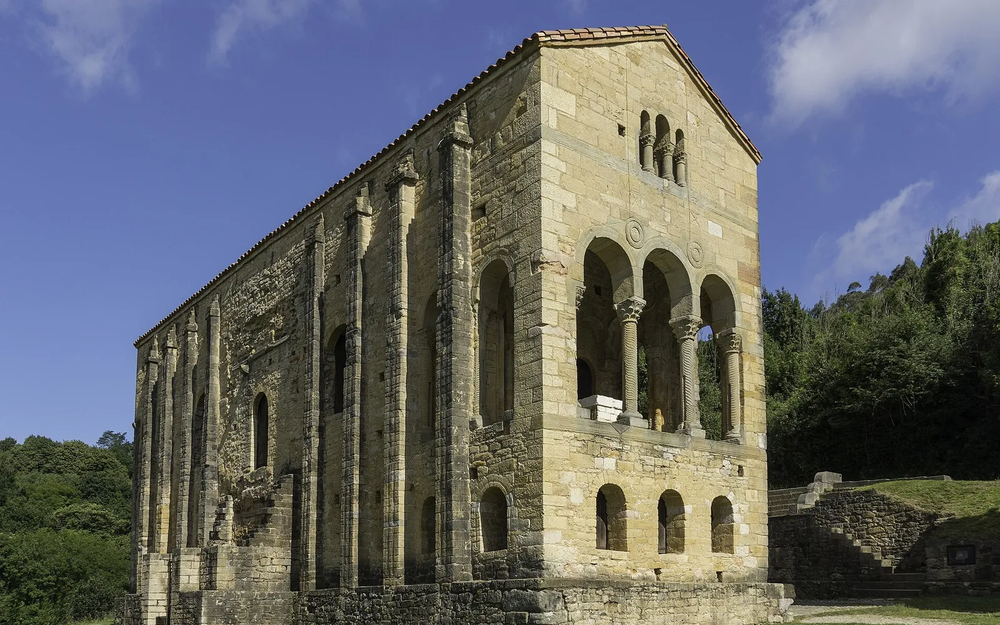
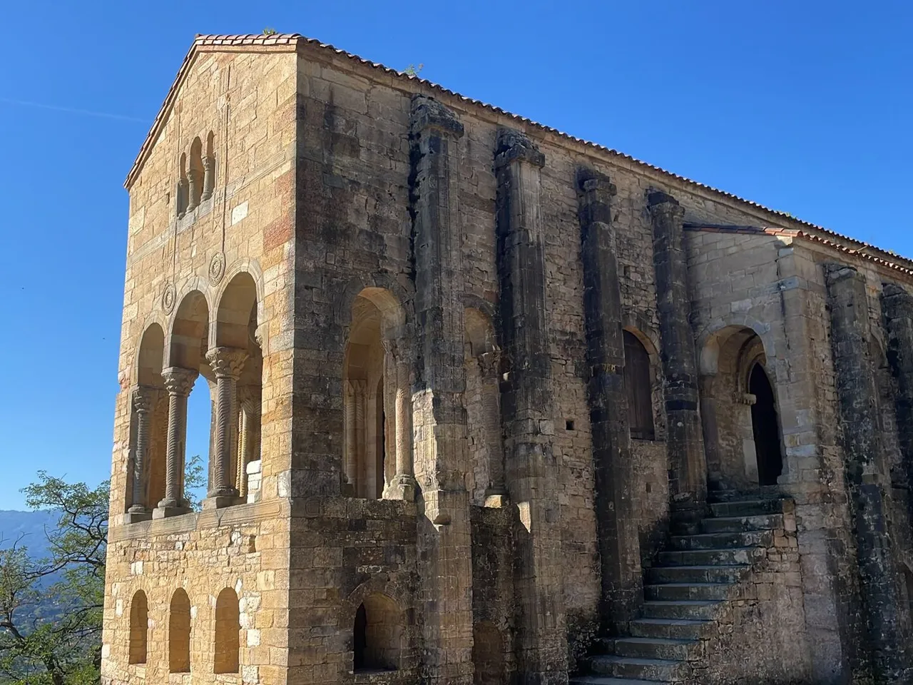
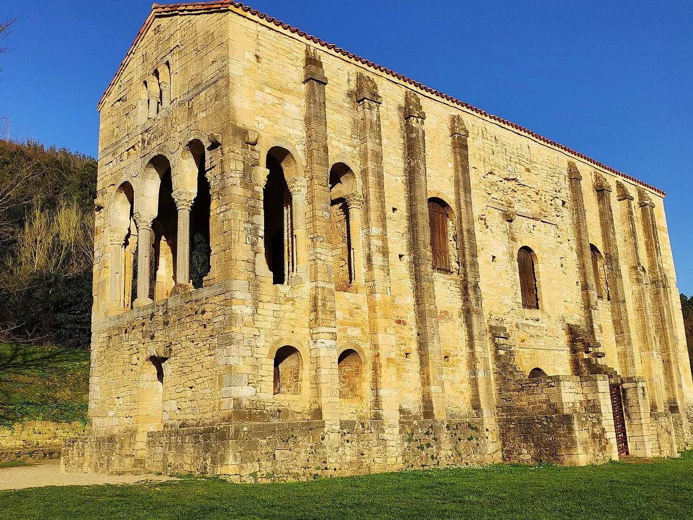
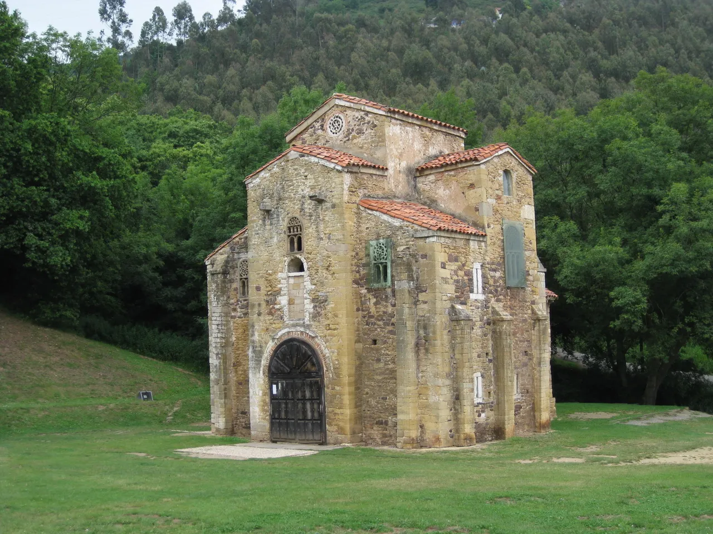
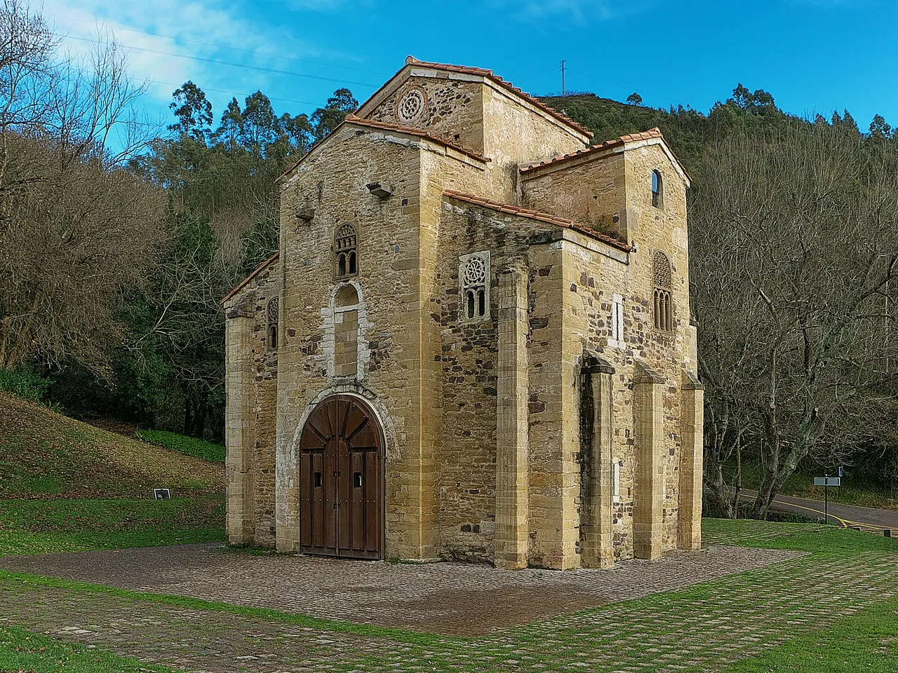

Un palacio del siglo IX convertido en iglesia, en la ladera de un monte con vistas a Oviedo. **Santa María del Naranco**, junto a **San Miguel de Lillo**, es la joya del **prerrománico asturiano** y Patrimonio de la Humanidad.

Te cuento su historia, cómo visitarlo y cómo llegar 👇

En un vistazo<h2>Lo que vas a encontrar</h2>

<b>⛪</b>Santa María del Naranco

<b>⛪</b>San Miguel de Lillo

<b>🌍</b>Patrimonio de la Humanidad

<b>🏛️</b>Prerrománico

<b>🌄</b>Monte Naranco

Antes de ir<h2>Santa María del Naranco: lo básico</h2>

<h3>🏛️ Origen</h3>
Se construyó en la década del 840, por orden de Ramiro I. Lo más aceptado es que era un aula regia palaciega.

<h3>🧭 Dónde está</h3>
En la ladera sur del monte Naranco, a unos 4 km de Oviedo.

<h3>🌍 Patrimonio</h3>
Patrimonio de la Humanidad desde 1985, dentro del conjunto «Monumentos de Oviedo y del Reino de Asturias».

<h3>🎟️ Visitas</h3>
Confirma horarios, precios y posibles cierres en la web oficial (santamariadelnaranco.es).

Curiosidades<h2>Datos y curiosidades</h2>

El edificio tiene planta rectangular de unos 21 × 6 metros, dos pisos y unos 9 m de altura. Tras el derrumbe de San Miguel de Lillo, probablemente en el siglo XII se convirtió en templo dedicado a Santa María. Los añadidos posteriores se demolieron entre 1931 y 1934.

Qué ver<h2>Qué ver en el Naranco</h2>
Dos monumentos y vistas.

<ol class="guide__grid guide__grid--cuenca">
<li class="gcard reveal">
01

<h3>Santa María del Naranco</h3>
Un palacio prerrománico de piedra con arcos y miradores.

</li>
<li class="gcard reveal">
02

<h3>La fachada</h3>
Observa los arcos y las columnas.

</li>
<li class="gcard reveal">
03

<h3>Desde fuera</h3>
Vista exterior del edificio.

</li>
<li class="gcard reveal">
04

<h3>San Miguel de Lillo</h3>
Iglesia prerrománica cercana, de la misma época.

</li>
<li class="gcard reveal">
05

<h3>La iglesia</h3>
Conserva parte de su estructura original.

</li>
</ol>

Más paradas<h2>Otros lugares con encanto</h2>

<ul class="checklist" style="margin:0 0 1rem;"><li><strong>Oviedo:</strong> <a href='/blog/oviedo-que-ver.html'>qué ver en la ciudad</a>.</li><li><strong>Gijón:</strong> <a href='/blog/gijon-que-ver.html'>ciudad costera</a> cercana.</li><li><strong>Santa Cristina de Lena:</strong> otro monumento prerrománico en la comarca.</li><li><strong>Mirador:</strong> vistas de Oviedo desde el monte Naranco.</li></ul>

<!--enr-->

La historia<h2>Un palacio de rey que se hizo iglesia</h2>

Santa María del Naranco y San Miguel de Lillo pertenecen al <strong>prerrománico asturiano</strong>, el arte del reino de Asturias entre los siglos VIII y X. Los dos edificios se levantaron en tiempos del rey <strong>Ramiro I</strong> (842-850) en la ladera del monte Naranco, que dominaba la ciudad de Oviedo. Santa María era probablemente una <strong>sala de recepciones y fiestas</strong> de un palacio real; San Miguel era la iglesia del conjunto.

Lo que sorprende al verla por dentro es que, <strong>hace más de mil años</strong>, ya usaba <strong>bóvedas de medio cañón con arcos que descargan el peso en contrafuertes</strong>, algo muy avanzado para su época, y una decoración de medallones y cuerdas tallados en piedra. De San Miguel de Lillo se conserva solo una parte (la zona de los pies de la iglesia), con unas <strong>celosías de piedra</strong> y unos relieves en las jambas con escenas de circo que son únicos en Europa.

Con los siglos Santa María se convirtió en iglesia, hasta que en la primera mitad del siglo XX se quitaron los añadidos para devolverle su aspecto original. Desde <strong>1985</strong> forman parte del conjunto Patrimonio de la Humanidad.

Cómo llegar<h2>Cómo llegar</h2>

<strong>En coche:</strong> desde Oviedo por la carretera del Naranco, unos 4 km.

<strong>Dónde aparcar:</strong> hay aparcamiento gratuito al pie de los monumentos y en el Centro de Recepción e Interpretación del Prerrománico, a unos 800 m andando por la avenida de los Monumentos.

<strong>Sin coche:</strong> la línea A del autobús urbano de Oviedo sube hasta el Naranco.

<strong>Horario y precio:</strong> visita guiada de unos 40 minutos, 5 € (incluye San Miguel de Lillo). Los lunes, gratis y sin guía. Entre abril y septiembre de 2026 estuvo cerrada por obras: <strong>confirma que está abierta antes de ir</strong>.

<a class="btn guide__mapbtn" href="https://www.google.com/maps/dir/?api=1&destination=Santa+María+del+Naranco" target="_blank" rel="noopener"><svg class="ico" viewBox="0 0 24 24" width="15" height="15" aria-hidden="true" fill="currentColor"><path d="M12 2a7 7 0 0 0-7 7c0 5.25 7 13 7 13s7-7.75 7-13a7 7 0 0 0-7-7zm0 9.5a2.5 2.5 0 1 1 0-5 2.5 2.5 0 0 1 0 5z"/></svg> Cómo llegar en Google Maps</a>

Consejos de Cheno<h2>El Naranco en una mañana</h2><ul><li><b>Antes</b>: Consulta horarios y cierres: pueden cambiar.</li><li><b>Cuándo</b>: Por la mañana hay menos gente.</li><li><b>Combínalo</b>: con la catedral y el casco antiguo de Oviedo.</li><li><b>Cámara</b>: Mira los detalles de las columnas y los arcos.</li></ul>

<!--faq-->

<h2>¿Te gustan estos planes?</h2>
Sígueme en Instagram como <a href="https://www.instagram.com/chenoaventuras/" target="_blank" rel="noopener">@chenoaventuras</a>: subo escapadas como esta cada semana.
<a class="btn guide__btn" href="/blog.html">Ver más planes en el blog</a>

Información consultada en octubre de 2026. Los precios, horarios y accesos cambian: consúltalos en las webs oficiales. Fotos de Wikimedia Commons: <a href="https://commons.wikimedia.org/wiki/File:Santa_Mar%C3%ADa_del_Naranco_2021.jpg" target="_blank" rel="noopener">Fernando</a> (CC BY-SA 4.0) · <a href="https://commons.wikimedia.org/wiki/File:Santa_Mar%C3%ADa_del_Naranco_3.jpg" target="_blank" rel="noopener">Consuelo Fernandez</a> (CC BY-SA 4.0) · <a href="https://commons.wikimedia.org/wiki/File:Santa_Mar%C3%ADa_del_Naranco,_Oviedo.jpg" target="_blank" rel="noopener">Alonso de Mendoza</a> (CC BY-SA 4.0) · <a href="https://commons.wikimedia.org/wiki/File:San_Miguel_de_Lillo-Oviedo.jpg" target="_blank" rel="noopener">Rodelar</a> (CC BY-SA 3.0) · <a href="https://commons.wikimedia.org/wiki/File:Iglesia_de_San_Miguel_de_Lillo_(Oviedo).jpg" target="_blank" rel="noopener">Jl FilpoC</a> (CC BY-SA 4.0).

