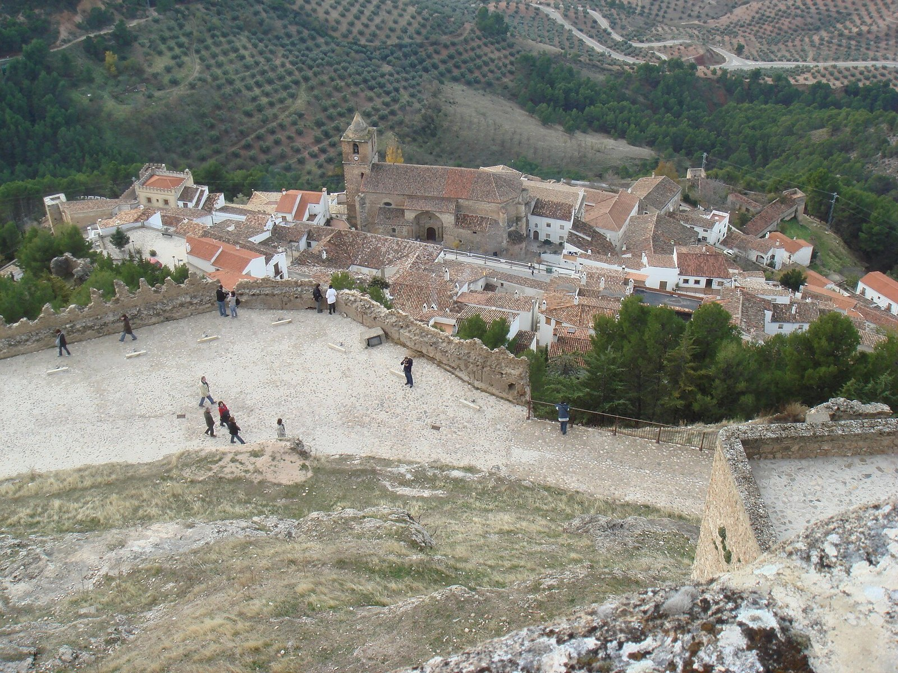
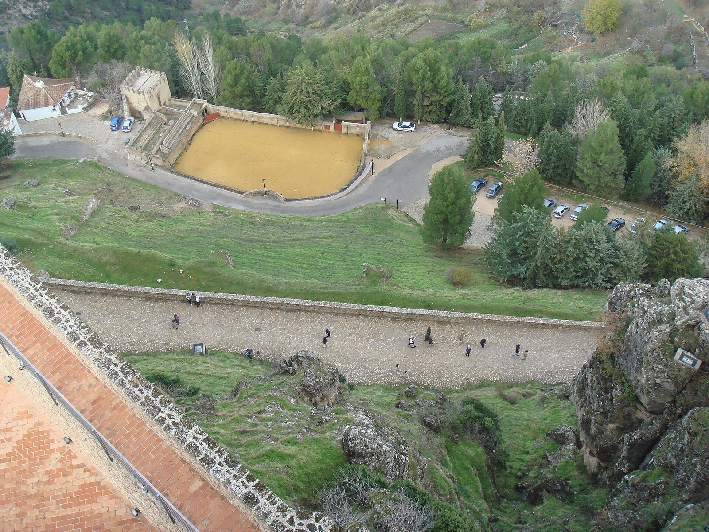
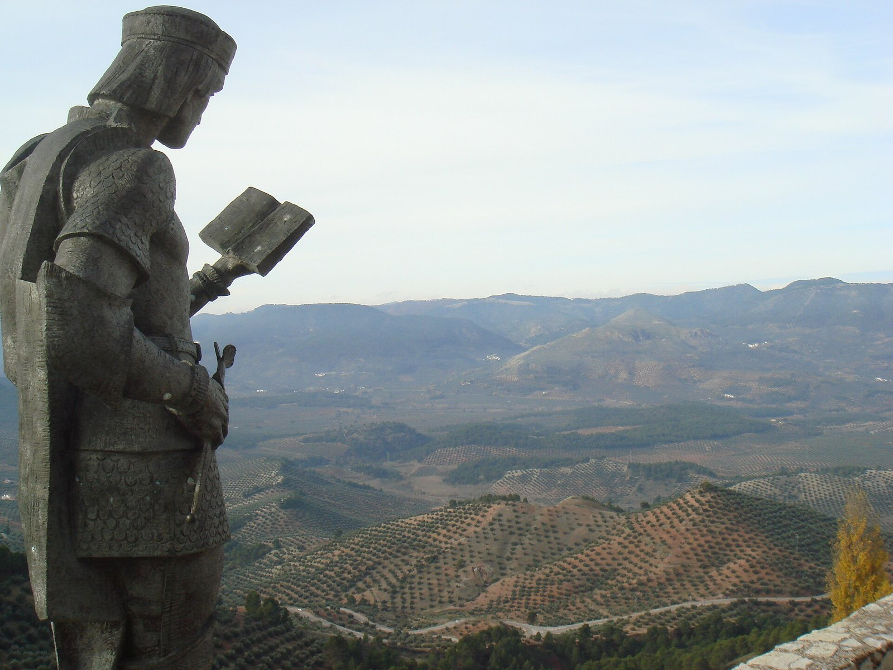
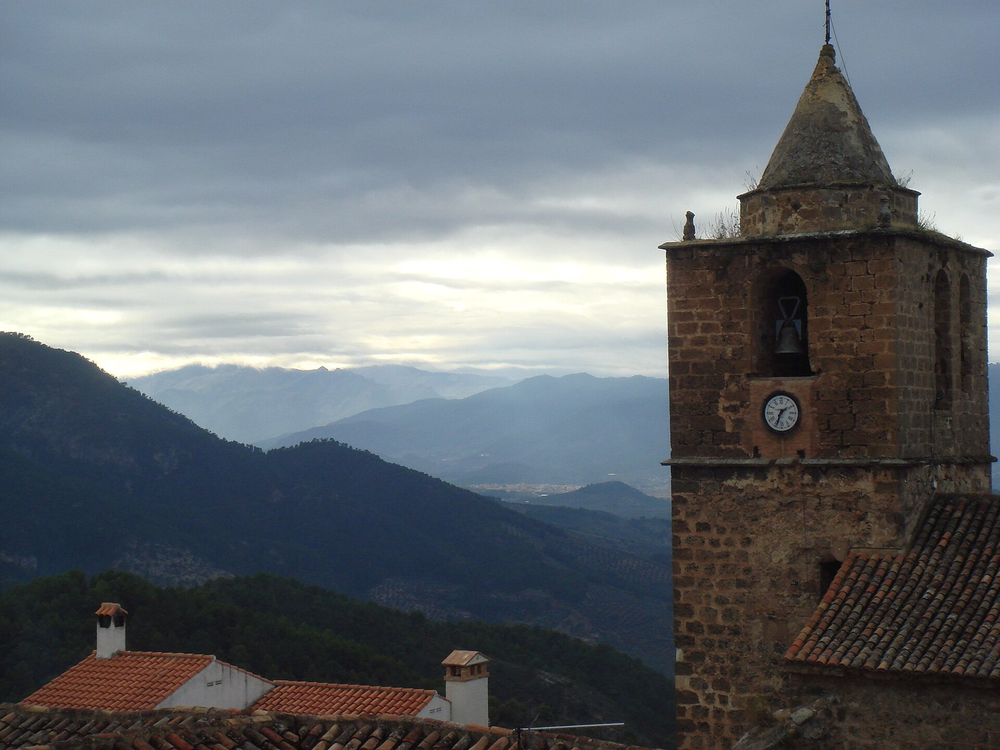
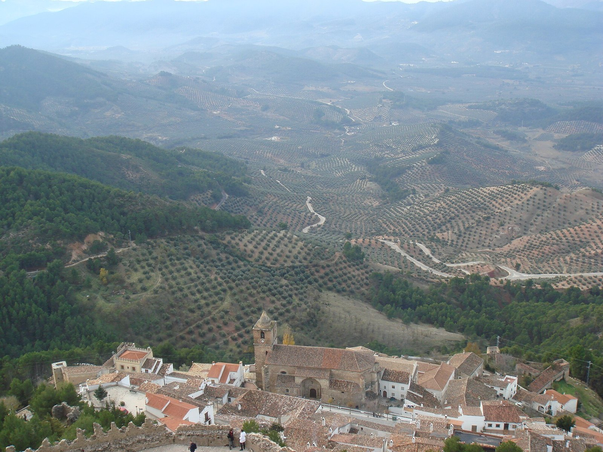

En lo más alto de un cerro, a más de **1.100 metros**, el **castillo de Segura de la Sierra** vigila un mar de montañas y olivos. A sus pies, las casas blancas del pueblo bajan por la ladera. Es uno de los **pueblos más bonitos de España** y la puerta del mayor espacio natural protegido del país, el **Parque Natural de las Sierras de Cazorla, Segura y Las Villas**.

Te cuento qué ver y cómo llegar 👇

En un vistazo<h2>Lo que vas a encontrar</h2>

<b>🏰</b>Castillo a 1.100 m

<b>🛁</b>Baños árabes

<b>🐂</b>Plaza de toros

<b>📜</b>Jorge Manrique

<b>🌄</b>Miradores

Antes de ir<h2>Lo básico de Segura</h2>

<h3>📍 Dónde está</h3>
En el noreste de <strong>Jaén</strong>, en la Sierra de Segura, al norte del Parque Natural de Cazorla.

<h3>⏱️ Tiempo</h3>
Medio día para el pueblo y el castillo. Combínalo con otros pueblos de la sierra.

<h3>🎟️ Castillo</h3>
Unos <strong>4 €</strong>, con centro de interpretación. Confirma el horario antes de ir.

Qué ver<h2>Qué ver en Segura de la Sierra</h2>

<ol class="guide__grid guide__grid--cuenca">
<li class="gcard reveal">
01

<h3>El castillo</h3>
Levantado por los musulmanes sobre una atalaya anterior y reformado tras la conquista cristiana. Tiene torre del homenaje, patio de armas, capilla y un adarve con vistas enormes.

</li>
<li class="gcard reveal">
02

<h3>La plaza de toros</h3>
Una plaza muy curiosa, de forma irregular, encajada junto a la muralla y la roca. Se ve perfecta desde lo alto del castillo.

</li>
<li class="gcard reveal">
03

<h3>Jorge Manrique</h3>
El autor de las <strong>Coplas por la muerte de su padre</strong> nació aquí según la tradición local. Su estatua mira hacia la sierra.

</li>
<li class="gcard reveal">
04

<h3>La iglesia del Collado</h3>
La iglesia de <strong>Nuestra Señora del Collado</strong>, con su torre, preside el pueblo. Muy cerca está la Fuente Imperial, del siglo XVI.

</li>
<li class="gcard reveal">
05

<h3>El pueblo entre olivos</h3>
Calles blancas que bajan por la ladera, con olivares hasta el horizonte. En la parte baja están los <strong>baños árabes</strong>, con bóvedas excavadas en la roca: de los pocos que se conservan en la provincia.

</li>
</ol>

Cerca<h2>La Sierra de Segura</h2>

Segura da nombre a una sierra llena de pueblos pequeños, pinares y ríos. Desde aquí puedes bajar hacia <strong>Hornos</strong>, otro pueblo colgado sobre el embalse del Tranco, o hacia el <strong>nacimiento del Guadalquivir</strong>, en la Sierra de Cazorla.

Cómo llegar<h2>Cómo llegar a Segura de la Sierra</h2>

En coche: a unas <strong>2 horas y cuarto de Jaén</strong> y a <strong>hora y media de Úbeda</strong>. El último tramo sube con muchas curvas desde el valle del Guadalimar. Aparca a la entrada y sube andando al castillo.

<a class="btn guide__mapbtn" href="https://www.google.com/maps/dir/?api=1&destination=38.2967,-2.6497" target="_blank" rel="noopener"><svg class="ico" viewBox="0 0 24 24" width="15" height="15" aria-hidden="true" fill="currentColor"><path d="M12 2a7 7 0 0 0-7 7c0 5.25 7 13 7 13s7-7.75 7-13a7 7 0 0 0-7-7zm0 9.5a2.5 2.5 0 1 1 0-5 2.5 2.5 0 0 1 0 5z"/></svg> Cómo llegar en Google Maps</a>

Combínalo con la <a href="/blog/sierra-de-cazorla.html">Sierra de Cazorla</a> y la <a href="/blog/ruta-rio-borosa.html">ruta del río Borosa</a>, o con <a href="/blog/ubeda-baeza-que-ver.html">Úbeda y Baeza</a>.

Consejos de Cheno<h2>Para disfrutarlo al máximo</h2><ul><li><b>Sube al castillo al atardecer</b>: la vista sobre la sierra es lo mejor del pueblo.</li><li><b>Calzado cómodo</b>: las calles son muy empinadas.</li><li><b>Duerme en la sierra</b> y aprovecha para hacer rutas.</li><li><b>Prueba los andrajos</b>, un guiso típico serrano.</li></ul>

<!--faq-->

<h2>¿Te gustan estos planes?</h2>
Sígueme en Instagram como <a href="https://www.instagram.com/chenoaventuras/" target="_blank" rel="noopener">@chenoaventuras</a>: subo escapadas como esta cada semana.
<a class="btn guide__btn" href="/blog.html">Ver más planes en el blog</a>

Información consultada en noviembre de 2026 (Jaén Paraíso Interior y Los Pueblos Más Bonitos de España). El precio y el horario del castillo pueden cambiar. Fotos de Wikimedia Commons: <a href="https://commons.wikimedia.org/wiki/File:Segura_de_la_Sierra,_en_Ja%C3%A9n_(Espa%C3%B1a).jpg" target="_blank" rel="noopener">marcialsalcedo</a> (CC BY-SA 3.0) · <a href="https://commons.wikimedia.org/wiki/File:DSC00226-Segura_de_la_Sierra-Jaen.jpg" target="_blank" rel="noopener">Rafael Tello</a> (CC BY-SA 4.0) · <a href="https://commons.wikimedia.org/wiki/File:DSC00215-Segura_de_la_Sierra-Jaen.jpg" target="_blank" rel="noopener">Rafael Tello</a> (CC BY-SA 4.0) · <a href="https://commons.wikimedia.org/wiki/File:DSC00161-Segura_de_la_Sierra-Jaen.jpg" target="_blank" rel="noopener">Rafael Tello</a> (CC BY-SA 4.0) · <a href="https://commons.wikimedia.org/wiki/File:DSC00233-Segura_de_la_Sierra-Jaen.jpg" target="_blank" rel="noopener">Rafael Tello</a> (CC BY-SA 4.0) · <a href="https://commons.wikimedia.org/wiki/File:DSC00227-Segura_de_la_Sierra-Jaen.jpg" target="_blank" rel="noopener">Rafael Tello</a> (CC BY-SA 4.0).

