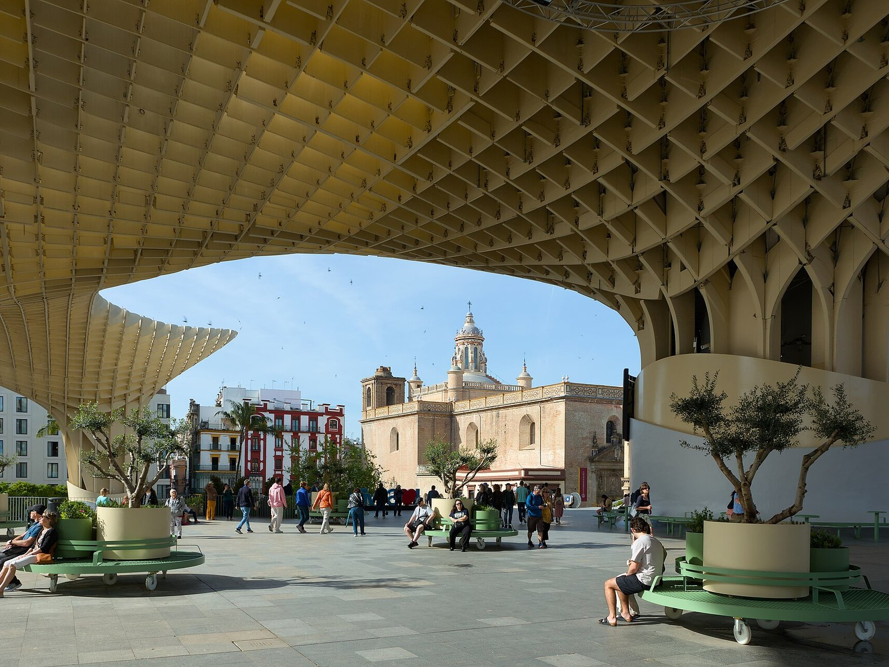
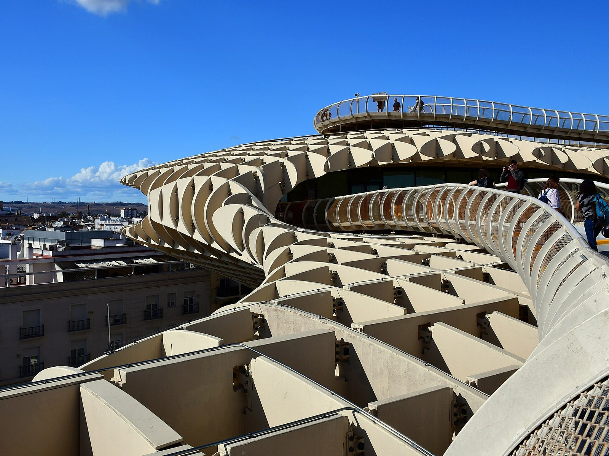
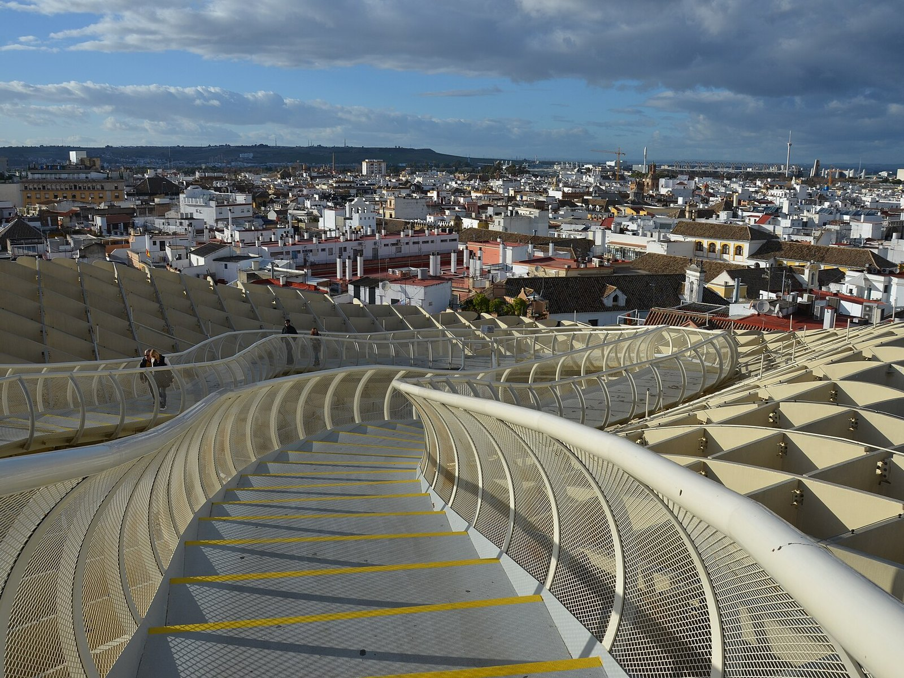
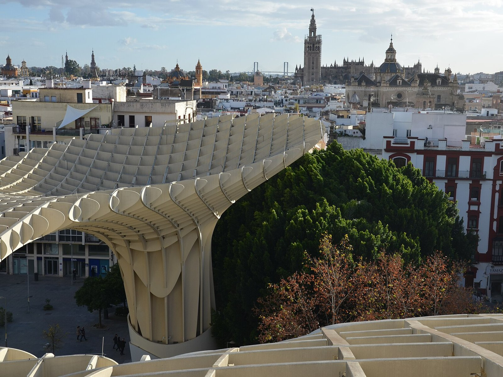
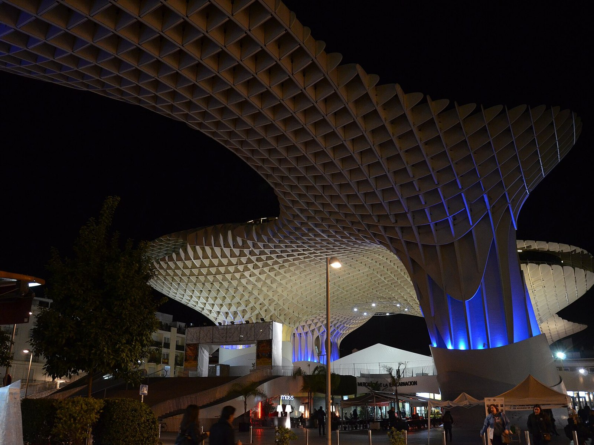
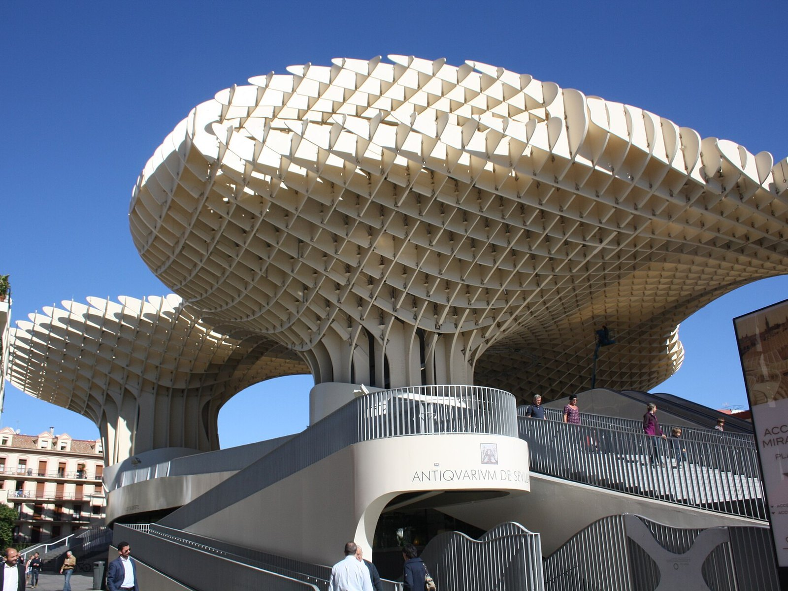

En plena **Plaza de la Encarnación**, entre casas encaladas e iglesias barrocas, se levanta algo que parece de otro planeta: seis enormes **setas de madera** unidas por arriba. Es el **Metropol Parasol**, para todos «las Setas», y según sus gestores es la **estructura de madera más grande del mundo**. Arriba hay una pasarela que serpentea sobre los tejados del centro con la Giralda al fondo.

Te cuento cuánto cuesta, a qué hora subir y lo que hay escondido debajo 👇

En un vistazo<h2>Lo que vas a encontrar</h2>

<b>🍄</b>Madera gigante

<b>🌇</b>Mirador 360º

<b>🌃</b>Abierto hasta la 1:00

<b>🏺</b>Ruinas romanas

<b>🎟️</b>Desde 16 €

Antes de ir<h2>Precio y horario</h2>

<h3>🎟️ Entrada</h3>
La general cuesta <strong>desde 16 €</strong> e incluye el <strong>Mirador 360º</strong>, la película <strong>«Feeling Sevilla»</strong> y el espectáculo de luces <strong>«Aurora»</strong>.

<h3>🕒 Horario</h3>
Todos los días de <strong>9:30 a 1:00</strong>. Último acceso, a las <strong>0:15</strong>. Aurora, de 21:30 a 1:00 (de abril a octubre).

<h3>🌅 Mejor hora</h3>
Sube <strong>una hora antes del atardecer</strong>: verás la ciudad con luz dorada y, después, encendida.

La visita<h2>Qué ver en las Setas de Sevilla</h2>

<ol class="guide__grid guide__grid--cuenca">
<li class="gcard reveal">
01

<h3>Desde abajo</h3>
Antes de subir, pasea bajo los parasoles: a pie de calle hay una plaza con sombra, el <strong>Mercado de la Encarnación</strong> y bares.

</li>
<li class="gcard reveal">
02

<h3>La retícula de madera</h3>
Miles de piezas de madera encajadas forman una cuadrícula que, según la luz, parece un panal o una ola.

</li>
<li class="gcard reveal">
03

<h3>La pasarela</h3>
Un recorrido que sube y baja por encima de las setas. Vas caminando literalmente sobre la estructura.

</li>
<li class="gcard reveal">
04

<h3>El Mirador 360º</h3>
El punto más alto, con Sevilla entera alrededor: la <strong>Giralda</strong>, las torres de las iglesias y, al fondo, la Torre Sevilla.

</li>
<li class="gcard reveal">
05

<h3>De noche</h3>
Al anochecer la estructura se ilumina, y de abril a octubre hay espectáculo de luces, <strong>Aurora</strong>, sobre la pasarela.

</li>
<li class="gcard reveal">
06

<h3>El Antiquarium</h3>
Bajo la plaza, los restos de casas <strong>romanas</strong> con mosaicos y de época andalusí que aparecieron al excavar. Se visita con entrada aparte.

</li>
</ol>

Curiosidades<h2>Un aparcamiento que acabó en museo</h2>

En la Plaza de la Encarnación hubo un mercado durante más de un siglo. Cuando lo derribaron, el Ayuntamiento quiso hacer un <strong>aparcamiento subterráneo</strong>, pero al excavar aparecieron <strong>restos romanos y andalusíes</strong> y la obra se paró. Años después, un concurso internacional eligió el diseño del arquitecto alemán <strong>Jürgen Mayer H.</strong>: una estructura que protegiera las ruinas, devolviera el mercado al barrio y diera sombra a la plaza. Se inauguró en <strong>2011</strong>.

<h3>🍄 Amadas y odiadas</h3>
Al principio a muchos sevillanos no les gustaban: decían que no pegaban con el casco histórico. Hoy son uno de los sitios más fotografiados de la ciudad.

<!--actividades-->

Cómo llegar<h2>Cómo llegar a las Setas de Sevilla</h2>

Están en la <strong>Plaza de la Encarnación</strong>, en pleno centro: a unos <strong>10-15 minutos a pie</strong> de la Catedral por la calle Sierpes o la calle Cuna. Muchas líneas de autobús urbano paran en la plaza. Si vas en coche, deja el coche en un aparcamiento público: el centro tiene muchas calles de acceso restringido.

<a class="btn guide__mapbtn" href="https://www.google.com/maps/dir/?api=1&destination=37.3934,-5.9918" target="_blank" rel="noopener"><svg class="ico" viewBox="0 0 24 24" width="15" height="15" aria-hidden="true" fill="currentColor"><path d="M12 2a7 7 0 0 0-7 7c0 5.25 7 13 7 13s7-7.75 7-13a7 7 0 0 0-7-7zm0 9.5a2.5 2.5 0 1 1 0-5 2.5 2.5 0 0 1 0 5z"/></svg> Cómo llegar en Google Maps</a><a class="btn guide__mapbtn btn--ghost" href="https://setasdesevilla.com/" target="_blank" rel="noopener"><svg class="ico" viewBox="0 0 24 24" width="15" height="15" aria-hidden="true" fill="none" stroke="currentColor" stroke-width="2" stroke-linecap="round" stroke-linejoin="round"><path d="M7 3v3M17 3v3M4 9h16M5 5h14a1 1 0 0 1 1 1v13a1 1 0 0 1-1 1H5a1 1 0 0 1-1-1V6a1 1 0 0 1 1-1z"/></svg> Entradas oficiales</a>

Desde aquí tienes a un paseo la <a href="/blog/catedral-de-sevilla.html">Catedral y la Giralda</a>, el <a href="/blog/real-alcazar-sevilla.html">Real Alcázar</a> y la <a href="/blog/plaza-de-espana-sevilla.html">Plaza de España</a>. Todo junto, en mi guía de <a href="/blog/sevilla-que-ver.html">qué ver en Sevilla</a>.

Consejos de Cheno<h2>Para disfrutarlo al máximo</h2><ul><li><b>Atardecer</b>: es el mejor momento, pero también el más lleno.</li><li><b>Compra online</b>: te ahorras la cola de la taquilla.</li><li><b>En verano, ve de noche</b>: a mediodía la pasarela quema.</li><li><b>Tapea en la plaza</b>: hay bares alrededor y dentro del mercado.</li></ul>

<!--faq-->

<h2>¿Te gustan estos planes?</h2>
Sígueme en Instagram como <a href="https://www.instagram.com/chenoaventuras/" target="_blank" rel="noopener">@chenoaventuras</a>: subo escapadas como esta cada semana.
<a class="btn guide__btn" href="/blog.html">Ver más planes en el blog</a>

Precio y horario consultados en noviembre de 2026 en la web oficial, setasdesevilla.com. Pueden cambiar: confírmalos antes de ir. Fotos de Wikimedia Commons: <a href="https://commons.wikimedia.org/wiki/File:Metropol_Parasol_2019_(3).jpg" target="_blank" rel="noopener">Gzzz</a> (CC BY-SA 4.0) · <a href="https://commons.wikimedia.org/wiki/File:Metropol_Parasol_Sevilla_2018_5.jpg" target="_blank" rel="noopener">Steven Lek</a> (CC BY-SA 4.0) · <a href="https://commons.wikimedia.org/wiki/File:Metropol_Parasol_Sevilla_2018_9.jpg" target="_blank" rel="noopener">Steven Lek</a> (CC BY-SA 4.0) · <a href="https://commons.wikimedia.org/wiki/File:Metropol_Parasol_Sevilla_2018_11.jpg" target="_blank" rel="noopener">Steven Lek</a> (CC BY-SA 4.0) · <a href="https://commons.wikimedia.org/wiki/File:Sevilla_-_Metropol_Parasol_%26_Iglesia_de_la_Anunciaci%C3%B3n.jpg" target="_blank" rel="noopener">Benjamin Smith</a> (CC BY-SA 4.0) · <a href="https://commons.wikimedia.org/wiki/File:Parasol_Metropol_Sevilla.JPG" target="_blank" rel="noopener">Michimaya</a> (CC BY-SA 3.0) · <a href="https://commons.wikimedia.org/wiki/File:Metropol_Parasol_2019_(7).jpg" target="_blank" rel="noopener">Gzzz</a> (CC BY-SA 4.0).

