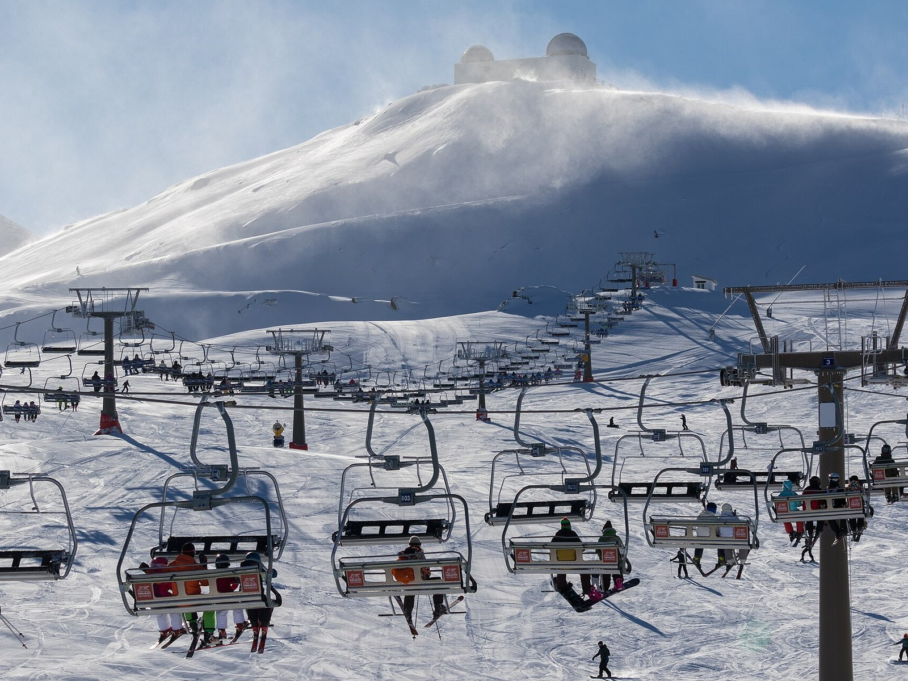
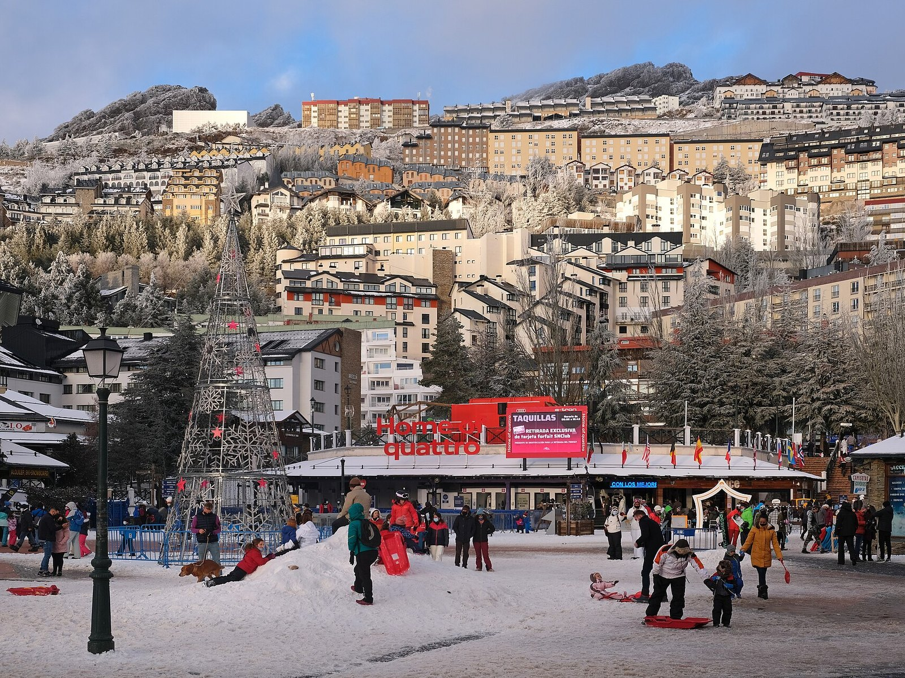
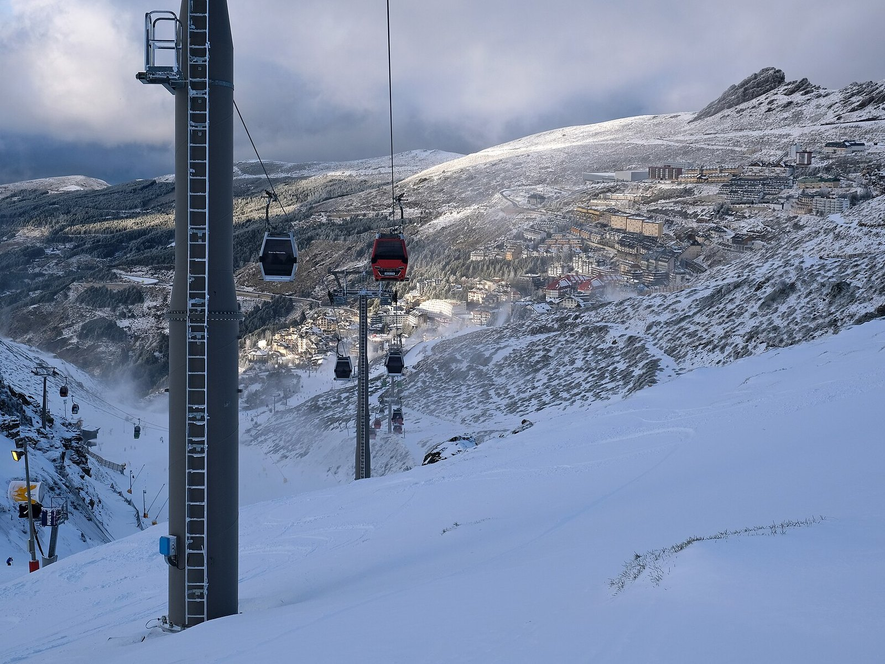
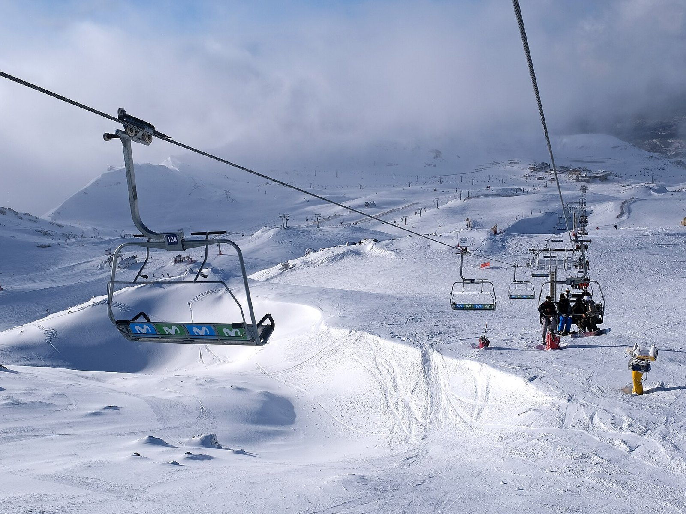
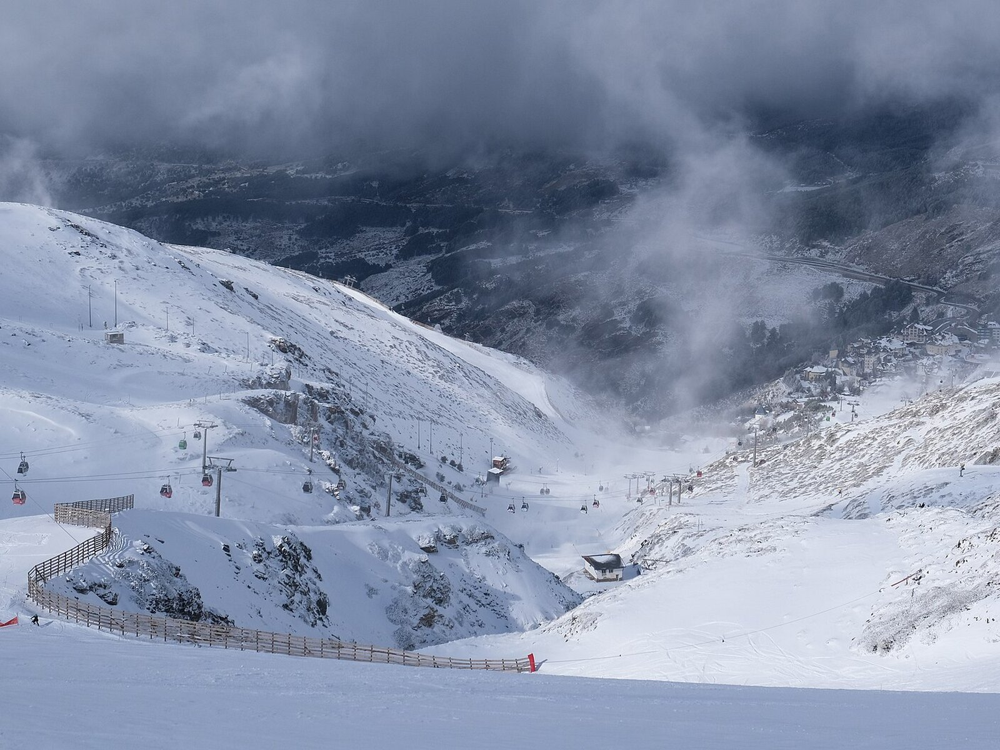
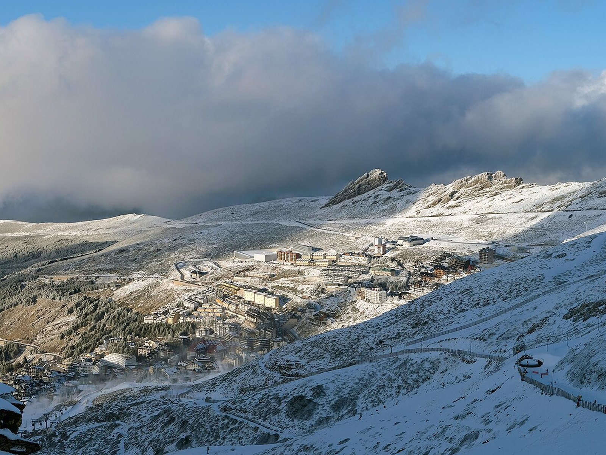

**Sierra Nevada** es la estación de esquí **más al sur de Europa** y la **más alta de España**: sus pistas suben hasta unos **3.300 metros**, a los pies del Veleta, y desde arriba, en días claros, se ve el Mediterráneo. Está a 45 minutos de Granada, así que puedes desayunar viendo la Alhambra y comer en la nieve.

Te cuento cuándo abre esta temporada, cuánto cuesta, cómo llegar y qué hacer aunque no hayas esquiado nunca 👇

En un vistazo<h2>Lo que vas a encontrar</h2>

<b>⛷️</b>Más de 100 km de pistas

<b>🏔️</b>Hasta 3.300 m

<b>🛷</b>Trineos y raquetas

<b>🚡</b>Telecabina para peatones

<b>🌊</b>Playa a 1 h 30

Antes de ir<h2>Temporada 2026-2027: fechas y precios</h2>

<h3>📅 Apertura</h3>
Prevista para el <strong>sábado 28 de noviembre de 2026</strong>, si hay nieve. La temporada suele durar hasta <strong>principios de mayo</strong>.

<h3>🎟️ Forfait</h3>
El de un día cuesta <strong>aproximadamente entre 50 y 70 €</strong> para adultos, según la fecha. En puentes y Navidad es más caro: cómpralo online con antelación.

<h3>📆 Cuándo ir</h3>
Entre semana y en <strong>enero y marzo</strong> hay menos gente. Los días más llenos son el <strong>puente de diciembre</strong>, Navidad y los fines de semana de febrero.

La estación<h2>Qué hacer en Sierra Nevada</h2>
No hace falta saber esquiar para disfrutarla: hay planes para todos.

<ol class="guide__grid guide__grid--cuenca">
<li class="gcard reveal">
01

<h3>Esquiar</h3>
Más de <strong>100 km de pistas</strong>, de verdes para empezar a negras, y escuelas con clases para niños y adultos. Las pistas más altas, junto al Veleta, rondan los 3.300 metros.

</li>
<li class="gcard reveal">
02

<h3>Pradollano</h3>
El pueblo de la estación, a unos <strong>2.100 metros</strong>: hoteles, tiendas de alquiler de material, bares y la plaza de Andalucía, donde los niños juegan en la nieve.

</li>
<li class="gcard reveal">
03

<h3>La telecabina</h3>
Sube de Pradollano a <strong>Borreguiles</strong>. Si no esquías, puedes comprar un <strong>billete de peatón</strong> de ida y vuelta para ver la nieve y las montañas desde arriba.

</li>
<li class="gcard reveal">
04

<h3>Borreguiles</h3>
Es el corazón de la estación: la zona de aprendizaje, restaurantes con terraza al sol y el punto de partida de los remontes que suben hacia el Veleta.

</li>
<li class="gcard reveal">
05

<h3>Trineos y raquetas</h3>
Trinéate solo en las <strong>zonas habilitadas</strong> (en las pistas está prohibido). Para caminar por la nieve, lo mejor es una ruta guiada con raquetas.

</li>
<li class="gcard reveal">
06

<h3>Las vistas</h3>
Desde arriba ves Granada y, en días muy claros, el mar y hasta las montañas del norte de África. Al atardecer la sierra se pone rosa.

</li>
</ol>

Curiosidades<h2>Lo que no te cuentan de Sierra Nevada</h2>

<ul class="checklist" style="margin:0 0 1rem;">
<li><strong>Un Mundial sin nieve:</strong> Sierra Nevada iba a acoger el Campeonato del Mundo de Esquí Alpino en 1995, pero no nevó y hubo que aplazarlo. Se celebró en <strong>1996</strong>.</li>
<li><strong>Un observatorio en las pistas:</strong> las cúpulas que ves sobre las pistas son el <strong>Observatorio de Sierra Nevada</strong>, del Instituto de Astrofísica de Andalucía, a casi 2.900 metros.</li>
<li><strong>El techo de la península:</strong> muy cerca está el <strong>Mulhacén</strong> (3.479 m), el pico más alto de la península ibérica. El Veleta, el que domina las pistas, tiene 3.398 m.</li>
<li><strong>Parque Nacional:</strong> la sierra es <strong>Parque Nacional desde 1999</strong>, con plantas que solo crecen aquí.</li>
</ul>

<!--actividades-->

Cómo llegar<h2>Cómo llegar a Sierra Nevada</h2>

<strong>En coche:</strong> desde Granada, por la <strong>A-395</strong>; son unos 30 km y algo más de 45 minutos hasta Pradollano. Lleva <strong>cadenas o neumáticos de invierno</strong>: la carretera pasa de los 2.000 metros. En Pradollano hay aparcamientos subterráneos de pago que se llenan pronto en fin de semana.

<strong>En autobús:</strong> hay una línea directa desde Granada hasta Pradollano, por unos <strong>5 € el trayecto</strong>. En temporada de esquí hay varias salidas al día; consulta los horarios antes, porque cambian.

<a class="btn guide__mapbtn" href="https://www.google.com/maps/dir/?api=1&destination=37.0947,-3.3964" target="_blank" rel="noopener"><svg class="ico" viewBox="0 0 24 24" width="15" height="15" aria-hidden="true" fill="currentColor"><path d="M12 2a7 7 0 0 0-7 7c0 5.25 7 13 7 13s7-7.75 7-13a7 7 0 0 0-7-7zm0 9.5a2.5 2.5 0 1 1 0-5 2.5 2.5 0 0 1 0 5z"/></svg> Cómo llegar en Google Maps</a><a class="btn guide__mapbtn btn--ghost" href="https://sierranevada.es/" target="_blank" rel="noopener"><svg class="ico" viewBox="0 0 24 24" width="15" height="15" aria-hidden="true" fill="none" stroke="currentColor" stroke-width="2" stroke-linecap="round" stroke-linejoin="round"><path d="M7 3v3M17 3v3M4 9h16M5 5h14a1 1 0 0 1 1 1v13a1 1 0 0 1-1 1H5a1 1 0 0 1-1-1V6a1 1 0 0 1 1-1z"/></svg> Web oficial y forfaits</a>

Aprovecha el viaje para ver <a href="/blog/granada-que-ver.html">Granada</a> y la <a href="/blog/alhambra-entradas-que-ver.html">Alhambra</a>, la ruta de <a href="/blog/los-cahorros-de-monachil.html">Los Cahorros de Monachil</a>, al pie de la sierra, o los pueblos blancos de <a href="/blog/alpujarra-granada.html">la Alpujarra</a>, en la otra cara de la montaña.

Consejos de Cheno<h2>Para disfrutarlo al máximo</h2><ul><li><b>Crema solar y gafas</b>: a 3.000 metros el sol quema aunque haga frío.</li><li><b>Sube temprano</b>: a partir de las 10 la carretera y los aparcamientos se colapsan.</li><li><b>Mira el parte</b>: si hay viento fuerte, los remontes de arriba cierran.</li><li><b>Alquila el material en Pradollano</b> la tarde antes si vas en fin de semana.</li><li><b>Ve por capas</b>: por la mañana hiela y a mediodía sobra el abrigo.</li></ul>

<!--faq-->

<h2>¿Te gustan estos planes?</h2>
Sígueme en Instagram como <a href="https://www.instagram.com/chenoaventuras/" target="_blank" rel="noopener">@chenoaventuras</a>: subo escapadas como esta cada semana.
<a class="btn guide__btn" href="/blog.html">Ver más planes en el blog</a>

Información consultada en noviembre de 2026 en la web oficial de la estación y en prensa especializada (Nevasport). La fecha de apertura depende de la nieve y los precios cambian según el día: confírmalos en sierranevada.es antes de ir. Fotos de Wikimedia Commons: <a href="https://commons.wikimedia.org/wiki/File:Sierra_Nevada_-_Telesilla,_Pradollano.jpg" target="_blank" rel="noopener">Werner Wilmes</a> (CC BY 2.0) · <a href="https://commons.wikimedia.org/wiki/File:Sierra_Nevada_Pradollano_3.jpg" target="_blank" rel="noopener">kallerna</a> (CC BY-SA 4.0) · <a href="https://commons.wikimedia.org/wiki/File:Sierra_Nevada_Pradollano_2.jpg" target="_blank" rel="noopener">kallerna</a> (CC BY-SA 4.0) · <a href="https://commons.wikimedia.org/wiki/File:Sierra_Nevada_Borreguiles_5.jpg" target="_blank" rel="noopener">kallerna</a> (CC BY-SA 4.0) · <a href="https://commons.wikimedia.org/wiki/File:Sierra_Nevada_Pradollano_1.jpg" target="_blank" rel="noopener">kallerna</a> (CC BY-SA 4.0) · <a href="https://commons.wikimedia.org/wiki/File:Sierra_Nevada_Pradollano_panorama_2.jpg" target="_blank" rel="noopener">kallerna</a> (CC BY-SA 4.0).

