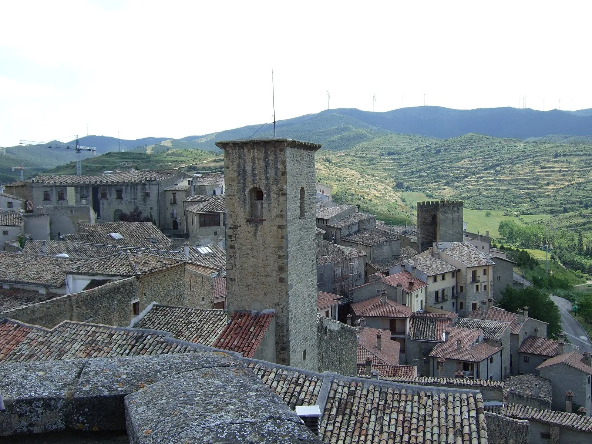
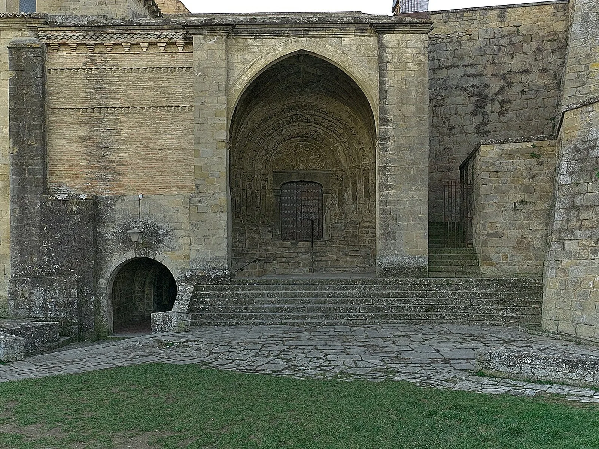
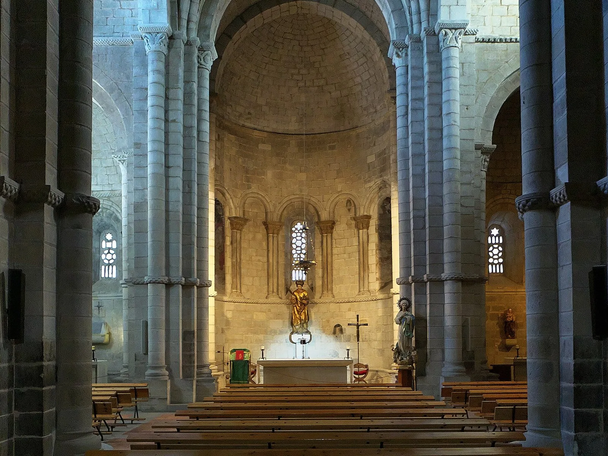
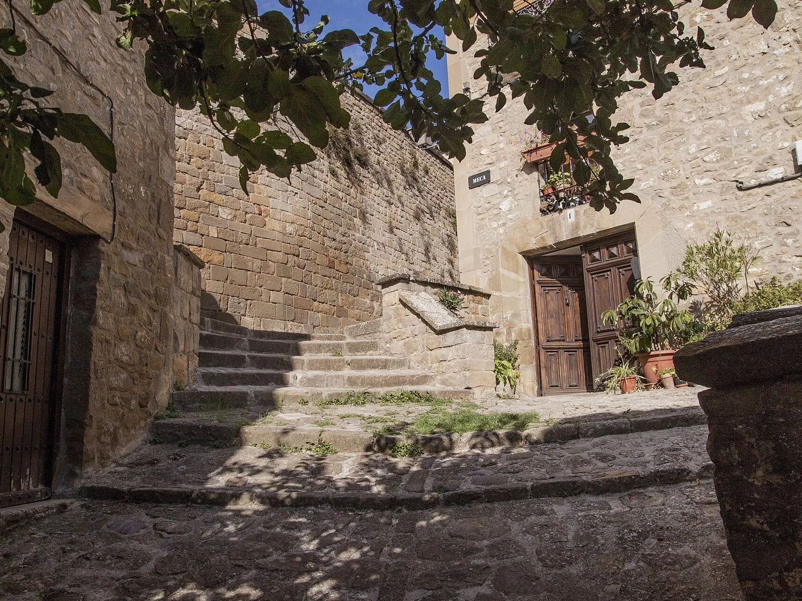
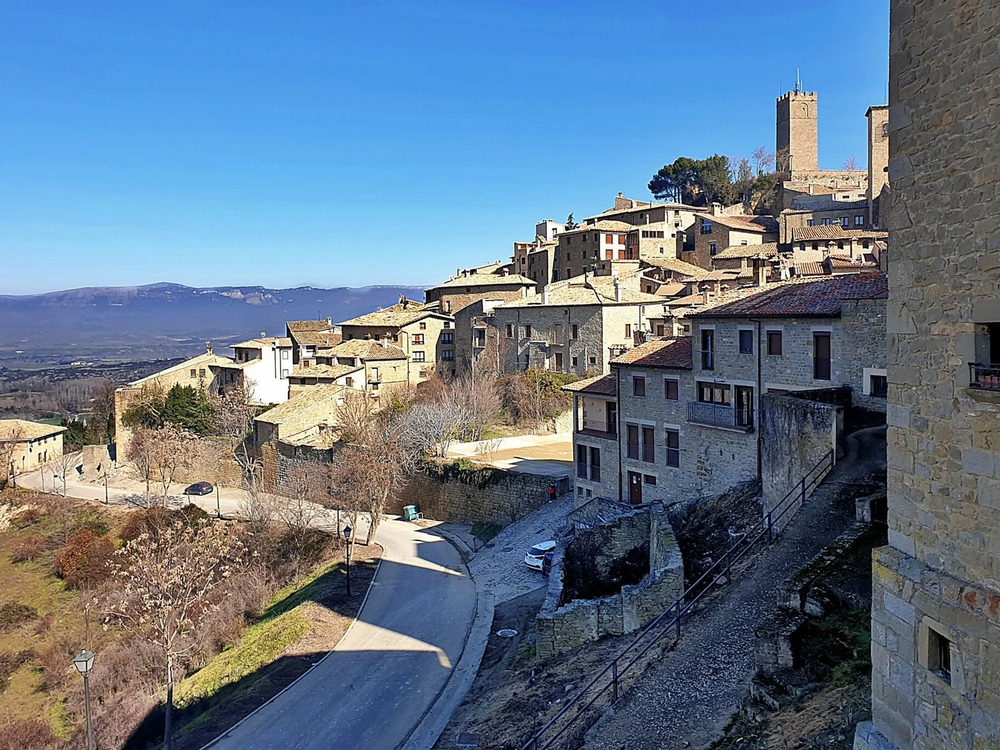

En lo alto de un cerro en las **Cinco Villas** de Zaragoza, casi en la frontera con Navarra, hay un pueblo de piedra dorada que apenas ha cambiado en siglos. En **Sos del Rey Católico** nació en **1452** el rey **Fernando el Católico**, y sus calles empedradas fueron el escenario de **La vaquilla**, la película de Berlanga. Es Conjunto Histórico-Artístico y uno de los pueblos medievales mejor conservados de Aragón.

Te cuento qué ver y cómo organizar la visita 👇

En un vistazo<h2>Lo que vas a encontrar</h2>

<b>👑</b>Cuna del Rey Católico

<b>⛪</b>Cripta románica

<b>🧱</b>Murallas

<b>🕍</b>Judería

<b>🎬</b>La vaquilla

Antes de ir<h2>Lo básico de Sos</h2>

<h3>📍 Dónde está</h3>
En el norte de <strong>Zaragoza</strong>, en la comarca de las Cinco Villas, a una hora de Pamplona.

<h3>⏱️ Tiempo</h3>
<strong>Medio día</strong> para el pueblo, el Palacio de Sada y la iglesia de San Esteban.

<h3>🕒 Horarios</h3>
El Palacio de Sada y las iglesias tienen horarios de visita que cambian según la temporada: consúltalos en la oficina de turismo, que está en el propio palacio.

Qué ver<h2>Qué ver en Sos del Rey Católico</h2>

<ol class="guide__grid guide__grid--cuenca">
<li class="gcard reveal">
01

<h3>El Palacio de Sada</h3>
La casa noble donde nació <strong>Fernando el Católico</strong> el 10 de marzo de 1452. Dentro está el centro de interpretación sobre el rey y la oficina de turismo.

</li>
<li class="gcard reveal">
02

<h3>La iglesia de San Esteban</h3>
Románica, en lo más alto del pueblo, junto al castillo. Fíjate en su portada esculpida, una de las mejores del románico aragonés.

</li>
<li class="gcard reveal">
03

<h3>La cripta pintada</h3>
Bajo la iglesia está la cripta de <strong>Santa María del Perdón</strong>, construida para salvar el desnivel de la roca, con <strong>pinturas murales románicas</strong>.

</li>
<li class="gcard reveal">
04

<h3>La judería</h3>
Calles estrechas, cuestas y pasadizos donde vivió la comunidad judía. Es la parte más enrevesada y bonita del pueblo.

</li>
<li class="gcard reveal">
05

<h3>El castillo y las murallas</h3>
Del castillo queda la <strong>torre del Homenaje</strong>, con vistas a las Cinco Villas. La muralla conserva puertas como el <strong>Portal de Zaragoza</strong>.

</li>
</ol>

Cine<h2>El pueblo de La vaquilla</h2>

En 1984, <strong>Luis García Berlanga</strong> eligió Sos para rodar <strong>La vaquilla</strong>, su comedia sobre la Guerra Civil, con Alfredo Landa, José Sacristán y Guillermo Montesinos. Muchos vecinos hicieron de figurantes. Pasea por la <strong>Plaza de la Villa</strong>, con el Ayuntamiento y la Lonja medieval, y reconocerás escenas de la película.

<h3>🏨 Dormir en un parador</h3>
El pueblo tiene un <strong>Parador</strong> en un edificio de estilo tradicional, a la entrada del casco histórico. Es una buena base para recorrer las Cinco Villas.

Cómo llegar<h2>Cómo llegar a Sos del Rey Católico</h2>

En coche: a unos <strong>130 km de Zaragoza</strong> (algo menos de dos horas) y a una hora de <strong>Pamplona</strong>. Aparca a la entrada del pueblo y sube andando.

<a class="btn guide__mapbtn" href="https://www.google.com/maps/dir/?api=1&destination=42.4961,-1.2153" target="_blank" rel="noopener"><svg class="ico" viewBox="0 0 24 24" width="15" height="15" aria-hidden="true" fill="currentColor"><path d="M12 2a7 7 0 0 0-7 7c0 5.25 7 13 7 13s7-7.75 7-13a7 7 0 0 0-7-7zm0 9.5a2.5 2.5 0 1 1 0-5 2.5 2.5 0 0 1 0 5z"/></svg> Cómo llegar en Google Maps</a>

Muy cerca, ya en Navarra, tienes las <a href="/blog/bardenas-reales.html">Bardenas Reales</a> y <a href="/blog/olite-que-ver.html">Olite</a>. Si vas hacia Zaragoza, para en el <a href="/blog/monasterio-de-piedra.html">Monasterio de Piedra</a> o en <a href="/blog/zaragoza-que-ver.html">la capital</a>.

Consejos de Cheno<h2>Para disfrutarlo al máximo</h2><ul><li><b>Empieza por el Palacio de Sada</b>: en la oficina de turismo te dan el plano.</li><li><b>Sube al castillo al atardecer</b>: la piedra se vuelve dorada.</li><li><b>Calzado cómodo</b>: todo son cuestas empedradas.</li><li><b>Ve fuera de puentes</b>: el pueblo es pequeño y se llena.</li></ul>

<!--actividades-->

<!--faq-->

<h2>¿Te gustan estos planes?</h2>
Sígueme en Instagram como <a href="https://www.instagram.com/chenoaventuras/" target="_blank" rel="noopener">@chenoaventuras</a>: subo escapadas como esta cada semana.
<a class="btn guide__btn" href="/blog.html">Ver más planes en el blog</a>

Información consultada en noviembre de 2026 (Turismo de Aragón y Los Pueblos Más Bonitos de España). Los horarios de visita cambian según la temporada: confírmalos antes de ir. Fotos de Wikimedia Commons: <a href="https://commons.wikimedia.org/wiki/File:Sos_del_Rey_Cat%C3%B3lico_(Arag%C3%B3n).jpg" target="_blank" rel="noopener">Txemari</a> (CC0) · <a href="https://commons.wikimedia.org/wiki/File:Sos_del_Rey_Cat%C3%B3lico_-_Vista_general.jpg" target="_blank" rel="noopener">Ecelan</a> (CC BY-SA 4.0) · <a href="https://commons.wikimedia.org/wiki/File:Fachada_de_la_Iglesia_de_San_Esteban_(Sos_del_Rey_Cat%C3%B3lico).jpg" target="_blank" rel="noopener">Jl FilpoC</a> (CC BY-SA 4.0) · <a href="https://commons.wikimedia.org/wiki/File:Interior_de_la_Iglesia_de_San_Esteban_(Sos_del_Rey_Cat%C3%B3lico).jpg" target="_blank" rel="noopener">Jl FilpoC</a> (CC BY-SA 4.0) · <a href="https://commons.wikimedia.org/wiki/File:Sos_del_Rey_Cat%C3%B3lico_AM1.jpg" target="_blank" rel="noopener">Amikosik</a> (CC BY-SA 4.0).

