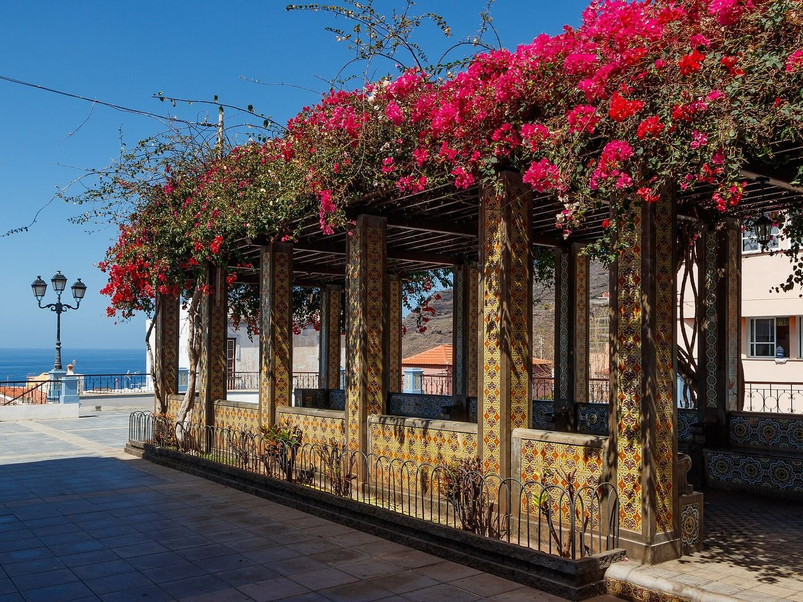
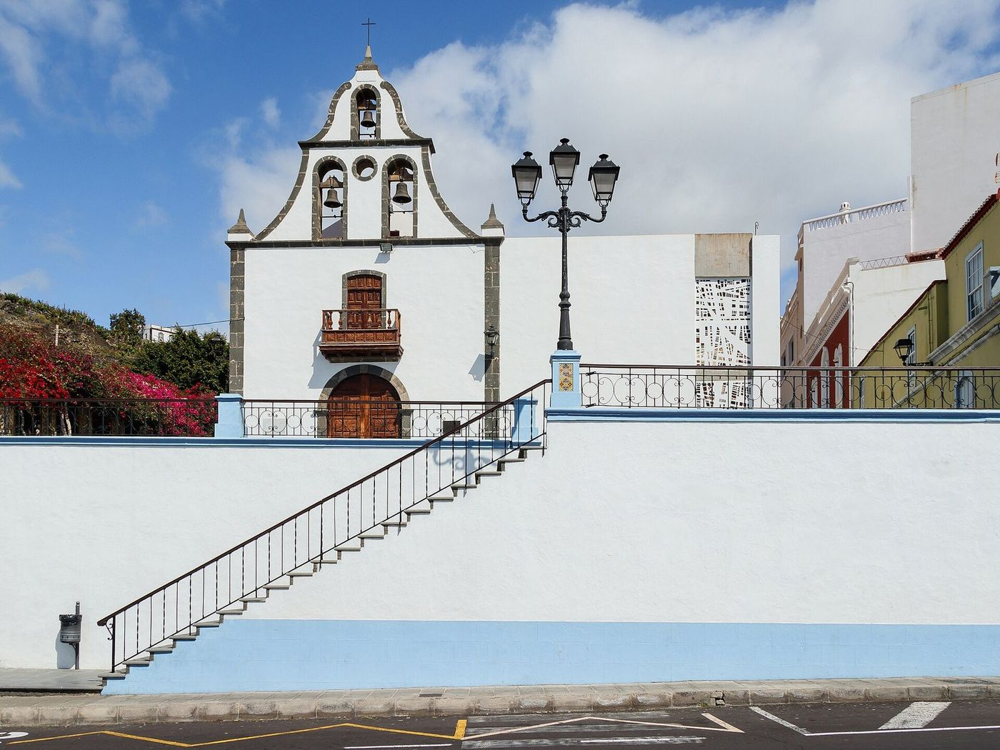
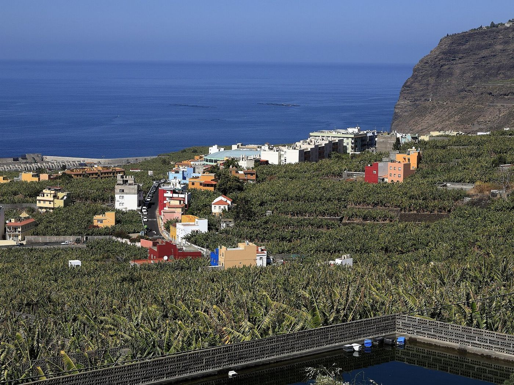
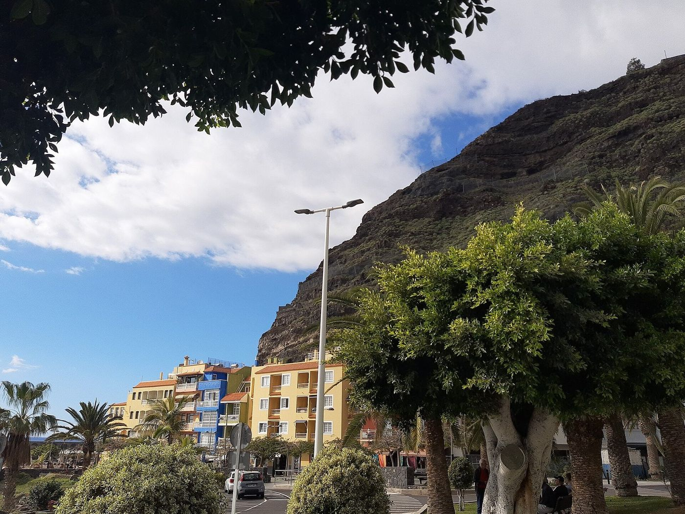
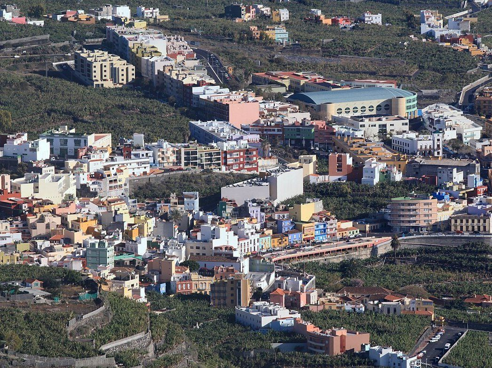

Un pueblo entre plataneras, un puerto con playa de arena negra y un acantilado enorme detrás. **Tazacorte** es una de las zonas más soleadas de **La Palma**, y también el sitio donde, en 1492, empezó la conquista de la isla.

Te cuento qué ver, qué hacer en el puerto y cómo combinarlo con el mirador del Time 👇

En un vistazo<h2>Lo que vas a encontrar</h2>

<b>🏖️</b>Playa de arena negra

<b>🍌</b>Plataneras

<b>⛵</b>Excursiones en barco

<b>🌺</b>Plaza de España

<b>🔭</b>Mirador del Time

Antes de ir<h2>Lo básico de Tazacorte</h2>

<h3>📍 Dónde está</h3>
En el <strong>oeste de La Palma</strong>, a unos 5 minutos de Los Llanos de Aridane.

<h3>☀️ Clima</h3>
De los sitios <strong>más soleados</strong> de la isla: lleva crema y gorra.

<h3>⛵ Barco</h3>
Salen <strong>paseos para ver cetáceos</strong>. Reserva con tiempo.

La historia<h2>Donde desembarcó la conquista</h2>

La conquista castellana de La Palma arrancó el <strong>29 de septiembre de 1492</strong> en la desembocadura del <strong>barranco de las Angustias</strong>, en el lugar donde hoy se ve el puerto de Tazacorte. Allí desembarcó <strong>Alonso Fernández de Lugo</strong> con sus tropas, y la isla quedó conquistada en <strong>1493</strong>, en buena parte mediante pactos con los cantones de los antiguos habitantes. Siglos después, las plataneras y el puerto convirtieron a Tazacorte en el motor económico del oeste de la isla.

Qué ver<h2>Qué ver en Tazacorte</h2>

<ol class="guide__grid guide__grid--cuenca">
<li class="gcard reveal">
01

<h3>La Plaza de España</h3>
Su pérgola cubierta de buganvilla, con bancos de azulejos, es la imagen más típica del pueblo. En primavera, llena de color.

</li>
<li class="gcard reveal">
02

<h3>La iglesia de San Miguel</h3>
Blanca, con campanario de espadaña, preside la plaza. Dentro conserva un retablo dorado.

</li>
<li class="gcard reveal">
03

<h3>Las plataneras</h3>
El paisaje que rodea el pueblo: terrazas de plataneras hasta el acantilado y el mar al fondo.

</li>
<li class="gcard reveal">
04

<h3>La playa de Tazacorte</h3>
Arena negra junto al puerto y el paseo marítimo, con terrazas para comer pescado.

</li>
<li class="gcard reveal">
05

<h3>El mirador del Time</h3>
Desde lo alto del acantilado, el valle de Aridane, el puerto y el mar a tus pies.

</li>
</ol>

Plan en barco<h2>Delfines y ballenas desde el puerto</h2>

El puerto es el punto de salida de los paseos en barco por la costa oeste, donde es habitual ver delfines y, según la época, otros cetáceos. Tienes <a href="https://www.civitatis.com/es/tazacorte/paseo-catamaran-palma/?aid=110968" target="_blank" rel="noopener sponsored">paseo en catamarán con fondo de cristal</a> y <a href="https://www.civitatis.com/es/tazacorte/paseo-yate-palma/?aid=110968" target="_blank" rel="noopener sponsored">paseo en yate</a>; si prefieres remar, hay un <a href="https://www.civitatis.com/es/tijarafe/tour-kayak-cueva-bonita/?aid=110968" target="_blank" rel="noopener sponsored">tour en kayak por la Cueva Bonita</a>, en la costa de Tijarafe.

Un recuerdo reciente<h2>Y el volcán, al lado</h2>

En 2021, la lava del <a href="/blog/volcan-tajogaite-la-palma.html">Tajogaite</a> llegó al mar cerca de aquí y creó una nueva plataforma de lava junto a la costa. Hoy, desde los miradores de la zona se entiende bien el recorrido de la colada.

Cómo llegar<h2>Cómo llegar a Tazacorte</h2>

<strong>En coche:</strong> desde Santa Cruz de La Palma, por el túnel de La Cumbre (LP-3) hasta Los Llanos de Aridane y de ahí a Tazacorte. Calcula unos 40 minutos.

<strong>Aparcamiento:</strong> hay en la zona del puerto y junto al paseo marítimo; en verano, mejor llegar pronto.

<strong>A pie:</strong> desde el mirador del Time, un sendero en zigzag baja hasta el puerto; es empinado, así que lleva agua y calzado con agarre.

<a class="btn guide__mapbtn" href="https://www.google.com/maps/search/?api=1&query=Puerto%20de%20Tazacorte%2C%20La%20Palma" target="_blank" rel="noopener"><svg class="ico" viewBox="0 0 24 24" width="15" height="15" aria-hidden="true" fill="currentColor"><path d="M12 2a7 7 0 0 0-7 7c0 5.25 7 13 7 13s7-7.75 7-13a7 7 0 0 0-7-7zm0 9.5a2.5 2.5 0 1 1 0-5 2.5 2.5 0 0 1 0 5z"/></svg> Cómo llegar en Google Maps</a>

Para el interior, <a href="/blog/cascada-de-colores-la-palma.html">la Cascada de Colores</a> y la <a href="/blog/caldera-de-taburiente.html">Caldera de Taburiente</a>. Más planes en <a href="/blog/que-hacer-en-la-palma.html">qué hacer en La Palma</a>.

Consejos de Cheno<h2>Para disfrutarlo al máximo</h2><ul><li><b>Reserva el barco</b> con unos días de antelación.</li><li><b>Crema y gorra:</b> es la zona más soleada de la isla.</li><li><b>Baja a pie desde el Time</b> solo si estás en forma: el sendero es empinado.</li><li><b>Prueba el pescado</b> del puerto en el paseo marítimo.</li><li><b>Combina con Los Llanos</b> para ver más del valle de Aridane.</li></ul>

<h2>¿Te gustan estos planes?</h2>
Sígueme en Instagram como <a href="https://www.instagram.com/chenoaventuras/" target="_blank" rel="noopener">@chenoaventuras</a>: subo escapadas como esta cada semana.
<a class="btn guide__btn" href="/blog.html">Ver más planes en el blog</a>

Información consultada en noviembre de 2026. Los accesos, cierres y permisos cambian a menudo: consúltalos en las webs oficiales del Cabildo de La Palma y del Parque Nacional antes de ir. Fotos de Wikimedia Commons: <a href="https://commons.wikimedia.org/wiki/File:Puerto_de_Tazacorte,_La_Palma,_from_trail_to_Mirador_del_Time.jpg" target="_blank" rel="noopener">Gerda Arendt</a> (CC0) · <a href="https://commons.wikimedia.org/wiki/File:Pergola_-_Plaza_de_Espa%C3%B1a_-_Tazacorte_02.jpg" target="_blank" rel="noopener">H. Zell</a> (CC BY-SA 3.0) · <a href="https://commons.wikimedia.org/wiki/File:Iglesia_San_Miguel_Arc%C3%A1ngel_-_Tazacorte_06.jpg" target="_blank" rel="noopener">H. Zell</a> (CC BY-SA 3.0) · <a href="https://commons.wikimedia.org/wiki/File:I08_889_Tazacorte.jpg" target="_blank" rel="noopener">Falk2</a> (CC BY-SA 4.0) · <a href="https://commons.wikimedia.org/wiki/File:Playa_de_Tazacorte,_La_Palma.jpg" target="_blank" rel="noopener">Gerda Arendt</a> (CC BY-SA 4.0) · <a href="https://commons.wikimedia.org/wiki/File:La_Palma_-_Tazacorte_(Mirador_del_Time)_03_ies.jpg" target="_blank" rel="noopener">Frank Vincentz</a> (CC BY-SA 3.0).

