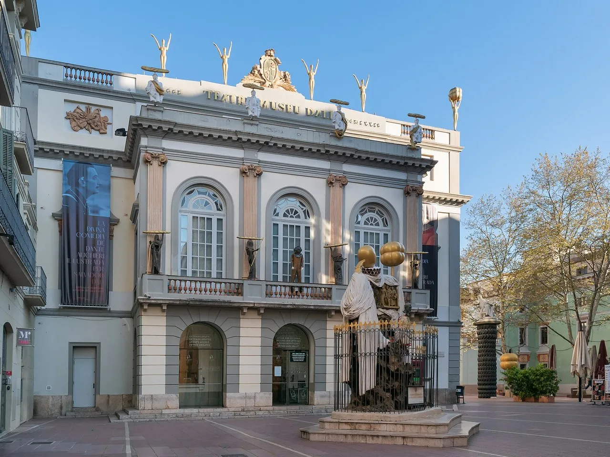
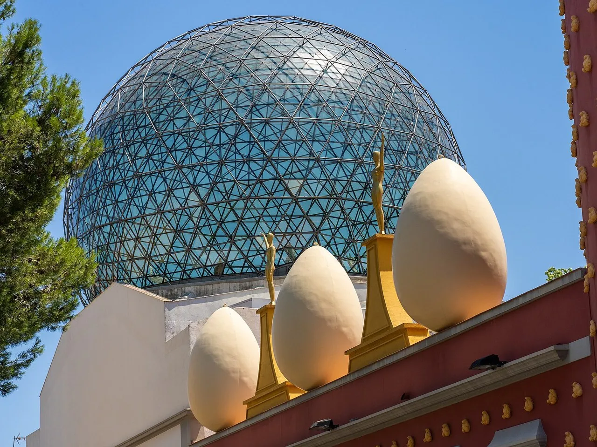
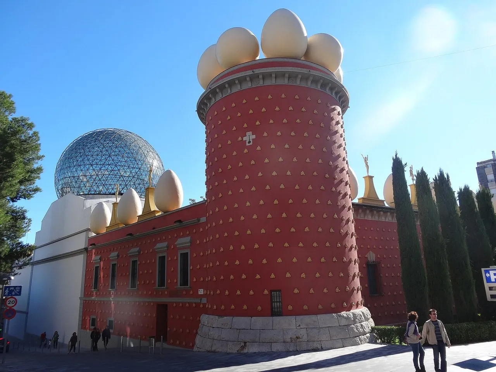
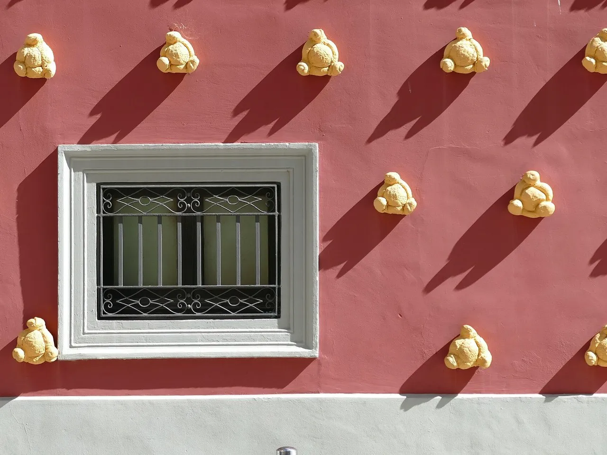
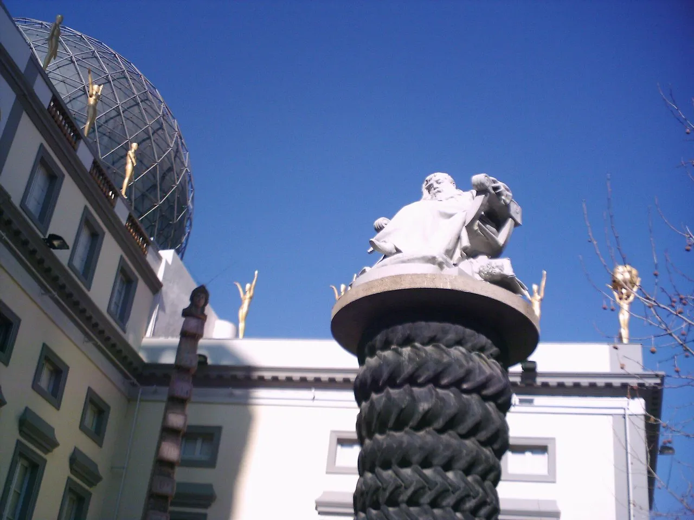
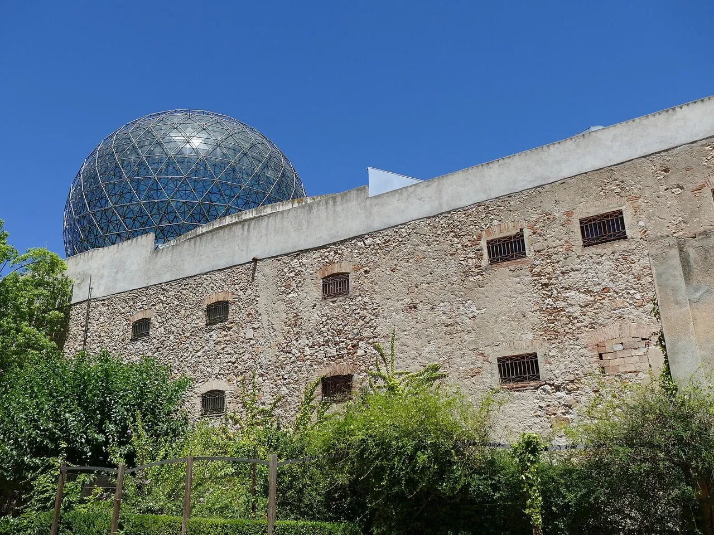

Una cúpula de cristal gigante, una torre roja coronada de huevos y una fachada cubierta de panes. Por fuera ya avisa: el **Teatro-Museo Dalí** de **Figueres** es la última gran obra de **Salvador Dalí**, levantada sobre el viejo teatro de su pueblo, y es donde está enterrado.

Te cuento el horario, cuánto cuesta, cuándo es gratis y cómo llegar 👇

En un vistazo<h2>Lo que vas a encontrar</h2>

<b>🎭</b>24 salas

<b>🥚</b>Torre Galatea

<b>🔮</b>La cúpula

<b>💎</b>Dalí·Joyas

<b>🆓</b>Gratis el 6 de enero

Antes de ir<h2>Lo básico del Teatro-Museo Dalí</h2>

<h3>🎟️ Precio</h3>
General <strong>desde 18,50 €</strong>, reducida desde 15 €. Con visita guiada, 26,50 €. Menores de 9 años, gratis.

<h3>🕙 Horario de invierno</h3>
Octubre-marzo: <strong>martes a domingo, 10:30-18:00</strong>. Último acceso, 45 minutos antes. <strong>Lunes, cerrado</strong> (salvo festivos señalados).

<h3>☀️ Verano</h3>
Julio y agosto: <strong>todos los días, 9:00-20:00</strong>.

<h3>⏱️ Duración</h3>
<strong>1 h 30 - 2 h</strong>. Visita libre, sin audioguía y sin cafetería dentro.

Qué ver<h2>Qué ver en el Teatro-Museo Dalí</h2>

<ol class="guide__grid guide__grid--cuenca">
<li class="gcard reveal">
01

<h3>El antiguo teatro</h3>
Dalí convirtió en museo el <strong>Teatro Municipal de Figueres</strong>, que se había quemado. Se inauguró en <strong>1974</strong> y reúne más de <strong>1.500 piezas</strong>.

</li>
<li class="gcard reveal">
02

<h3>La cúpula</h3>
La gran <strong>cúpula de cristal</strong> se ve desde todo Figueres. Debajo, donde estaba el escenario, está la sala 3, el corazón del museo.

</li>
<li class="gcard reveal">
03

<h3>La Torre Galatea</h3>
Roja, con <strong>huevos gigantes</strong> arriba: un añadido de los últimos años de Dalí, que pasó en ella el final de su vida.

</li>
<li class="gcard reveal">
04

<h3>La pared de los panes</h3>
La fachada de la torre está salpicada de <strong>panes dorados</strong>, uno de los símbolos favoritos de Dalí.

</li>
<li class="gcard reveal">
05

<h3>El patio del Cadillac</h3>
Dentro, el patio central (sala 2) con el famoso <strong>Cadillac lluvioso</strong>. Ya en la plaza de entrada hay esculturas que anuncian lo que viene.

</li>
<li class="gcard reveal">
06

<h3>La cripta y Dalí·Joyas</h3>
Bajo el escenario está la <strong>cripta</strong> donde descansa Dalí. Al final, las salas 23 y 24 guardan <strong>Dalí·Joyas</strong>, su colección de joyas.

</li>
</ol>

<!--actividades-->

Horarios<h2>Horario del Museo Dalí en 2026</h2>

<h3>❄️ 1 enero - 22 marzo</h3>
Martes a domingo, 10:30-18:00.

<h3>🌸 23 marzo - 31 mayo</h3>
Martes a domingo, 9:30-18:00.

<h3>☀️ Junio y septiembre</h3>
Junio, 10:30-18:00; septiembre, 9:30-18:00. Martes a domingo.

<h3>🍂 1 octubre - 31 diciembre</h3>
Martes a domingo, 10:30-18:00. Abre excepcionalmente el lunes 7 de diciembre.

Cómo llegar<h2>Cómo llegar al Museo Dalí</h2>

<h3>🚆 En tren regional</h3>
Línea <strong>R11</strong> Barcelona-Sants – Portbou, hasta la estación de Figueres, en el centro.

<h3>🚄 En AVE</h3>
Hasta <strong>Figueres-Vilafant</strong>, a las afueras, con lanzadera al centro.

<h3>🚗 En coche</h3>
AP-7, <strong>salida 3 Figueres Nord</strong>, o N-II. El museo está en zona de tráfico restringido: aparca en los parkings del centro.

<h3>🧭 Con excursión</h3>
Desde Barcelona: <a href="https://www.civitatis.com/es/barcelona/excursion-museo-dali-figueres/?aid=110968" target="_blank" rel="noopener sponsored">Girona, Figueres y Museo Dalí</a> o el <a href="https://www.civitatis.com/es/barcelona/tour-dali-cadaques-figueras-portlligat/?aid=110968" target="_blank" rel="noopener sponsored">tour de Dalí con Cadaqués y Portlligat</a>.

Consejos de Cheno<h2>Para disfrutarlo al máximo</h2><ul><li><b>Reserva online</b>: el aforo es limitado y hay que recoger la entrada media hora antes.</li><li><b>Fotos sí, sin flash</b> ni trípode.</li><li><b>Come antes o después</b>: no hay cafetería en el museo.</li><li><b>El triángulo daliniano</b>: Púbol y Portlligat (Cadaqués) están a unos 40 km; hacen falta dos días para los tres.</li><li><b>Combínalo con</b> <a href="/blog/girona-que-ver.html">Girona</a>.</li></ul>

<!--faq-->

<h2>¿Te gustan estos planes?</h2>
Sígueme en Instagram como <a href="https://www.instagram.com/chenoaventuras/" target="_blank" rel="noopener">@chenoaventuras</a>: subo escapadas como esta cada semana.
<a class="btn guide__btn" href="/blog.html">Ver más planes en el blog</a>

Información consultada en noviembre de 2026 en la web de la Fundació Gala-Salvador Dalí. Fotos de Wikimedia Commons (exterior del edificio): <a href="https://commons.wikimedia.org/wiki/File:Figueres_-_Teatro-Museo_Dal%C3%AD_y_Torre_Galatea_17.jpg" target="_blank" rel="noopener">Zarateman</a> (CC0) · <a href="https://commons.wikimedia.org/wiki/File:Teatre-Museu_Dal%C3%AD_(Figueres)_01.jpg" target="_blank" rel="noopener">Maksim Sokolov</a> (CC BY-SA 4.0) · <a href="https://commons.wikimedia.org/wiki/File:Dali_Theatre_and_Museum_in_Figueres_(1).jpg" target="_blank" rel="noopener">Krzysztof Golik</a> (CC BY-SA 4.0) · <a href="https://commons.wikimedia.org/wiki/File:Torre_Galatea,_Figueres_(novembre_2012)_-_panoramio.jpg" target="_blank" rel="noopener">EliziR</a> (CC BY-SA 3.0) · <a href="https://commons.wikimedia.org/wiki/File:Figueres_-_Teatre-Museu_Dal%C3%AD_0104.JPG" target="_blank" rel="noopener">Phyrexian</a> (CC BY-SA 4.0) · <a href="https://commons.wikimedia.org/wiki/File:Detail_of_the_wall_decoration_of_Torre_Gorgot_02.jpg" target="_blank" rel="noopener">Kritzolina</a> (CC BY-SA 4.0) · <a href="https://commons.wikimedia.org/wiki/File:Cupola_of_the_Teatre-Museu_Dal%C3%AD_in_Figueres_01.jpg" target="_blank" rel="noopener">Kritzolina</a> (CC BY-SA 4.0).

