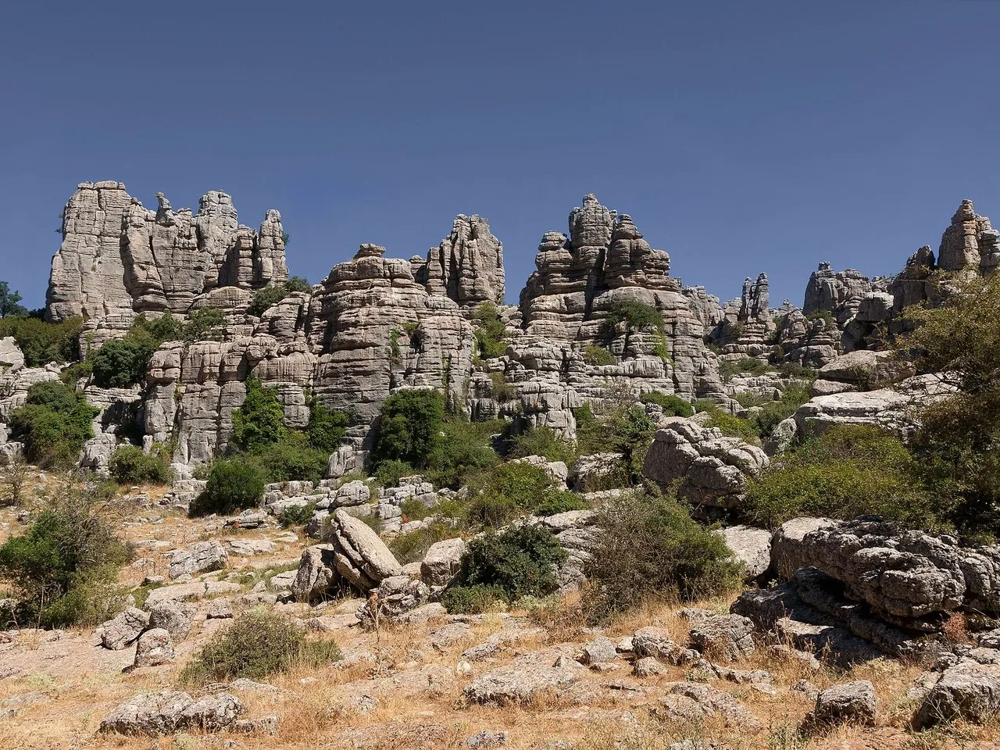
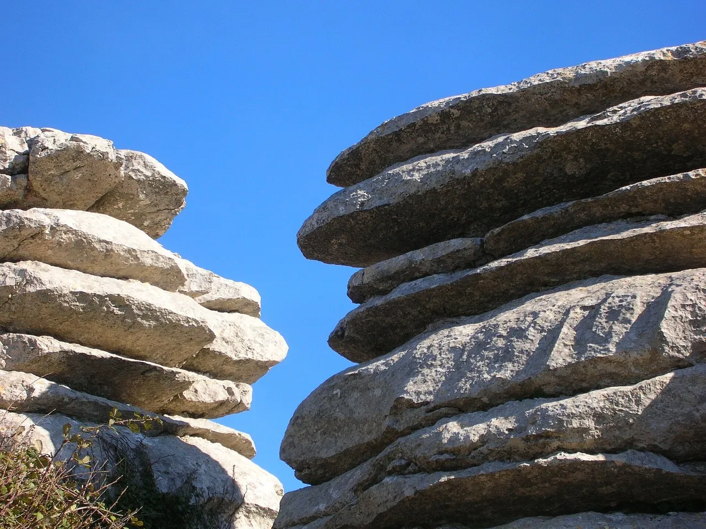
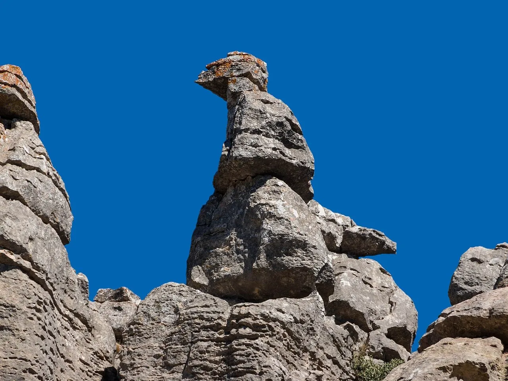
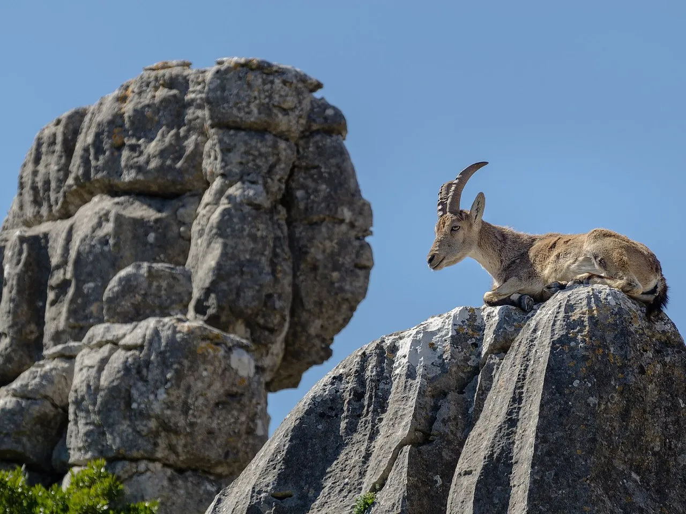
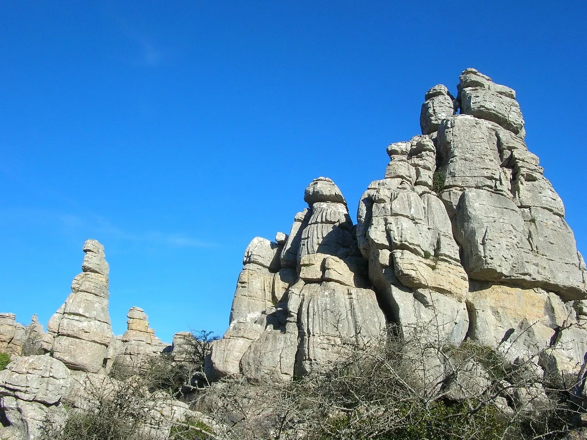
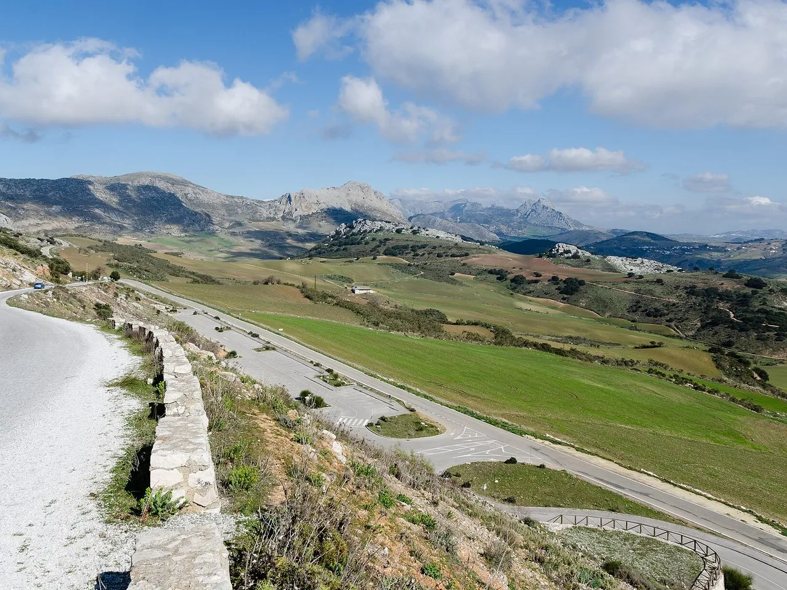

Rocas que parecen tornillos, setas o pilas de platos gigantes, a más de 1.200 metros de altura y con cabras montesas mirándote desde arriba. **El Torcal de Antequera** es uno de los paisajes más raros de España: fondo de mar convertido en montaña. Y se recorre gratis.

Te cuento las rutas, cómo llegar (ojo con el coche los fines de semana) y qué llevar 👇

En un vistazo<h2>Lo que vas a encontrar</h2>

<b>🪨</b>Rocas kársticas

<b>🥾</b>3 rutas gratis

<b>🐐</b>Cabras montesas

<b>🚌</b>Lanzadera

<b>🔭</b>Observatorio

Antes de ir<h2>Lo básico del Torcal</h2>

<h3>💶 Precio</h3>
<strong>Gratis</strong>: paraje, centro de visitantes y rutas señalizadas. La lanzadera cuesta <strong>3 €</strong>.

<h3>🚗 Ojo con el coche</h3>
Fines de semana, festivos y puentes de otoño a primavera, cuando se llena el parking de arriba <strong>se corta el acceso</strong>. Sube temprano o después de las 14:30.

<h3>🕘 Centro de visitantes</h3>
Todos los días, <strong>9:30-17:00</strong>, con cafetería, tienda y observatorio.

<h3>🧥 Qué llevar</h3>
Botas (la roca resbala), agua y <strong>abrigo</strong>: a 1.200 m hace más frío que en Málaga, con viento y niebla.

Qué ver<h2>Qué ver en el Torcal de Antequera</h2>

<ol class="guide__grid guide__grid--cuenca">
<li class="gcard reveal">
01

<h3>Un laberinto de piedra</h3>
Un paisaje <strong>kárstico</strong> con más de mil simas y cuevas, pasillos entre rocas y formas imposibles. Parece otro planeta.

</li>
<li class="gcard reveal">
02

<h3>Las rocas en capas</h3>
Cada «plato» es una capa de sedimento marino. Hace millones de años esto era el fondo del <strong>mar de Tetis</strong>.

</li>
<li class="gcard reveal">
03

<h3>Las formas caprichosas</h3>
El agua, el hielo y el viento han esculpido figuras que la gente bautiza a su manera: tornillos, setas, caras…

</li>
<li class="gcard reveal">
04

<h3>La fauna</h3>
Es Zona de Especial Protección para las Aves: buitres leonados, búho real, chovas… y es fácil cruzarse con <strong>cabras montesas</strong>.

</li>
<li class="gcard reveal">
05

<h3>El Torcal Alto</h3>
Donde están el centro de visitantes y el arranque de las rutas Verde y Amarilla, en el corazón del paraje.

</li>
<li class="gcard reveal">
06

<h3>Las vistas</h3>
Desde la carretera de subida y los miradores se ve la vega de Antequera y las sierras de alrededor.

</li>
</ol>

<!--actividades-->

Rutas<h2>Las rutas del Torcal</h2>
Señalizadas, gratuitas y sin reserva (los grupos deben avisar).

<h3>🟢 Ruta Verde</h3>
Circular, <strong>1,5 km</strong>, unos <strong>45 minutos</strong>, dificultad media-baja. Sale del aparcamiento superior.

<h3>🟡 Ruta Amarilla</h3>
Circular, <strong>3 km</strong>, unas <strong>2 horas</strong>, dificultad media. Del aparcamiento superior al centro de visitantes.

<h3>🟠 Subida al Torcal Alto</h3>
Lineal, <strong>3,6 km</strong> y +263 m desde el aparcamiento inferior; unas <strong>3 h 30</strong> ida y vuelta. Es la opción cuando el coche no puede subir.

<h3>🧭 Con guía</h3>
Otros senderos solo se recorren con guía. Por ejemplo, el <a href="https://www.civitatis.com/es/antequera/senderismo-torcal-antequera/?aid=110968" target="_blank" rel="noopener sponsored">senderismo por el Torcal</a> o la <a href="https://www.civitatis.com/es/antequera/visita-guiada-torcal-dolmenes-antequera/?aid=110968" target="_blank" rel="noopener sponsored">visita guiada al Torcal y los Dólmenes</a>.

Cómo llegar<h2>Cómo llegar al Torcal</h2>

Desde <strong>Antequera</strong>, por la carretera <strong>A-7075</strong>: el aparcamiento inferior está entre los km 41 y 42, y desde allí una carretera estrecha de montaña sube al Torcal Alto. Cuando hay <strong>restricción de acceso</strong>, solo pueden subir autobuses, taxis, VTC, vehículos con tarjeta PMR y motos; el resto, en la <strong>lanzadera</strong> (3 €) o a pie.

<strong>Sin coche:</strong> la <a href="https://www.civitatis.com/es/malaga/excursion-antequera-torcal/?aid=110968" target="_blank" rel="noopener sponsored">excursión desde Málaga a los Dólmenes y el Torcal</a> incluye el transporte.

<a class="btn guide__mapbtn" href="https://www.google.com/maps/dir/?api=1&destination=Centro+de+Visitantes+Torcal+de+Antequera" target="_blank" rel="noopener"><svg class="ico" viewBox="0 0 24 24" width="15" height="15" aria-hidden="true" fill="currentColor"><path d="M12 2a7 7 0 0 0-7 7c0 5.25 7 13 7 13s7-7.75 7-13a7 7 0 0 0-7-7zm0 9.5a2.5 2.5 0 1 1 0-5 2.5 2.5 0 0 1 0 5z"/></svg> Centro de visitantes del Torcal</a>

Consejos de Cheno<h2>Para disfrutarlo al máximo</h2><ul><li><b>Madruga o ve por la tarde</b> los fines de semana para poder subir en coche.</li><li><b>Botas de montaña</b>: la roca es pedregosa y resbala con humedad.</li><li><b>Mira el tiempo</b>: con niebla el Torcal es mágico, pero te puedes desorientar.</li><li><b>No apiles piedras ni dejes basura</b>; los drones están prohibidos sin permiso.</li><li><b>Combínalo con</b> los Dólmenes de Antequera, el <a href="/blog/caminito-del-rey.html">Caminito del Rey</a> o <a href="/blog/malaga-que-ver.html">Málaga</a>.</li></ul>

<!--faq-->

<h2>¿Te gustan estos planes?</h2>
Sígueme en Instagram como <a href="https://www.instagram.com/chenoaventuras/" target="_blank" rel="noopener">@chenoaventuras</a>: subo escapadas como esta cada semana.
<a class="btn guide__btn" href="/blog.html">Ver más planes en el blog</a>

Información consultada en noviembre de 2026 en la web oficial del Torcal de Antequera (rutas, acceso, lanzadera, geología y fauna). Fotos de Wikimedia Commons: <a href="https://commons.wikimedia.org/wiki/File:El_Torcal_Felsformation_02_2014.jpg" target="_blank" rel="noopener">Tuxyso</a> (CC BY-SA 3.0) · <a href="https://commons.wikimedia.org/wiki/File:El_Torcal_de_Antequera_karst_scenery_Andalusia_Spain.jpg" target="_blank" rel="noopener">Jebulon</a> (CC0) · <a href="https://commons.wikimedia.org/wiki/File:Torcal_de_Antequera_detalle.JPG" target="_blank" rel="noopener">Grez</a> (CC BY-SA 3.0) · <a href="https://commons.wikimedia.org/wiki/File:El_Torcal_de_Antequera_karst_sculpture_Andalusia_Spain.jpg" target="_blank" rel="noopener">Jebulon</a> (CC0) · <a href="https://commons.wikimedia.org/wiki/File:El_Torcal_Iberiensteinbock_2014.jpg" target="_blank" rel="noopener">Tuxyso</a> (CC BY-SA 3.0) · <a href="https://commons.wikimedia.org/wiki/File:El_Torcal_de_Antequera_2.JPG" target="_blank" rel="noopener">Grez</a> (CC BY-SA 3.0) · <a href="https://commons.wikimedia.org/wiki/File:Landscape_Around_El_Torcal_2014.jpg" target="_blank" rel="noopener">Tuxyso</a> (CC BY-SA 3.0).

