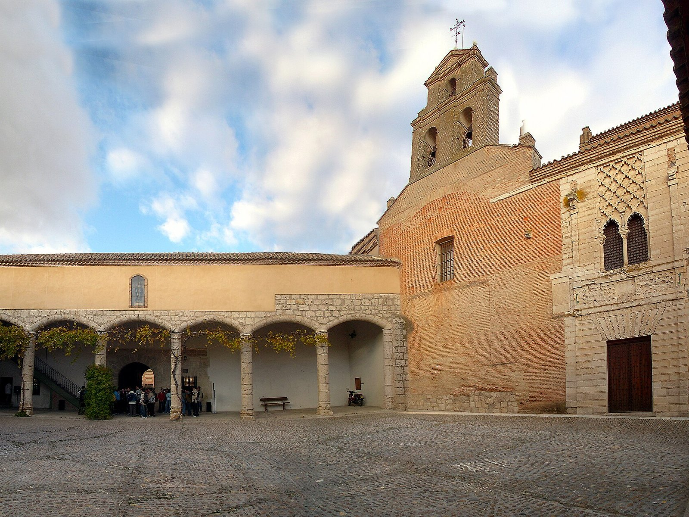
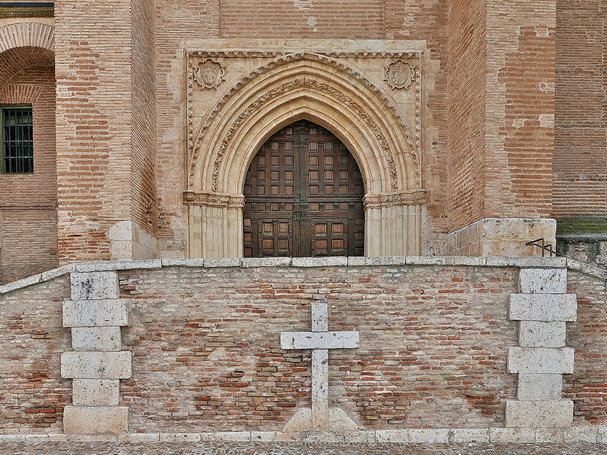
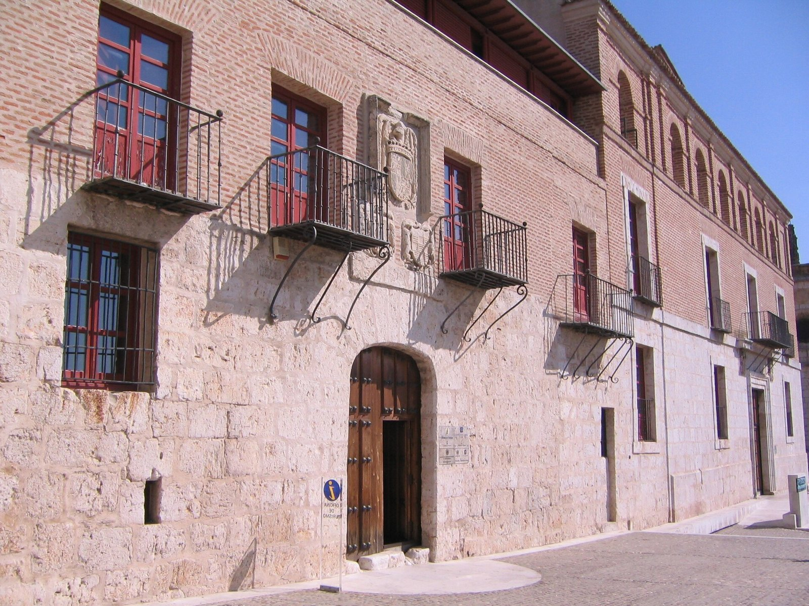
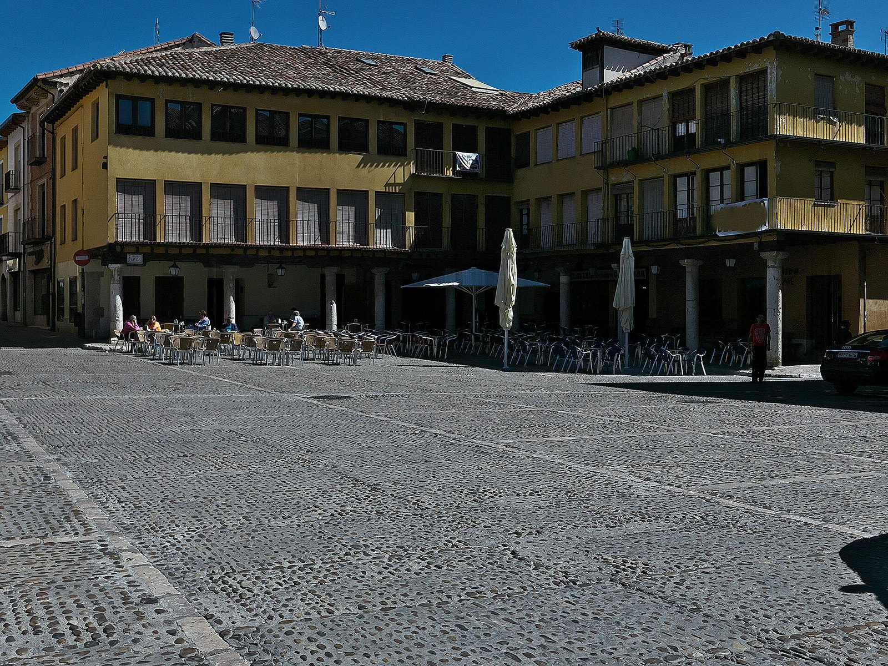
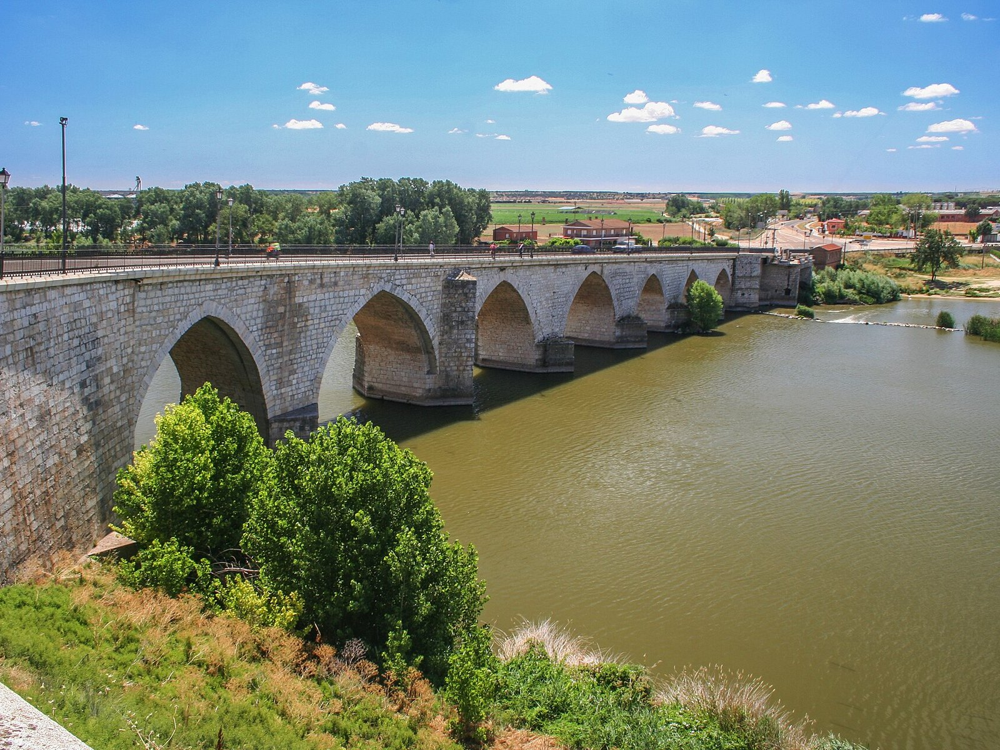

En 1494, en un pueblo junto al **Duero**, Castilla y Portugal se repartieron medio mundo. **Tordesillas** dio nombre al tratado que marcó la historia de América, y años después fue el lugar donde vivió encerrada la reina **Juana I**. Hoy es un pueblo tranquilo, con una plaza mayor muy bonita y uno de los monumentos **mudéjares** más especiales de España.

Te cuento qué ver 👇

En un vistazo<h2>Lo que vas a encontrar</h2>

<b>📜</b>El Tratado de 1494

<b>👑</b>Juana I

<b>🕌</b>Arte mudéjar

<b>🌉</b>Puente sobre el Duero

<b>🏛️</b>Plaza mayor

Antes de ir<h2>Lo básico de Tordesillas</h2>

<h3>📍 Dónde está</h3>
En la provincia de <strong>Valladolid</strong>, a 30 minutos de la capital y junto a la A-6.

<h3>⏱️ Tiempo</h3>
<strong>Medio día</strong> es suficiente. Combínalo con Medina del Campo o con Toro.

<h3>🎟️ Santa Clara</h3><ul class="guide__prices"><li>Entrada general<b>9 €</b></li><li>Visita libre (fines de semana)<b>6 €</b></li><li>Lunes<b>Cerrado</b></li></ul>

Qué ver<h2>Qué ver en Tordesillas</h2>

<ol class="guide__grid guide__grid--cuenca">
<li class="gcard reveal">
01

<h3>Real Monasterio de Santa Clara</h3>
Fue un <strong>palacio de Alfonso XI</strong> en el siglo XIV y después pasó a ser monasterio. Es una joya del arte mudéjar: la visita incluye los <strong>baños árabes</strong>, la capilla y un retablo portátil del siglo XV.

</li>
<li class="gcard reveal">
02

<h3>La iglesia de Santa Clara</h3>
Su portada gótica da al patio del monasterio. Dentro, la <strong>capilla mayor</strong> tiene una de las armaduras de madera mudéjares más bonitas de Castilla.

</li>
<li class="gcard reveal">
03

<h3>Las Casas del Tratado</h3>
Dos palacios unidos del siglo XV donde, según la tradición, se firmó el <strong>Tratado de Tordesillas</strong>. Hoy acogen el museo del Tratado y la oficina de turismo.

</li>
<li class="gcard reveal">
04

<h3>La plaza mayor</h3>
Porticada, con soportales de columnas y balcones. Es el sitio para tomar algo y ver la vida del pueblo.

</li>
<li class="gcard reveal">
05

<h3>El puente sobre el Duero</h3>
Un largo puente de piedra de origen medieval. Crúzalo y date la vuelta: desde la otra orilla tienes la <strong>mejor vista del pueblo</strong>, con Santa Clara y las torres sobre el río.

</li>
</ol>

Historia<h2>Tordesillas en dos fechas</h2>

<ul class="guide__timeline">
<li><b>7 de junio de 1494</b>Castilla y Portugal firman el <strong>Tratado de Tordesillas</strong>: una línea a 370 leguas al oeste de Cabo Verde reparte las tierras por descubrir.</li>
<li><b>1509 - 1555</b>La reina <strong>Juana I de Castilla</strong> vive recluida en Tordesillas, en un palacio junto al río que ya no existe, hasta su muerte.</li>
</ul>

<h3>👑 Juana I, la reina de Tordesillas</h3>
La historia la recuerda como <strong>«Juana la Loca»</strong>. Pasó casi 46 años en Tordesillas. Se conserva un <strong>clavicordio</strong> que se atribuye a la reina, y en el pueblo se organizan visitas que cuentan su vida.

Cómo llegar<h2>Cómo llegar a Tordesillas</h2>

En coche, a unos <strong>30 minutos de Valladolid</strong> y unas <strong>2 horas de Madrid</strong> por la autovía <strong>A-6</strong>. Hay autobuses frecuentes desde Valladolid. Aparca cerca de la plaza mayor o junto al río y haz todo a pie.

<a class="btn guide__mapbtn" href="https://www.google.com/maps/dir/?api=1&destination=41.5007,-5.0006" target="_blank" rel="noopener"><svg class="ico" viewBox="0 0 24 24" width="15" height="15" aria-hidden="true" fill="currentColor"><path d="M12 2a7 7 0 0 0-7 7c0 5.25 7 13 7 13s7-7.75 7-13a7 7 0 0 0-7-7zm0 9.5a2.5 2.5 0 1 1 0-5 2.5 2.5 0 0 1 0 5z"/></svg> Cómo llegar en Google Maps</a>

Cerca tienes <a href="/blog/valladolid-que-ver.html">Valladolid</a>, el castillo de la Mota en <a href="/blog/medina-del-campo-castillo-mota.html">Medina del Campo</a> y <a href="/blog/toro-que-ver.html">Toro</a>, ya en Zamora. Y si te interesa la historia del Tratado, en <a href="/blog/arevalo-que-ver.html">Arévalo</a> también tienen su parte.

Consejos de Cheno<h2>Para disfrutarlo al máximo</h2><ul><li><b>Reserva Santa Clara</b>: la visita es guiada y los grupos son pequeños.</li><li><b>No vayas en lunes</b>: el monasterio cierra.</li><li><b>Cruza el puente</b> para la foto del pueblo.</li><li><b>Prueba el lechazo</b> en algún asador de la zona.</li></ul>

<!--actividades-->

<!--faq-->

<h2>¿Te gustan estos planes?</h2>
Sígueme en Instagram como <a href="https://www.instagram.com/chenoaventuras/" target="_blank" rel="noopener">@chenoaventuras</a>: subo escapadas como esta cada semana.
<a class="btn guide__btn" href="/blog.html">Ver más planes en el blog</a>

Información consultada en noviembre de 2026 (Turismo de Castilla y León y Patrimonio Nacional). Los precios y horarios de Santa Clara pueden cambiar: confírmalos antes de ir. Fotos de Wikimedia Commons: <a href="https://commons.wikimedia.org/wiki/File:Tordesillas_2.jpg" target="_blank" rel="noopener">LBM1948</a> (CC BY-SA 4.0) · <a href="https://commons.wikimedia.org/wiki/File:Atrio_de_las_Claras.jpg" target="_blank" rel="noopener">José-Manuel Benito</a> (dominio público) · <a href="https://commons.wikimedia.org/wiki/File:Portada_de_la_iglesia_del_Real_Monasterio_de_Santa_Clara_de_Tordesillas.jpg" target="_blank" rel="noopener">Jl FilpoC</a> (CC BY-SA 4.0) · <a href="https://commons.wikimedia.org/wiki/File:Tordesillas_Casa_del_Tratado.JPG" target="_blank" rel="noopener">Txo</a> (dominio público) · <a href="https://commons.wikimedia.org/wiki/File:Plaza_mayor_de_Tordesillas.jpg" target="_blank" rel="noopener">Jl FilpoC</a> (CC BY-SA 4.0) · <a href="https://commons.wikimedia.org/wiki/File:Tordesillas_r%C3%ADo_Duero.JPG" target="_blank" rel="noopener">Josemanuel</a> (CC BY-SA 3.0).

