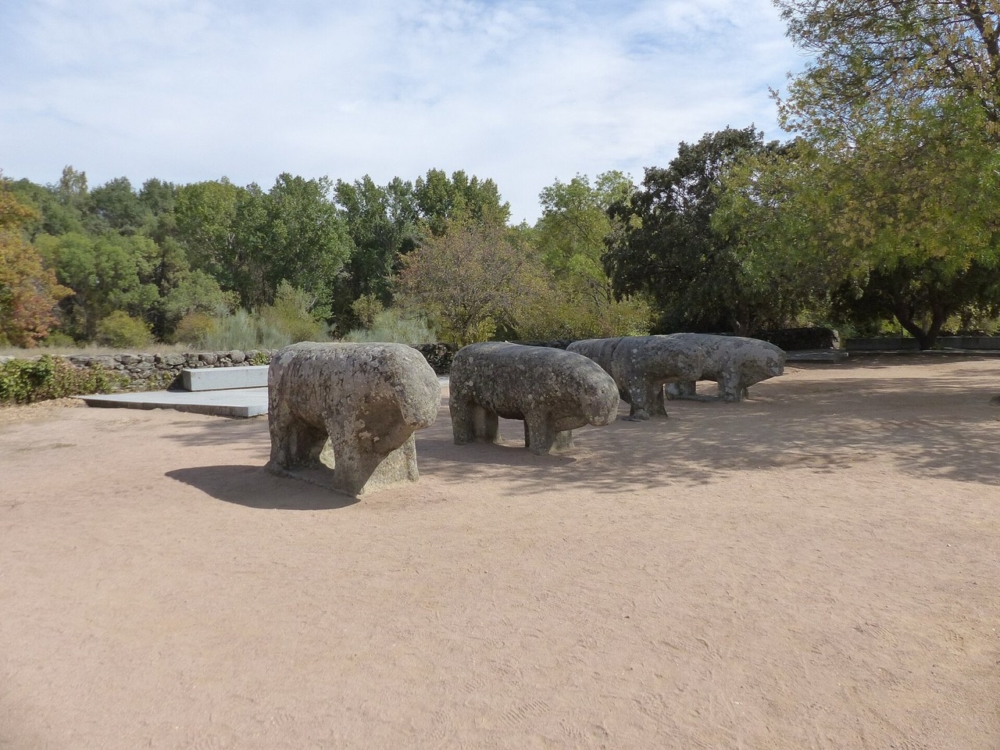
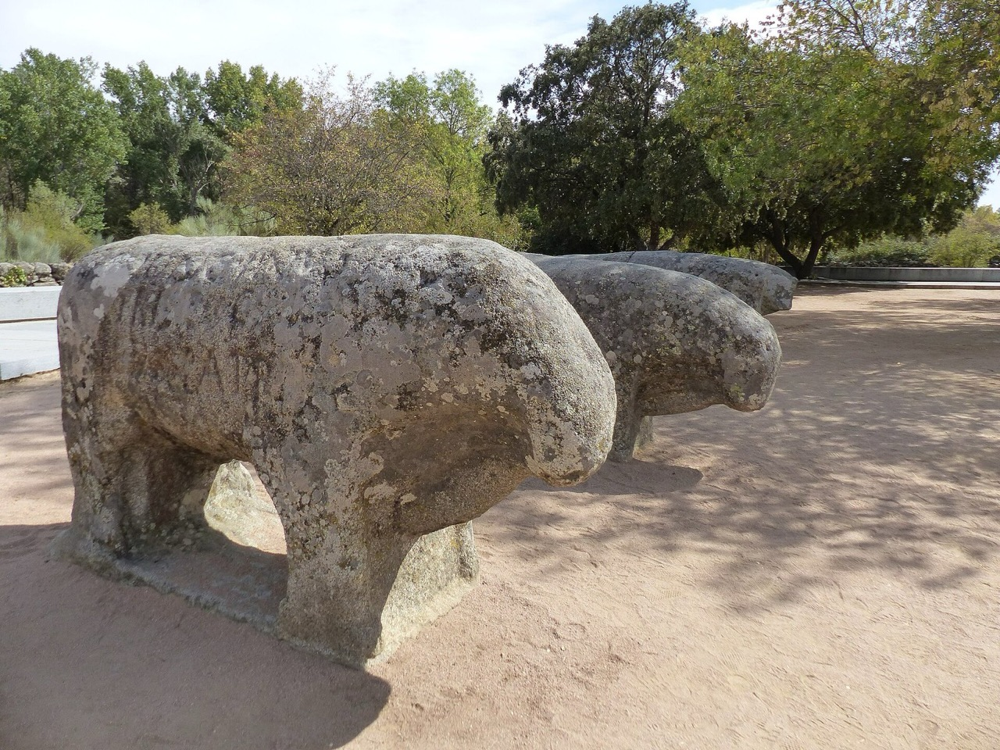
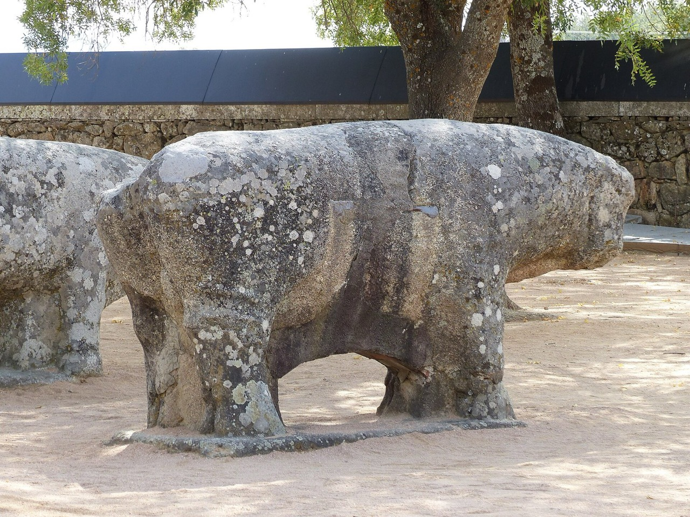

En un prado de **El Tiemblo**, en Ávila, hay **cuatro animales de granito** en fila, tallados hace más de dos mil años. Son los **Toros de Guisando**, y no solo son de lo más curioso de la prehistoria española: junto a ellos, en **1468**, se firmó el pacto que convirtió a **Isabel** —la futura Isabel la Católica— en heredera de Castilla.

Te cuento qué ver 👇

En un vistazo<h2>Lo que vas a encontrar</h2>

<b>🐂</b>Cuatro verracos

<b>🪨</b>Granito

<b>👑</b>Isabel la Católica

<b>📜</b>Pacto de 1468

<b>🆓</b>Gratis

Antes de ir<h2>Lo básico de los Toros</h2>

<h3>📍 Dónde están</h3>
En <strong>El Tiemblo</strong> (Ávila), a algo más de una hora de Madrid.

<h3>⏱️ Tiempo</h3>
Unos <strong>20-30 minutos</strong>. Es una parada perfecta de camino.

<h3>🆓 Precio</h3>
<strong>Gratis</strong>, al aire libre.

Qué ver<h2>Qué ver en los Toros de Guisando</h2>

<ol class="guide__grid guide__grid--cuenca">
<li class="gcard reveal">
01

<h3>Los cuatro verracos</h3>
Cuatro esculturas en fila, mirando hacia el mismo lado. Son <strong>verracos</strong>, una escultura típica de los vetones.

</li>
<li class="gcard reveal">
02

<h3>¿Toros o cerdos?</h3>
Se discute si son <strong>toros o verracos</strong> (cerdos). Fíjate en las formas y decide tú.

</li>
<li class="gcard reveal">
03

<h3>El granito</h3>
Tallados en un solo bloque de <strong>granito</strong>, con los líquenes de siglos encima.

</li>
</ol>

<h3>👑 El Tratado de los Toros de Guisando</h3>
En septiembre de 1468, junto a estas esculturas, el rey <strong>Enrique IV</strong> reconoció a su hermanastra <strong>Isabel</strong> como heredera del trono, por delante de su hija Juana. Fue el primer paso para que Isabel llegara a reina de Castilla. Cada verano, El Tiemblo lo recuerda con unas jornadas medievales.

Cómo llegar<h2>Cómo llegar a los Toros de Guisando</h2>

En coche, desde <strong>Madrid</strong> se tarda algo más de una hora, pasando por San Martín de Valdeiglesias. Desde <strong>Ávila</strong>, unos 50 minutos. Están junto a la carretera, en el término de El Tiemblo, y hay sitio para aparcar.

<a class="btn guide__mapbtn" href="https://www.google.com/maps/dir/?api=1&destination=40.3545,-4.4016" target="_blank" rel="noopener"><svg class="ico" viewBox="0 0 24 24" width="15" height="15" aria-hidden="true" fill="currentColor"><path d="M12 2a7 7 0 0 0-7 7c0 5.25 7 13 7 13s7-7.75 7-13a7 7 0 0 0-7-7zm0 9.5a2.5 2.5 0 1 1 0-5 2.5 2.5 0 0 1 0 5z"/></svg> Cómo llegar en Google Maps</a>

Muy cerca tienes la <a href="/blog/sierra-de-gredos.html">Sierra de Gredos</a> y, ya en la capital, <a href="/blog/avila-que-ver.html">Ávila</a>.

Consejos de Cheno<h2>Para disfrutarlo al máximo</h2><ul><li><b>Hazlo de camino</b> a Gredos o al Valle del Tiétar.</li><li><b>Busca los otoños</b> los castañares de El Tiemblo están muy cerca.</li><li><b>Lee la historia antes</b> así la visita gana mucho.</li></ul>

<!--actividades-->

<!--faq-->

<h2>¿Te gustan estos planes?</h2>
Sígueme en Instagram como <a href="https://www.instagram.com/chenoaventuras/" target="_blank" rel="noopener">@chenoaventuras</a>: subo escapadas como esta cada semana.
<a class="btn guide__btn" href="/blog.html">Ver más planes en el blog</a>

Información consultada en noviembre de 2026 (Ayuntamiento de El Tiemblo y fuentes históricas). Los horarios y precios cambian: confírmalos antes de ir. Fotos de Wikimedia Commons: <a href="https://commons.wikimedia.org/wiki/File:Toros_de_Guisando,_El_Tiemblo_(%C3%81vila).jpg" target="_blank" rel="noopener">José Luis Filpo Cabana</a> (CC BY 4.0), <a href="https://commons.wikimedia.org/wiki/File:Toros_de_Guisando,_%C3%81vila,_Espa%C3%B1a,_2020_02.jpg" target="_blank" rel="noopener">Benjamín Núñez González</a> (CC BY-SA 4.0), <a href="https://commons.wikimedia.org/wiki/File:Toros_de_Guisando,_%C3%81vila,_Espa%C3%B1a,_2020_03.jpg" target="_blank" rel="noopener">Benjamín Núñez González</a> (CC BY-SA 4.0), <a href="https://commons.wikimedia.org/wiki/File:Toros_de_Guisando,_%C3%81vila,_Espa%C3%B1a,_2020_05.jpg" target="_blank" rel="noopener">Benjamín Núñez González</a> (CC BY-SA 4.0), <a href="https://commons.wikimedia.org/wiki/File:Toros_de_Guisando,_%C3%81vila,_Espa%C3%B1a,_2020_16.jpg" target="_blank" rel="noopener">Benjamín Núñez González</a> (CC BY-SA 4.0).

