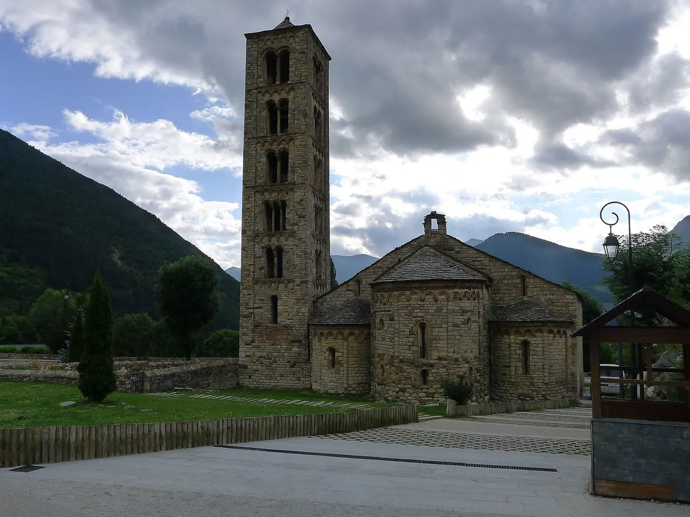
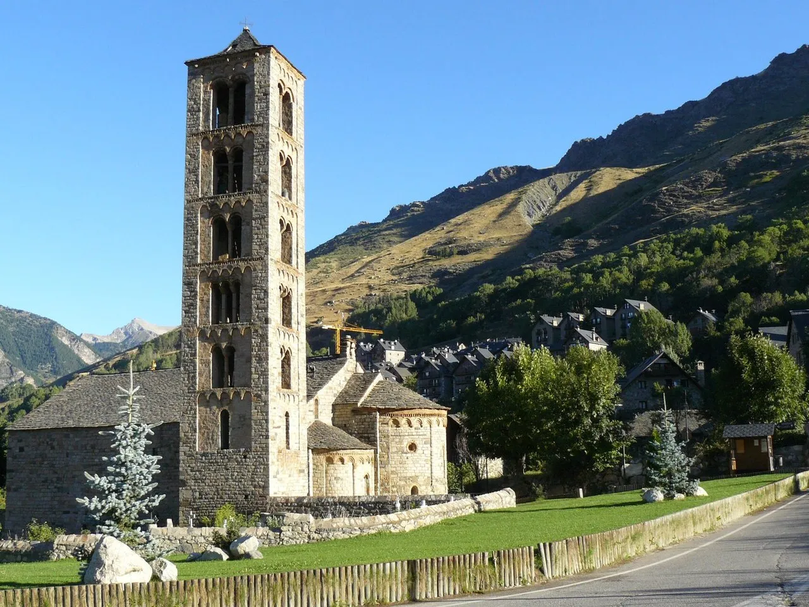
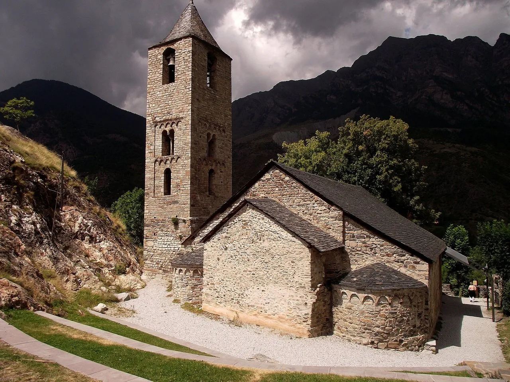
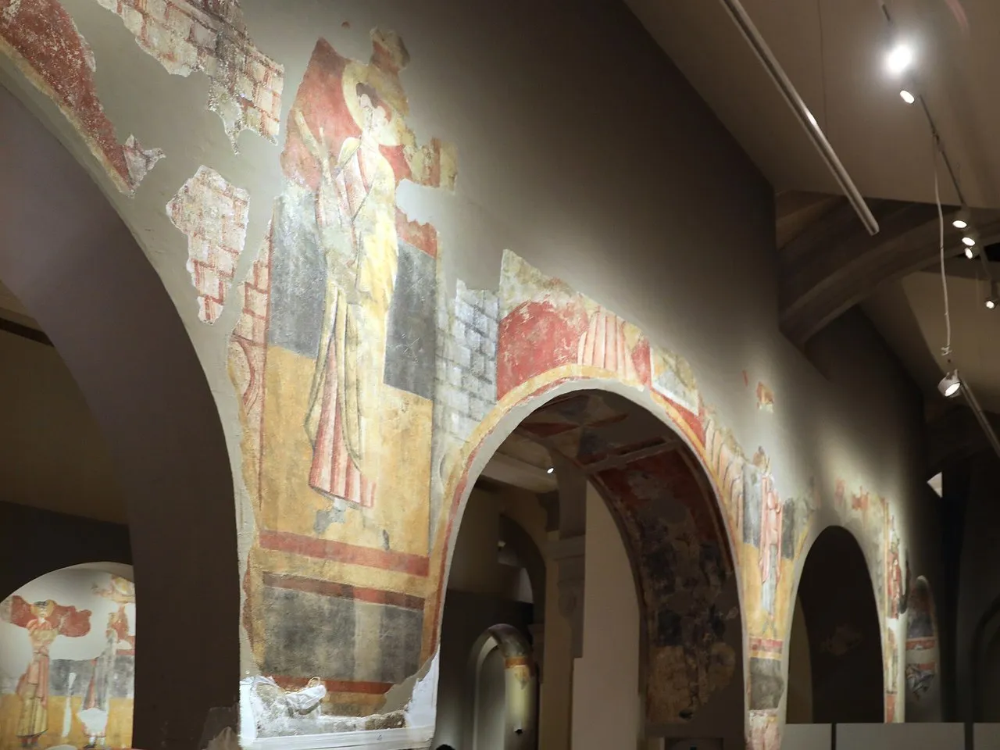
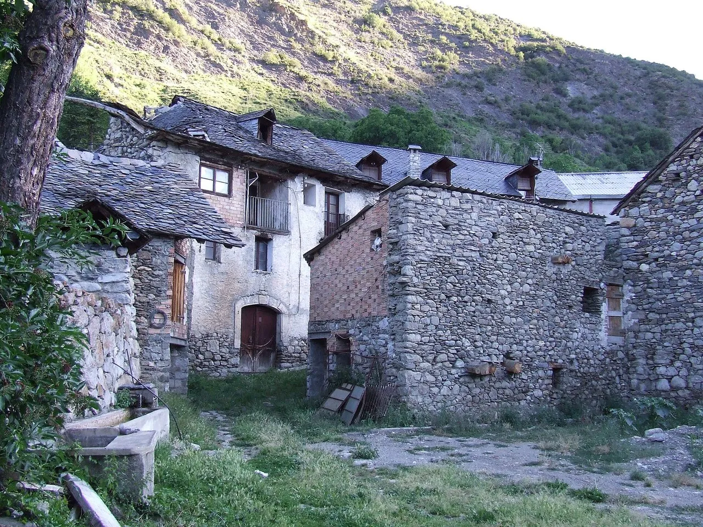
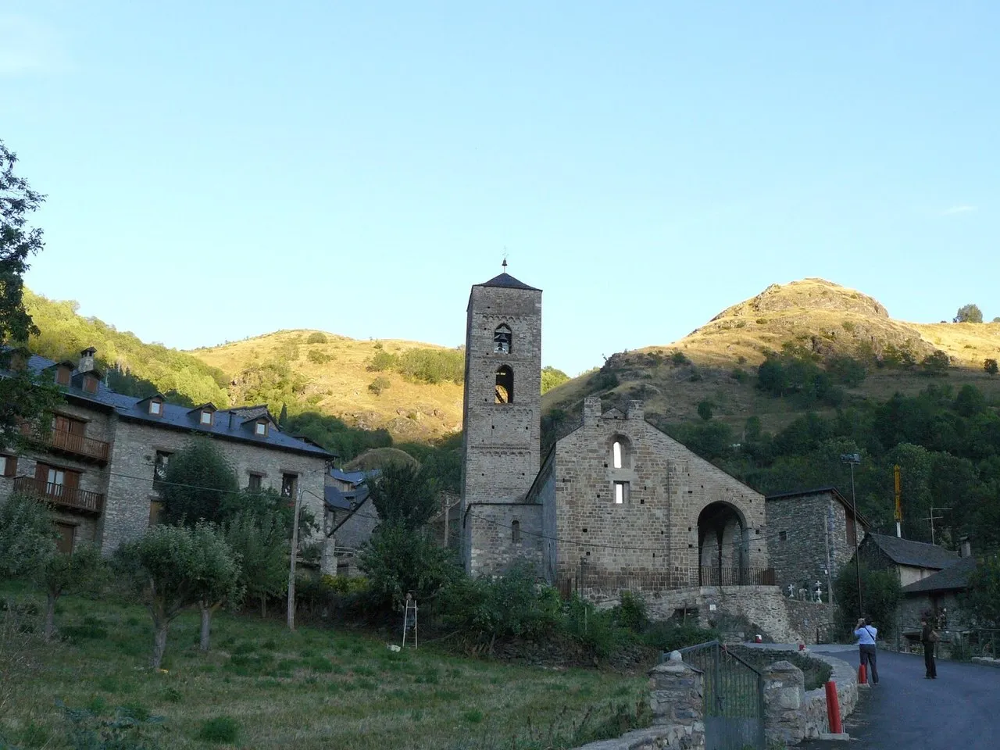

Campanarios de piedra altísimos recortados contra las montañas del Pirineo, iglesias del siglo XII en pueblos diminutos y uno de los Pantocrátor más famosos del mundo. Las **iglesias románicas de la Vall de Boí** son **Patrimonio Mundial** desde el año 2000, y se pueden recorrer en un día.

Te cuento cuáles son, cuánto cuestan, sus horarios y un aviso importante para este invierno 👇

En un vistazo<h2>Lo que vas a encontrar</h2>

<b>⛪</b>9 iglesias románicas

<b>🌍</b>Patrimonio Mundial

<b>🎨</b>Pantocrátor de Taüll

<b>🏔️</b>Pirineo de Lleida

<b>🎟️</b>Entrada conjunta

Antes de ir<h2>Lo básico de la Vall de Boí</h2>

<h3>📍 Dónde está</h3>
En el <strong>Pirineo de Lleida</strong> (Alta Ribagorça), a unos <strong>140 km de Lleida</strong> y <strong>300 km de Barcelona</strong>, a las puertas del Parque Nacional de Aigüestortes.

<h3>🎟️ Precio</h3>
Sant Climent, <strong>5 €</strong>; casi todas las demás, <strong>3 €</strong>; Santa Maria de Taüll, <strong>gratis</strong>. Conjuntas: 3 iglesias <strong>8 €</strong>, 5 <strong>12 €</strong> y 7 <strong>15 €</strong>.

<h3>⚠️ Obras en Sant Climent</h3>
Desde el <strong>30 de noviembre de 2026</strong> cierra por obras en la cubierta, previsiblemente hasta <strong>finales de la primavera de 2027</strong>.

<h3>⏱️ Tiempo</h3>
Un <strong>día</strong> da para las más importantes. Hay visitas guiadas de unos 45 minutos (3 € más la entrada) en las fechas de más gente.

Qué ver<h2>Las iglesias imprescindibles de la Vall de Boí</h2>

<ol class="guide__grid guide__grid--cuenca">
<li class="gcard reveal">
01

<h3>Sant Climent de Taüll</h3>
La más famosa, con su campanario esbelto y el <strong>videomapping</strong> que recrea las pinturas del ábside tal como eran en <strong>1123</strong>. El Pantocrátor original está en el MNAC de Barcelona. <strong>Cerrada por obras desde el 30 de noviembre de 2026</strong>.

</li>
<li class="gcard reveal">
02

<h3>Taüll y Santa Maria</h3>
Desde Sant Climent se sube andando al pueblo de <strong>Taüll</strong>, donde está <strong>Santa Maria de Taüll</strong>, la única iglesia del valle con entrada <strong>gratuita</strong>.

</li>
<li class="gcard reveal">
03

<h3>Sant Joan de Boí</h3>
En el pueblo de Boí, a la entrada del valle, con reproducciones de sus pinturas murales en el interior.

</li>
<li class="gcard reveal">
04

<h3>Las pinturas originales</h3>
Muchas pinturas murales del valle se arrancaron a principios del siglo XX y hoy están en el <strong>MNAC</strong> de Barcelona. En las iglesias se ven reproducciones.

</li>
<li class="gcard reveal">
05

<h3>Santa Eulàlia de Erill la Vall</h3>
En Erill la Vall, donde está también el <strong>Centre del Romànic</strong>, el centro de interpretación del valle. Buen sitio para empezar la visita.

</li>
<li class="gcard reveal">
06

<h3>La Nativitat de Durro</h3>
Domina el pueblo de Durro desde lo alto. A 1,5 km del pueblo, por un camino fácil a pie, está la ermita de <strong>Sant Quirc de Durro</strong>, con vistas al valle.

</li>
</ol>

<!--actividades-->

Horarios<h2>Horarios de las iglesias (noviembre-diciembre)</h2>

Según el Centre del Romànic: <strong>Santa Maria de Taüll</strong>, de lunes a sábado de 10:00 a 19:00 y domingos de 10:00 a 14:00. <strong>Sant Joan de Boí</strong> y <strong>Santa Eulàlia de Erill la Vall</strong>, de lunes a sábado de 10:00 a 14:00 y de 16:00 a 19:00, y domingos de 10:00 a 14:00. El <strong>25 de diciembre</strong> cierran, y el 24 y el 31 por la tarde.

<strong>Sant Feliu de Barruera</strong> y la <strong>Nativitat de Durro</strong> solo abren algunos fines de semana en otoño, y <strong>Cardet</strong>, <strong>Cóll</strong> y <strong>Sant Quirc</strong> aparecen como cerradas en invierno: consulta la web del Centre del Romànic antes de ir. Las entradas se compran en su web o en la puerta de cada iglesia.

Cómo llegar<h2>Cómo llegar a la Vall de Boí</h2>

<h3>🚗 En coche</h3>
Por la <strong>N-230</strong> y el desvío de la <strong>L-500</strong> hacia el valle. Desde Lleida, unos 140 km; desde Zaragoza, 236; desde Barcelona, 300.

<h3>🚌 En autobús</h3>
Hay autobuses desde Lleida y Barcelona hasta <strong>El Pont de Suert</strong>. Desde allí, taxi hasta el valle.

<h3>🅿️ Aparcar</h3>
Sant Climent tiene un aparcamiento grande junto a la carretera; en Taüll y Boí, mejor aparcar a la entrada del pueblo.

<h3>⛷️ En invierno</h3>
La estación de esquí de <strong>Boí Taüll</strong> está en el mismo valle: lleva cadenas y consulta el estado de la carretera.

Plan de Cheno<h2>La Vall de Boí en un día</h2><ul><li><b>Mañana:</b> Centre del Romànic y Santa Eulàlia en Erill la Vall, y después Sant Joan de Boí.</li><li><b>Mediodía:</b> sube a Taüll y visita Santa Maria (gratis) y, cuando reabra, Sant Climent.</li><li><b>Tarde:</b> Durro y el paseo a la ermita de Sant Quirc para ver el valle desde arriba.</li><li><b>Si tienes otro día:</b> el <a href="/blog/aiguestortes.html">Parque Nacional de Aigüestortes</a> está al lado, y el <a href="/blog/valle-de-aran.html">Valle de Arán</a>, a una hora.</li></ul>

<!--faq-->

<h2>¿Te gustan estos planes?</h2>
Sígueme en Instagram como <a href="https://www.instagram.com/chenoaventuras/" target="_blank" rel="noopener">@chenoaventuras</a>: subo escapadas como esta cada semana.
<a class="btn guide__btn" href="/blog.html">Ver más planes en el blog</a>

Información consultada en noviembre de 2026 en la web del Centre del Romànic de la Vall de Boí. Los horarios cambian según la temporada: confírmalos antes de ir. Fotos de Wikimedia Commons: <a href="https://commons.wikimedia.org/wiki/File:Ta%C3%BCll_-_Sant_Climent.jpg" target="_blank" rel="noopener">Xavigivax</a> (CC BY-SA 3.0) · <a href="https://commons.wikimedia.org/wiki/File:Sant_Climent_de_Ta%C3%BCll_07.JPG" target="_blank" rel="noopener">Vicente Maza Gómez</a> (CC BY-SA 3.0) · <a href="https://commons.wikimedia.org/wiki/File:Esgl%C3%A9sia_de_Sant_Joan_de_Bo%C3%AD_(La_Vall_de_Bo%C3%AD)_-_1.jpg" target="_blank" rel="noopener">wsrmatre</a> (CC BY-SA 2.0) · <a href="https://commons.wikimedia.org/wiki/File:Affreschi_di_sant_joan_de_bo%C3%AC,_1100_ca,_dalla_chiesa_parrocchiale_di_sant_joan_de_bo%C3%AC_(la_vall_de_bo%C3%AC)_01.jpg" target="_blank" rel="noopener">Francesco Bini</a> (CC BY-SA 4.0) · <a href="https://commons.wikimedia.org/wiki/File:Vall_de_Bo%C3%AD._Erill_la_Vall_2.JPG" target="_blank" rel="noopener">Gustau Erill i Pinyot</a> (CC BY-SA 3.0) · <a href="https://commons.wikimedia.org/wiki/File:Durro_-_Iglesia_de_la_Nativitat.jpg" target="_blank" rel="noopener">Xavigivax</a> (CC BY-SA 3.0).

