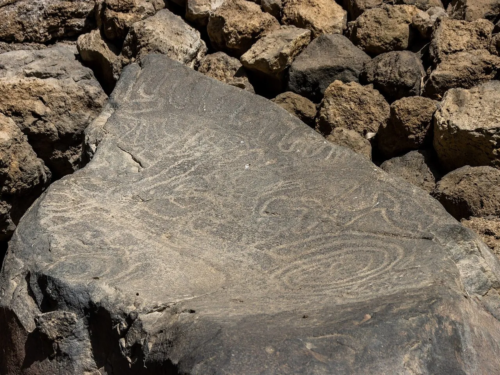
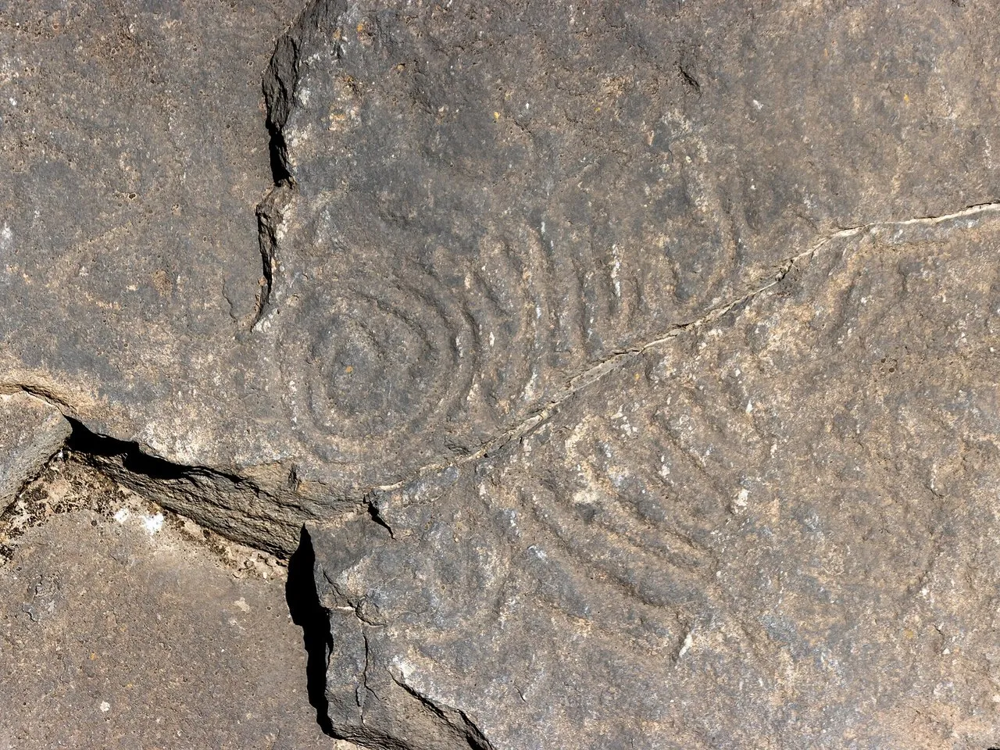
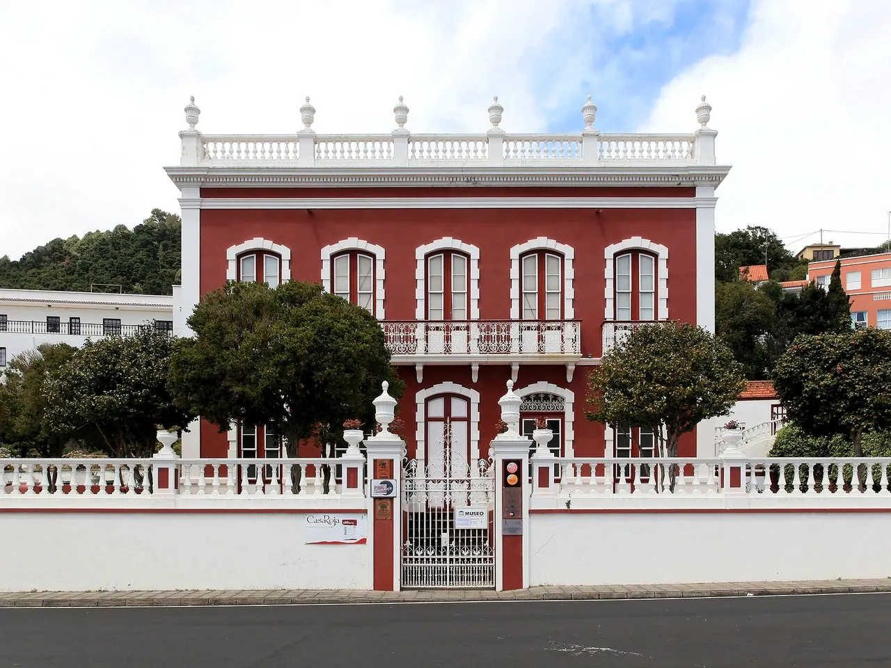
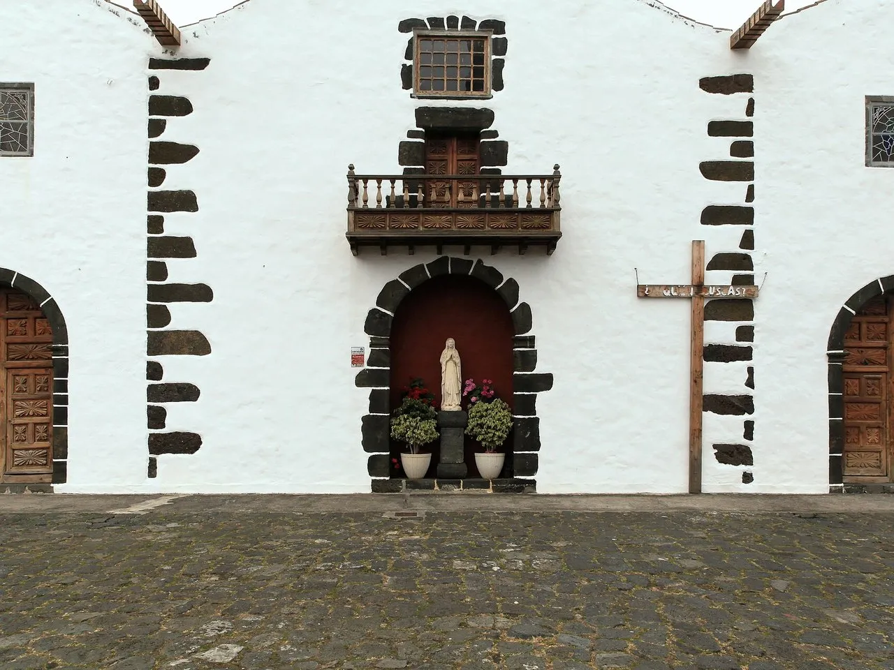
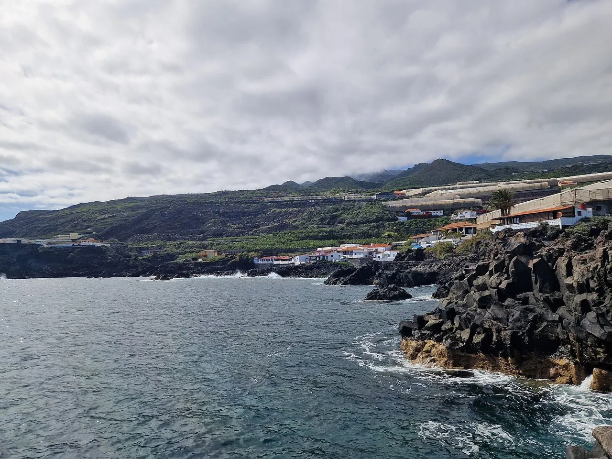

Grabados de los antiguos pobladores en una cueva volcánica, alfombras de flores en las calles y un mercadillo con productos de la tierra cada fin de semana. **Villa de Mazo**, en el este de **La Palma**, guarda tradiciones únicas en Canarias y este año compite por ser el **pueblo de la Navidad de Ferrero Rocher**.

Te cuento qué ver, horarios y cuándo ir 👇

En un vistazo<h2>Lo que vas a encontrar</h2>

<b>🪨</b>Petroglifos

<b>🌸</b>Corpus de flores

<b>🧵</b>Museo del bordado

<b>🧺</b>Mercadillo

<b>🎄</b>Candidato Ferrero 2026

Antes de ir<h2>Lo básico de Villa de Mazo</h2>

<h3>📍 Dónde está</h3>
En la costa <strong>este de La Palma</strong>, entre Santa Cruz de La Palma y Fuencaliente, junto al aeropuerto.

<h3>⏱️ Tiempo</h3>
<strong>Medio día</strong>; mejor en sábado para combinar Belmaco, museo y mercadillo.

<h3>🧺 Mercadillo</h3>
<strong>Sábados y domingos</strong>, de 9:00 a 14:00.

<h3>🎄 Navidad</h3>
Programa municipal del <strong>15 de diciembre al 6 de enero</strong>.

Qué ver<h2>Qué ver en Villa de Mazo</h2>

<ol class="guide__grid guide__grid--cuenca">
<li class="gcard reveal">
01

<h3>Parque Arqueológico de Belmaco</h3>
Una gran cueva volcánica donde vivieron los antiguos habitantes de La Palma. Aquí se hallaron, en el siglo XVIII, <strong>los primeros petroglifos descubiertos en Canarias</strong>.

</li>
<li class="gcard reveal">
02

<h3>Los petroglifos</h3>
Espirales y círculos grabados en la roca por los <strong>benahoaritas</strong>, los primeros pobladores de la isla. Abre de lunes a sábado, de 10:00 a 15:00.

</li>
<li class="gcard reveal">
03

<h3>Museo Casa Roja</h3>
Una casona señorial roja que alberga el <strong>único museo del Corpus Christi de España</strong> y una muestra de bordados. Lunes a sábado, de 10:00 a 14:00.

</li>
<li class="gcard reveal">
04

<h3>La iglesia de San Blas</h3>
El templo del patrón del municipio, de paredes blancas y piedra volcánica. Su fiesta es el <strong>3 de febrero</strong>.

</li>
<li class="gcard reveal">
05

<h3>La costa y el mercadillo</h3>
Coladas de lava junto al mar y, en el pueblo, el <strong>mercadillo</strong> de los sábados y domingos con productos de la tierra.

</li>
</ol>

<!--actividades-->

<h3>🎄 Candidato a pueblo Ferrero Rocher</h3>
Villa de Mazo representa a <strong>Canarias</strong> en el concurso de la Navidad de Ferrero Rocher 2026. Mira cómo va y cómo votar en <a href="/blog/pueblo-navidad-ferrero-rocher-2026.html">el pueblo de la Navidad de Ferrero Rocher</a>.

Horarios<h2>Cuándo abre cada sitio</h2>

<h3>🪨 Belmaco</h3>
Lunes a sábado, <strong>10:00-15:00</strong>.

<h3>🧵 Casa Roja</h3>
Lunes a sábado, <strong>10:00-14:00</strong>.

<h3>🧺 Mercadillo</h3>
Sábado y domingo, <strong>9:00-14:00</strong>.

<h3>🌋 Muy cerca</h3>
El volcán más joven de España: <a href="https://www.civitatis.com/es/santa-cruz-de-la-palma/excursion-volcan-tajogaite/?aid=110968" target="_blank" rel="noopener sponsored">excursión al volcán Tajogaite</a>.

Consejos de Cheno<h2>Para disfrutarlo al máximo</h2><ul><li><b>Ve en sábado</b>: todo abierto y mercadillo.</li><li><b>Los domingos</b> Belmaco y la Casa Roja cierran.</li><li><b>Vuelve en Corpus</b> para ver las alfombras de flores.</li><li><b>Combínalo con</b> <a href="/blog/santa-cruz-de-la-palma-que-ver.html">Santa Cruz de La Palma</a> y <a href="/blog/que-hacer-en-la-palma.html">más planes en La Palma</a>.</li></ul>

<!--faq-->

<h2>¿Te gustan estos planes?</h2>
Sígueme en Instagram como <a href="https://www.instagram.com/chenoaventuras/" target="_blank" rel="noopener">@chenoaventuras</a>: subo escapadas como esta cada semana.
<a class="btn guide__btn" href="/blog.html">Ver más planes en el blog</a>

Información consultada en noviembre de 2026 en la web del Ayuntamiento de Villa de Mazo. Fotos de Wikimedia Commons: <a href="https://commons.wikimedia.org/wiki/File:Ayuntamiento_de_Villa_de_Mazo.jpg" target="_blank" rel="noopener">Rolfcosar</a> (CC BY-SA 4.0) · <a href="https://commons.wikimedia.org/wiki/File:Parque_Arqueol%C3%B3gico_Belmaco_2020_089.jpg" target="_blank" rel="noopener">Mike Peel</a> (CC BY-SA 4.0) · <a href="https://commons.wikimedia.org/wiki/File:Parque_Arqueol%C3%B3gico_Belmaco_2020_094.jpg" target="_blank" rel="noopener">Mike Peel</a> (CC BY-SA 4.0) · <a href="https://commons.wikimedia.org/wiki/File:La_Palma_-_Villa_de_Mazo_-_Calle_Maximiliano_P%C3%A9rez_D%C3%ADaz_-_Museo_Casa_Roja_01_ies.jpg" target="_blank" rel="noopener">Frank Vincentz</a> (CC BY-SA 3.0) · <a href="https://commons.wikimedia.org/wiki/File:La_Palma_-_Villa_de_Mazo_-_Calle_La_Calzada_-_Iglesia_San_Blas_05_ies.jpg" target="_blank" rel="noopener">Frank Vincentz</a> (CC BY-SA 3.0) · <a href="https://commons.wikimedia.org/wiki/File:Villa_de_Mazo,_La_Palma,_view_from_harbour_to_mountains.jpg" target="_blank" rel="noopener">Gerda Arendt</a> (CC0).

