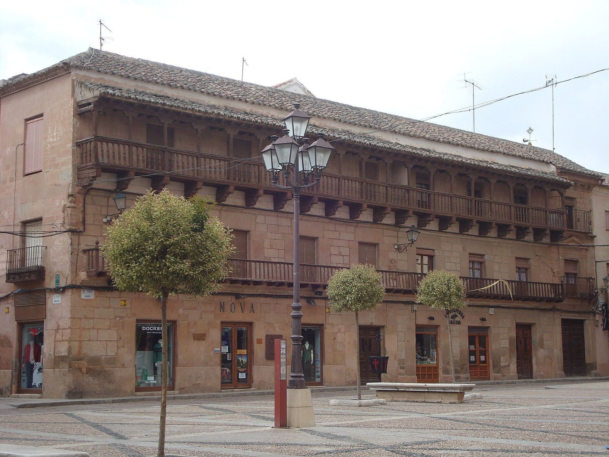
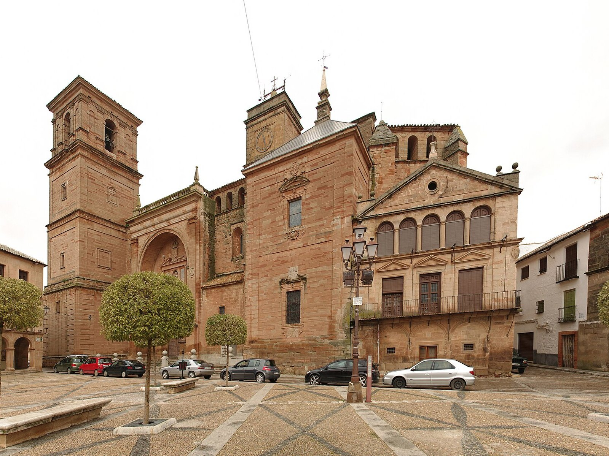
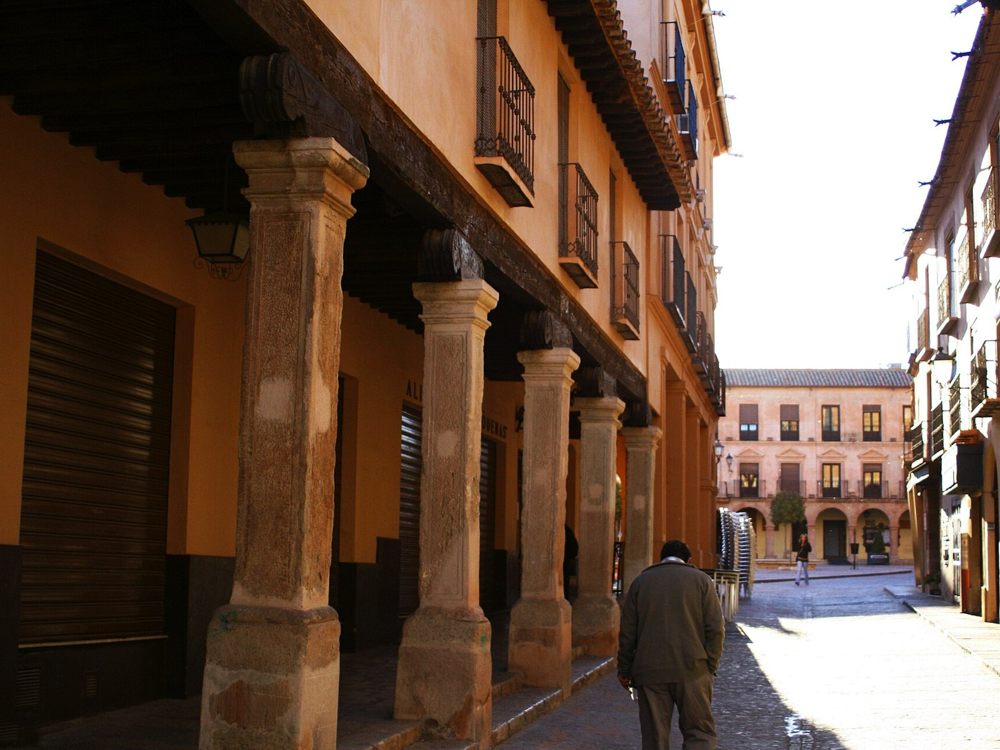
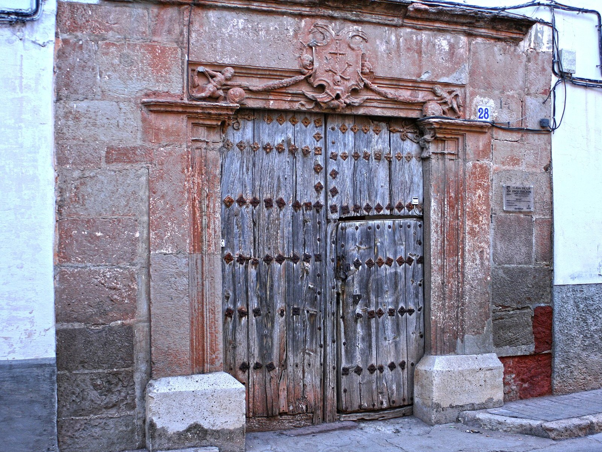
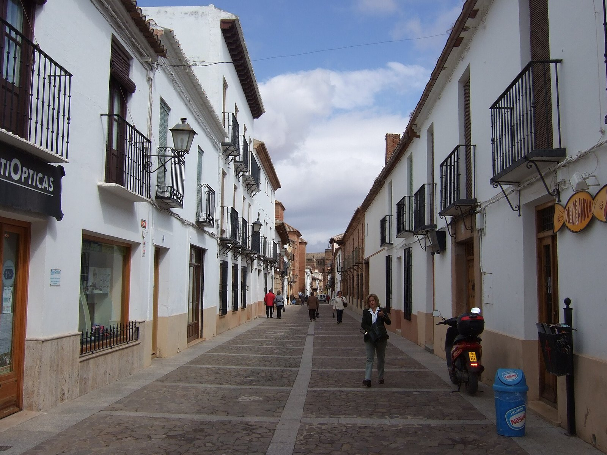

**Villanueva de los Infantes** es uno de esos pueblos que sorprenden. En mitad del **Campo de Montiel**, en Ciudad Real, tiene una **plaza mayor** con balcones de madera, iglesias y palacios de piedra rojiza, y casonas con escudo en cada esquina. Aquí murió **Quevedo**, y hay quien defiende que este es el **«lugar de La Mancha»** con el que empieza el Quijote. Forma parte de **los pueblos más bonitos de España**.

Te cuento qué ver 👇

En un vistazo<h2>Lo que vas a encontrar</h2>

<b>🏛️</b>Plaza mayor

<b>✒️</b>Quevedo

<b>🐴</b>El Quijote

<b>🛡️</b>Casonas con escudo

<b>💧</b>Ruidera cerca

Antes de ir<h2>Lo básico de Villanueva</h2>

<h3>📍 Dónde está</h3>
En el <strong>Campo de Montiel</strong>, al sureste de Ciudad Real, cerca de Jaén y Albacete.

<h3>⏱️ Tiempo</h3>
<strong>Medio día</strong> para el casco histórico. Un día entero si sumas Ruidera.

<h3>🏛️ Conjunto histórico</h3>
Todo el centro está protegido. Empieza por la oficina de turismo, en la plaza mayor.

Qué ver<h2>Qué ver en Villanueva de los Infantes</h2>

<ol class="guide__grid guide__grid--cuenca">
<li class="gcard reveal">
01

<h3>La plaza mayor</h3>
Soportales, columnas de piedra y <strong>balcones corridos de madera</strong>. En ella están el Ayuntamiento, la iglesia de San Andrés y unas esculturas de Don Quijote y Sancho.

</li>
<li class="gcard reveal">
02

<h3>La iglesia de San Andrés</h3>
Preside la plaza con su torre y su portada. Aquí fue enterrado <strong>Quevedo</strong> en 1645, aunque con los siglos sus restos se mezclaron con otros de la cripta.

</li>
<li class="gcard reveal">
03

<h3>Calles con soportales</h3>
Las calles que salen de la plaza también tienen <strong>soportales con columnas de piedra</strong>. Perfectos para pasear a la sombra en verano o al abrigo en invierno.

</li>
<li class="gcard reveal">
04

<h3>Las casonas con escudo</h3>
Hidalgos y caballeros llenaron el pueblo de casas nobles. La más famosa es la <strong>Casa del Caballero del Verde Gabán</strong>, con un patio precioso, que toma el nombre de un personaje del Quijote.

</li>
<li class="gcard reveal">
05

<h3>La calle Cervantes</h3>
Una de las calles más bonitas, con casas encaladas, rejas y portadas de piedra. Recórrela sin prisa hasta la plaza.

</li>
</ol>

Curiosidad<h2>¿El «lugar de La Mancha»?</h2>

«En un lugar de La Mancha, de cuyo nombre no quiero acordarme…». Un equipo de la <strong>Universidad Complutense de Madrid</strong> estudió en 2005 las distancias y los tiempos de viaje que aparecen en el Quijote y concluyó que ese lugar sería <strong>Villanueva de los Infantes</strong>. Es una teoría, no una certeza: otros pueblos manchegos también lo reclaman. Pero el pueblo la ha hecho suya, y lo verás en sus calles.

<h3>✒️ La celda de Quevedo</h3>
En el antiguo <strong>convento de Santo Domingo</strong> se conserva la celda donde murió Francisco de Quevedo, el <strong>8 de septiembre de 1645</strong>. Era señor de la cercana Torre de Juan Abad y pasó aquí sus últimos días. Una visita corta y muy curiosa.

<h3>💧 Lagunas de Ruidera</h3>
A unos 40 minutos tienes las <strong>Lagunas de Ruidera</strong>, una cadena de lagunas de aguas turquesa que también aparecen en el Quijote, en el episodio de la cueva de Montesinos.

Cómo llegar<h2>Cómo llegar a Villanueva de los Infantes</h2>

En coche: a <strong>1 hora y cuarto de Ciudad Real</strong> y unas <strong>2 horas y tres cuartos de Madrid</strong> por la A-4 hasta Valdepeñas. Aparca fuera del centro y entra a pie a la plaza.

<a class="btn guide__mapbtn" href="https://www.google.com/maps/dir/?api=1&destination=38.7364,-3.0136" target="_blank" rel="noopener"><svg class="ico" viewBox="0 0 24 24" width="15" height="15" aria-hidden="true" fill="currentColor"><path d="M12 2a7 7 0 0 0-7 7c0 5.25 7 13 7 13s7-7.75 7-13a7 7 0 0 0-7-7zm0 9.5a2.5 2.5 0 1 1 0-5 2.5 2.5 0 0 1 0 5z"/></svg> Cómo llegar en Google Maps</a>

En la provincia tienes también <a href="/blog/almagro-que-ver.html">Almagro</a>, los <a href="/blog/molinos-campo-de-criptana.html">molinos de Campo de Criptana</a> y las <a href="/blog/lagunas-de-ruidera.html">Lagunas de Ruidera</a>.

Consejos de Cheno<h2>Para disfrutarlo al máximo</h2><ul><li><b>Pide el plano</b> en la oficina de turismo y sigue la ruta monumental.</li><li><b>Asómate a los patios</b> cuando las puertas estén abiertas.</li><li><b>Prueba el pisto y las gachas</b> manchegas.</li><li><b>Llévate el Quijote</b> en el móvil y lee el primer capítulo en la plaza.</li></ul>

<!--actividades-->

<!--faq-->

<h2>¿Te gustan estos planes?</h2>
Sígueme en Instagram como <a href="https://www.instagram.com/chenoaventuras/" target="_blank" rel="noopener">@chenoaventuras</a>: subo escapadas como esta cada semana.
<a class="btn guide__btn" href="/blog.html">Ver más planes en el blog</a>

Información consultada en noviembre de 2026 (Los Pueblos Más Bonitos de España y Turismo de Castilla-La Mancha). Fotos de Wikimedia Commons: <a href="https://commons.wikimedia.org/wiki/File:Plaza_Mayor,_Villanueva_de_los_Infantes,_Ciudad_Real.jpg" target="_blank" rel="noopener">Sebastian T. Schork</a> (CC BY-SA 4.0) · <a href="https://commons.wikimedia.org/wiki/File:Parroquia_de_San_Andr%C3%A9s.jpg" target="_blank" rel="noopener">Rafael Merino</a> (CC BY-SA 3.0) · <a href="https://commons.wikimedia.org/wiki/File:Villanueva_de_los_Infantes_-_007_(30593038222).jpg" target="_blank" rel="noopener">Luis Rogelio HM</a> (CC BY-SA 2.0) · <a href="https://commons.wikimedia.org/wiki/File:Villanueva_de_los_Infantes_01.jpg" target="_blank" rel="noopener">Angel Aroca Escámez</a> (CC BY-SA 3.0) · <a href="https://commons.wikimedia.org/wiki/File:Villanueva_de_los_Infantes_03.jpg" target="_blank" rel="noopener">Angel Aroca Escámez</a> (CC BY-SA 3.0) · <a href="https://commons.wikimedia.org/wiki/File:Villanueva_de_los_Infantes_calle_Cervantes.jpg" target="_blank" rel="noopener">Roberto Abizanda</a> (CC BY-SA 3.0).

