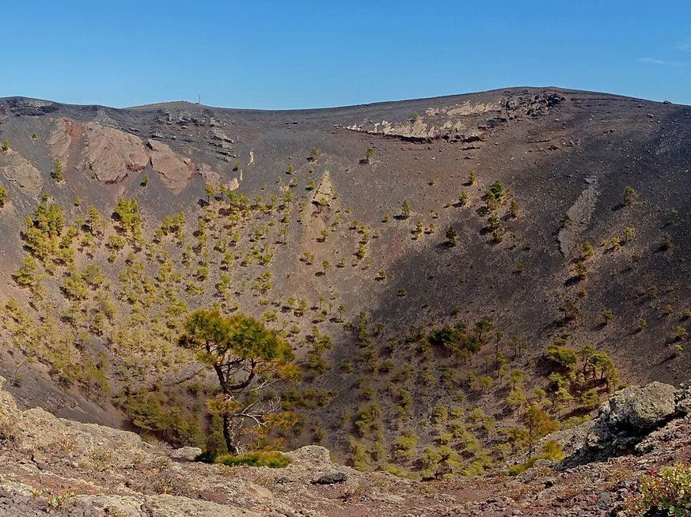
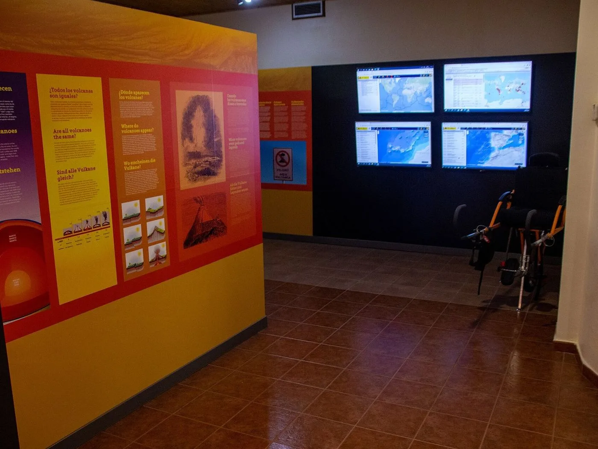
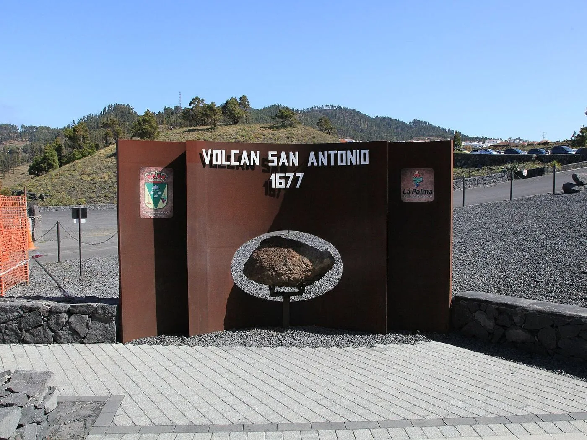
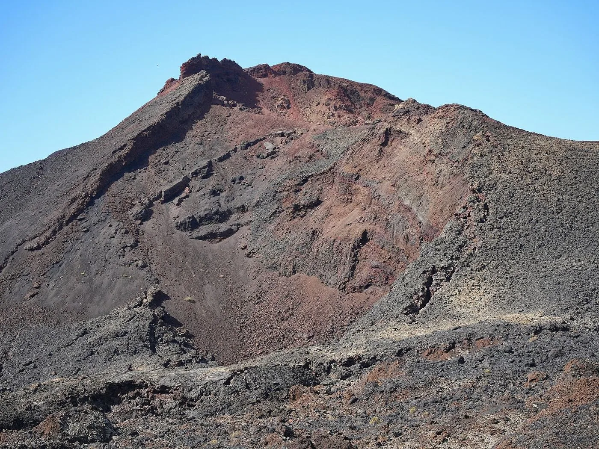
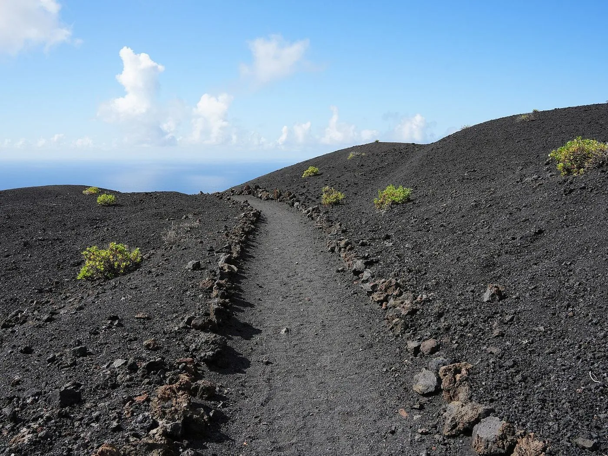

Dos volcanes con tres siglos de diferencia, a pocos kilómetros uno de otro. En el sur de **La Palma**, el **volcán San Antonio** (1677) se recorre por el borde de su cráter y el **Teneguía** (1971), la erupción más reciente antes del Tajogaite, se visita por un sendero entre lava negra.

Te cuento qué ver, cuánto se tarda y cómo combinarlo con las salinas y los faros de Fuencaliente 👇

En un vistazo<h2>Lo que vas a encontrar</h2>

<b>🌋</b>Dos volcanes históricos

<b>🕳️</b>Cráter del San Antonio

<b>🥾</b>Sendero al Teneguía

<b>🏛️</b>Centro de visitantes

<b>🍇</b>Malvasía volcánica

Antes de ir<h2>Lo básico de los volcanes de Fuencaliente</h2>

<h3>📍 Dónde está</h3>
En <strong>Fuencaliente</strong>, al sur de La Palma, junto a la carretera que baja al faro.

<h3>⏱️ Tiempo</h3>
<strong>1 hora</strong> para centro y cráter; media mañana si sigues al Teneguía.

<h3>🧢 Lleva</h3>
<strong>Gorra, agua y calzado cerrado</strong>: ceniza suelta, sol y viento.

La historia<h2>Tres siglos entre uno y otro</h2>

El sur de La Palma es zona de volcanes jóvenes. El <strong>volcán San Antonio</strong> entró en erupción en <strong>1677</strong> y cambió el paisaje de Fuencaliente, cubriendo con lava y ceniza tierras de cultivo. Casi trescientos años después, entre el <strong>26 de octubre y el 18 de noviembre de 1971</strong>, se abrió el <strong>Teneguía</strong>, a pocos kilómetros, y fue la última erupción de la isla hasta la del <a href="/blog/volcan-tajogaite-la-palma.html">Tajogaite</a>, en 2021. Hoy el cráter del San Antonio y la lava del Teneguía se recorren a pie, con la ceniza negra y rojiza como protagonista.

Qué ver<h2>Qué ver en los volcanes</h2>

<ol class="guide__grid guide__grid--cuenca">
<li class="gcard reveal">
01

<h3>El cráter del San Antonio</h3>
Un sendero rodea el borde del cráter, con laderas de ceniza negra y rojiza. Las vistas llegan hasta el mar y las plataneras de la costa.

</li>
<li class="gcard reveal">
02

<h3>El centro de visitantes</h3>
Una exposición explica cómo se forman los volcanes y qué pasó en 1677 y en 1971, con paneles y pantallas sobre la actividad sísmica.

</li>
<li class="gcard reveal">
03

<h3>La entrada del volcán</h3>
Junto al aparcamiento, el cartel del San Antonio y el inicio de la visita. Es el punto de partida de todos los senderos de la zona.

</li>
<li class="gcard reveal">
04

<h3>El Teneguía</h3>
Un cono rojizo y negro, de aspecto casi marciano, rodeado de coladas. Se ve de cerca desde el sendero.

</li>
<li class="gcard reveal">
05

<h3>El sendero</h3>
Un camino señalizado de ceniza, parte del GR 131, baja entre lava hasta el Teneguía y sigue hasta el faro de Fuencaliente.

</li>
</ol>

Sabor volcánico<h2>Vinos que crecen en la ceniza</h2>

En Fuencaliente los viñedos crecen sobre ceniza volcánica, protegidos por pequeños muros de piedra. De aquí salen vinos de malvasía muy particulares. Si te interesa, hay <a href="https://www.civitatis.com/es/fuencaliente-de-la-palma/visita-bodegas-teneguia/?aid=110968" target="_blank" rel="noopener sponsored">visitas a las bodegas Teneguía</a> con cata.

Cómo llegar<h2>Cómo llegar a los volcanes</h2>

<strong>En coche:</strong> desde Santa Cruz de La Palma, por la <strong>LP-2</strong> hacia el sur hasta Fuencaliente; el centro de visitantes está junto al cráter del San Antonio, a pie de carretera. Calcula alrededor de una hora desde la capital.

<strong>Consejo:</strong> sigue al sur y combina la visita con las <a href="/blog/salinas-y-faros-de-fuencaliente.html">salinas y los faros</a>.

<strong>Con guía:</strong> si prefieres no conducir, hay <a href="https://www.civitatis.com/es/fuencaliente-de-la-palma/ruta-volcanes-la-palma/?aid=110968" target="_blank" rel="noopener sponsored">excursiones organizadas por la Ruta de los Volcanes</a>.

<a class="btn guide__mapbtn" href="https://www.google.com/maps/search/?api=1&query=Centro%20de%20Visitantes%20Volc%C3%A1n%20San%20Antonio%2C%20Fuencaliente%2C%20La%20Palma" target="_blank" rel="noopener"><svg class="ico" viewBox="0 0 24 24" width="15" height="15" aria-hidden="true" fill="currentColor"><path d="M12 2a7 7 0 0 0-7 7c0 5.25 7 13 7 13s7-7.75 7-13a7 7 0 0 0-7-7zm0 9.5a2.5 2.5 0 1 1 0-5 2.5 2.5 0 0 1 0 5z"/></svg> Cómo llegar en Google Maps</a>

Sigue por el sur con las <a href="/blog/salinas-y-faros-de-fuencaliente.html">salinas y los faros de Fuencaliente</a> y la <a href="/blog/ruta-de-los-volcanes-la-palma.html">Ruta de los Volcanes</a>. Más ideas en <a href="/blog/que-hacer-en-la-palma.html">qué hacer en La Palma</a>.

Consejos de Cheno<h2>Para disfrutarlo al máximo</h2><ul><li><b>Sube por la mañana:</b> hay menos viento y mejor luz.</li><li><b>Gorra y agua:</b> en la ceniza no hay sombra.</li><li><b>Respeta los caminos:</b> la ceniza y la lava se desmoronan.</li><li><b>Combínalo</b> con las salinas y los faros del sur.</li><li><b>Calzado cerrado:</b> los zapatos abiertos se llenan de ceniza.</li></ul>

<h2>¿Te gustan estos planes?</h2>
Sígueme en Instagram como <a href="https://www.instagram.com/chenoaventuras/" target="_blank" rel="noopener">@chenoaventuras</a>: subo escapadas como esta cada semana.
<a class="btn guide__btn" href="/blog.html">Ver más planes en el blog</a>

Información consultada en noviembre de 2026. Los accesos, horarios y precios cambian: consúltalos en las webs oficiales del Cabildo de La Palma antes de ir. Fotos de Wikimedia Commons: <a href="https://commons.wikimedia.org/wiki/File:I08_825_Volc%C3%A1n_San_Antonio.jpg" target="_blank" rel="noopener">Falk2</a> (CC BY-SA 4.0) · <a href="https://commons.wikimedia.org/wiki/File:San_Antonio_volcano_-_Panorama_02.jpg" target="_blank" rel="noopener">H. Zell</a> (CC BY-SA 3.0) · <a href="https://commons.wikimedia.org/wiki/File:San_Antonio_volcano_2020_004.jpg" target="_blank" rel="noopener">Photograph by Mike Peel</a> (CC BY-SA 4.0) · <a href="https://commons.wikimedia.org/wiki/File:La_Palma_-_Fuencaliente_-_San_Antonio_14_ies.jpg" target="_blank" rel="noopener">Frank Vincentz</a> (CC BY-SA 3.0) · <a href="https://commons.wikimedia.org/wiki/File:La_Palma_-_Volcan_de_Teneguia_-_5.jpg" target="_blank" rel="noopener">Ingo Mehling</a> (CC BY-SA 4.0) · <a href="https://commons.wikimedia.org/wiki/File:La_Palma_-_Teneguia_Hiking_Path.jpg" target="_blank" rel="noopener">Ingo Mehling</a> (CC BY-SA 4.0).

