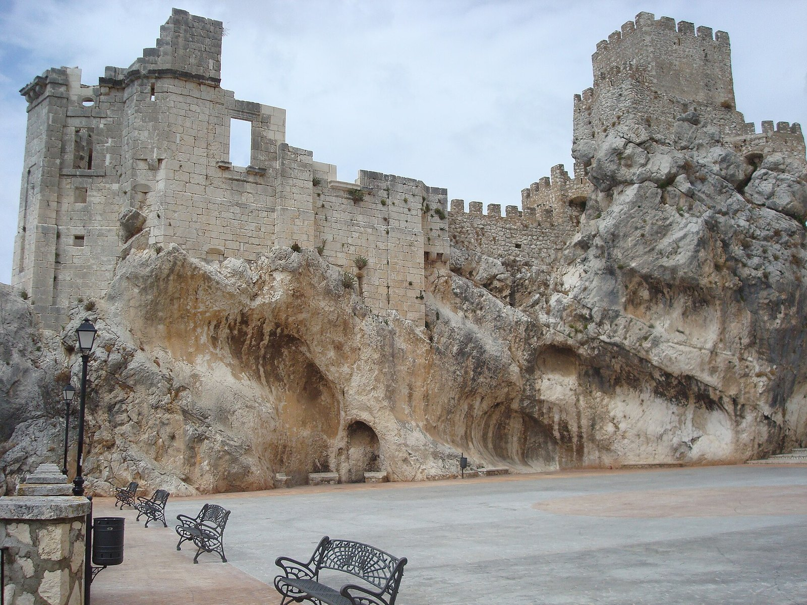
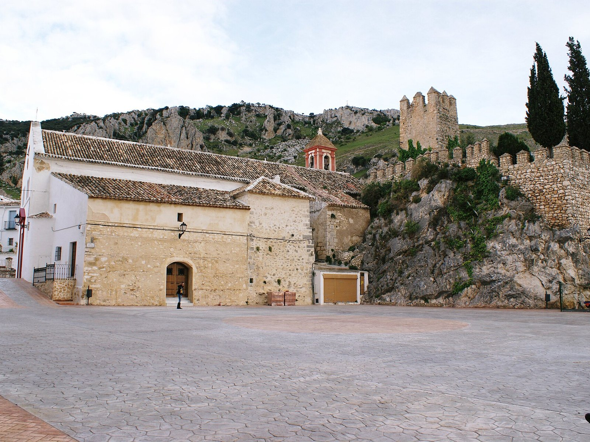
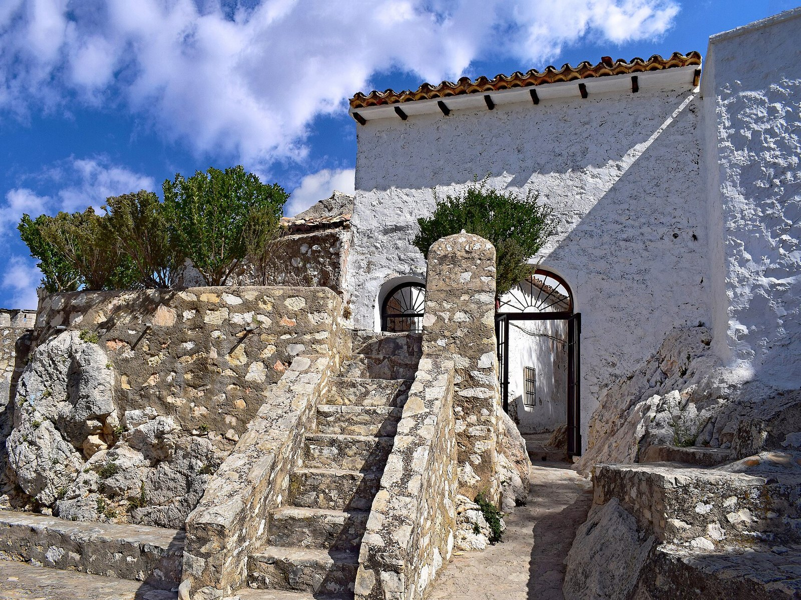
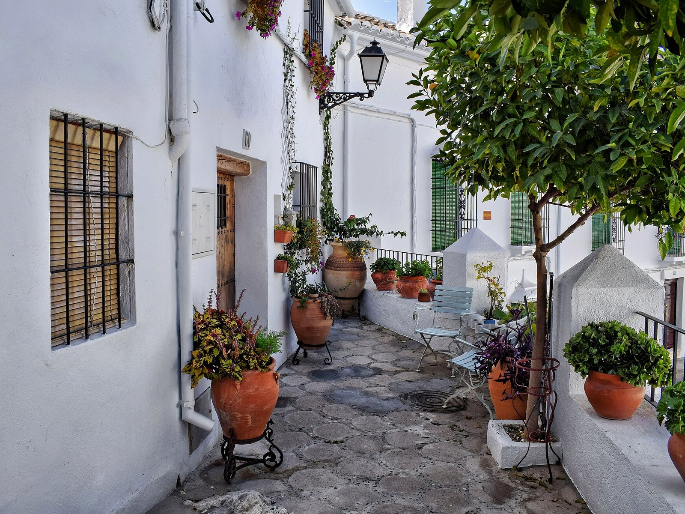
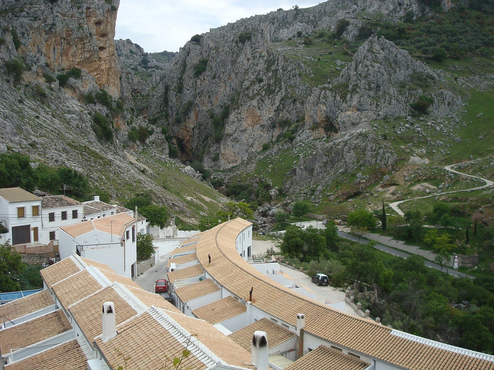
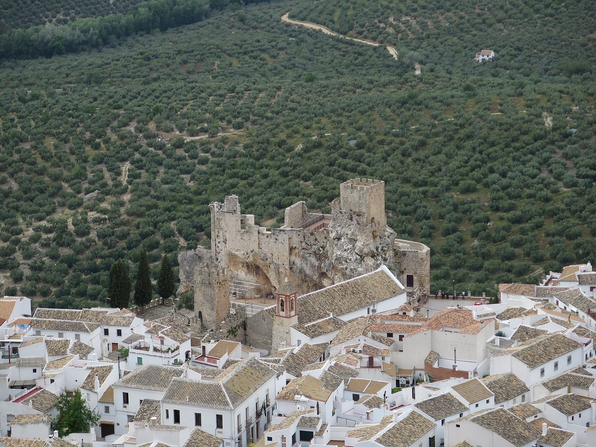

Visto desde la carretera, **Zuheros** parece una cascada de casas blancas que cae desde una gran roca coronada por un **castillo**. Está en pleno **Parque Natural de las Sierras Subbéticas**, rodeado de un mar de olivos, y es uno de los pueblos más bonitos de Andalucía. Además tiene una cueva con **pinturas prehistóricas** y fama de hacer algunos de los mejores **quesos de cabra** de España.

Te cuento qué ver y cómo organizar la visita 👇

En un vistazo<h2>Lo que vas a encontrar</h2>

<b>🏰</b>Castillo en la roca

<b>🏘️</b>Pueblo blanco

<b>🦇</b>Cueva prehistórica

<b>🥾</b>Cañón del Bailón

<b>🧀</b>Queso de cabra

Antes de ir<h2>Lo básico de Zuheros</h2>

<h3>📍 Dónde está</h3>
En el sur de <strong>Córdoba</strong>, en las Sierras Subbéticas, a algo más de una hora de la capital.

<h3>⏱️ Tiempo</h3>
Medio día para el pueblo. Un día entero si visitas la cueva y haces la ruta del Bailón.

<h3>🌸 Cuándo ir</h3>
A finales de invierno, con los <strong>almendros en flor</strong>, o en primavera y otoño para caminar.

Qué ver<h2>Qué ver en Zuheros</h2>

<ol class="guide__grid guide__grid--cuenca">
<li class="gcard reveal">
01

<h3>El castillo</h3>
De origen musulmán y reformado tras la conquista cristiana, parece nacer de la propia roca. Se visita con el museo del pueblo.

</li>
<li class="gcard reveal">
02

<h3>La Plaza de la Paz</h3>
El corazón del pueblo, con la iglesia de <strong>Nuestra Señora de los Remedios</strong>, levantada donde estuvo la mezquita, y el castillo al lado.

</li>
<li class="gcard reveal">
03

<h3>El Mirador de la Villa</h3>
Un balcón junto al castillo con vistas al cañón y a la campiña de olivos. Es el mejor sitio para la foto del pueblo.

</li>
<li class="gcard reveal">
04

<h3>Las calles</h3>
Callejuelas encaladas, rejas y macetas que trepan por la ladera. Piérdete sin rumbo: el pueblo es pequeño.

</li>
<li class="gcard reveal">
05

<h3>El cañón del Bailón</h3>
El río Bailón ha excavado un cañón a los pies del pueblo. Una <strong>ruta de senderismo</strong> lo recorre entre paredes de roca y buitres.

</li>
<li class="gcard reveal">
06

<h3>El mar de olivos</h3>
Desde lo alto verás olivares hasta el horizonte. Muy cerca pasa la <strong>Vía Verde del Aceite</strong>, ideal para hacer en bici.

</li>
</ol>

A 4 km<h2>La Cueva de los Murciélagos</h2>

Subiendo por una carretera de curvas con vistas espectaculares llegas a la <strong>Cueva de los Murciélagos</strong>. Fue habitada desde el Paleolítico: tiene <strong>pinturas y grabados prehistóricos</strong> de animales y figuras humanas, y en ella se encontraron cerámicas del Neolítico que puedes ver en el museo arqueológico del pueblo. El recorrido turístico es de unos 450 metros, con escaleras, y pasa junto a una enorme estalagmita a la que llaman <strong>«el Espárrago»</strong>.

<h3>📝 Reserva antes</h3>
La visita es <strong>guiada y con reserva</strong>, en grupos reducidos. Los horarios cambian según la temporada: confírmalos con el Ayuntamiento de Zuheros antes de ir.

<h3>🧀 El queso de Zuheros</h3>
En el pueblo hay queserías artesanas de <strong>queso de cabra</strong> con premios internacionales, y cada septiembre se celebra la <strong>Fiesta del Queso</strong>. Llévate uno de recuerdo.

Cómo llegar<h2>Cómo llegar a Zuheros</h2>

En coche: a algo más de <strong>una hora de Córdoba</strong> y a una hora y cuarto de Jaén. Deja el coche en los aparcamientos de la entrada: las calles del centro son estrechas y empinadas.

<a class="btn guide__mapbtn" href="https://www.google.com/maps/dir/?api=1&destination=37.5432,-4.3157" target="_blank" rel="noopener"><svg class="ico" viewBox="0 0 24 24" width="15" height="15" aria-hidden="true" fill="currentColor"><path d="M12 2a7 7 0 0 0-7 7c0 5.25 7 13 7 13s7-7.75 7-13a7 7 0 0 0-7-7zm0 9.5a2.5 2.5 0 1 1 0-5 2.5 2.5 0 0 1 0 5z"/></svg> Cómo llegar en Google Maps</a>

En la misma comarca tienes <a href="/blog/priego-de-cordoba.html">Priego de Córdoba</a>, la joya del barroco, y de vuelta a la capital, la <a href="/blog/mezquita-de-cordoba.html">Mezquita</a> y los <a href="/blog/cordoba-patios-juderia.html">patios de la judería</a>.

Consejos de Cheno<h2>Para disfrutarlo al máximo</h2><ul><li><b>Reserva la cueva</b> con días de antelación.</li><li><b>Sube al mirador al atardecer</b>: la roca y el castillo se ponen dorados.</li><li><b>Calzado cómodo</b>: hay cuestas y escaleras por todas partes.</li><li><b>Prueba el queso</b> en una de las queserías del pueblo.</li></ul>

<!--faq-->

<h2>¿Te gustan estos planes?</h2>
Sígueme en Instagram como <a href="https://www.instagram.com/chenoaventuras/" target="_blank" rel="noopener">@chenoaventuras</a>: subo escapadas como esta cada semana.
<a class="btn guide__btn" href="/blog.html">Ver más planes en el blog</a>

Información consultada en noviembre de 2026 (Turismo de Andalucía y Los Pueblos Más Bonitos de España). Los horarios y precios de la cueva y del castillo cambian: confírmalos antes de ir. Fotos de Wikimedia Commons: <a href="https://commons.wikimedia.org/wiki/File:Zuheros._Vista_general._06.jpg" target="_blank" rel="noopener">Francisco de Asís Alfaro Fernández</a> (CC BY-SA 4.0) · <a href="https://commons.wikimedia.org/wiki/File:Zuheros_-_012_(30593197012).jpg" target="_blank" rel="noopener">Luis Rogelio HM</a> (CC BY-SA 2.0) · <a href="https://commons.wikimedia.org/wiki/File:Zuheros_church.jpg" target="_blank" rel="noopener">Hugh Llewelyn</a> (CC BY-SA 2.0) · <a href="https://commons.wikimedia.org/wiki/File:Corner_in_Zuheros_(49916807307).jpg" target="_blank" rel="noopener">Jocelyn Erskine-Kellie</a> (CC BY-SA 2.0) · <a href="https://commons.wikimedia.org/wiki/File:Mirador_de_la_Villa,_Zuheros_(26958232368).jpg" target="_blank" rel="noopener">Jocelyn Erskine-Kellie</a> (CC BY-SA 2.0) · <a href="https://commons.wikimedia.org/wiki/File:Zuheros_-_005_(30593198872).jpg" target="_blank" rel="noopener">Luis Rogelio HM</a> (CC BY-SA 2.0) · <a href="https://commons.wikimedia.org/wiki/File:Zuheros_03.JPG" target="_blank" rel="noopener">Veinticuatro de Jahén</a> (CC BY-SA 4.0).

